# 2019 SEAT Leon Cupra DNUC dashboard for Pico 2 W

Rust firmware for a Raspberry Pi Pico 2 W, Pimoroni PIM715 display and
Adafruit 5880 I2C encoder, intended for a 2019 Seat Leon Cupra DNUC.
**Exact ECU support, electrical installation and physical display FPS are
unverified.** The default build shows unavailable vehicle channels. Demo data
requires `demo`; the optional Longan transport currently performs unqualified
adapter bring-up and sends no diagnostic CAN requests.

Browse the offline **ECU Reference** workspace while configuring views: searchable source/scaling evidence, family limitations and unresolved definitions, with the shared preview retained. [Studio usage](docs/configurator/ecu-reference.md) · [Technical ECU library](docs/vehicle/ecu-reference/README.md).

[Studio workflows](docs/configurator/gallery.md) · [Widgets](#widget-gallery) ·
[Orientation](#landscape-and-portrait) · [Startup & controls](#controls-and-startup) · [Build & Flash](#build--flash-from-studio) ·
[Hardware & wiring](#hardware-protection-and-wiring-for-the-dnuc-cupra) ·
[Architecture](#architecture) · [Validation](#firmware-build-and-validation)

[](docs/configurator/gallery.md#edit-and-repair)

*Studio edits a shared-renderer dashboard. Preview readings are synthetic; they do not establish vehicle support.*

## Configure dashboard views

Launch the Rust/Wasm editor from the repository root:

```powershell
./configurator/Studio.ps1 -Setup
./configurator/Studio.ps1 -Check
./configurator/Studio.ps1 -Serve
```

Open `http://127.0.0.1:8080`. Drag widgets onto a landscape 4×2 or portrait 2×4 grid, configure up to eight
named views, and export a complete `.eavp` project. Dashboard-only JSON and compact
`.eav` exports remain available. The preview
uses the firmware renderer. See the [View Studio guide](docs/configurator/studio.md)
for warnings, fuel/AFR, ECU source evidence, local saving and import/export.
Choose numeric/history, circular, needle, horizontal, vertical or segmented
gauges. [Gauge and colour controls](docs/configurator/gauges-and-colours.md) include
fixed or expanding scales, per-widget palettes and separate combined warnings.

Browser editing of an already served build needs no local Rust toolchain. Native
builds require Windows x64, the documented tools, and **4 GiB scratch space plus
256 MiB free headroom**, in addition to installations and caches. A practical
build and verified download succeeded on Windows 11 Pro with an i9-13900HX and
31.8 GiB RAM; a minimum RAM specification has not been established. The earlier
16.5 GB observation belongs to the separate experimental instruction proof.
[PC requirements and measurement limits](docs/configurator/setup-tools.md#pc-requirements-and-measurement-limits).

For a complete project, use **Build & Flash** or **Download build recipe** so
startup settings and converted artwork are included. For a dashboard-only `.eav`
export, build with the user's observed working profile:

```powershell
./firmware/scripts/Build-Dashboard.ps1 -Name my-views -Profile 280-70 -Mode Demo -Config ./dashboard.eav -Expert
```

This builds and validates an artifact without flashing. See the
[configuration build guide](docs/configurator/building.md) for runtime parsing,
fallback and hardware validation. Vehicle source qualification remains required.
The [original configurator validation record](docs/configurator/validation.md)
preserves its dated implementation checks and measurements; later feature
guides describe the current workflows and remaining device checks.


### Edit, inspect and save

1. Add widgets from the library, then place and resize them on the grid. Name,
   reorder and choose the boot view. The widget menu provides explicit move/delete
   actions when overlapping widgets are hard to select.
2. Adjust units, palette, scale, history and warnings. Search settings or use the
   command palette to reach a control. Appearance presets reuse styling; inspect
   their scope before applying them to a view.
3. An **INVALID PREVIEW** keeps rejected edits visible for repair. It does not
   replace the accepted project. Fix the fields or discard invalid edits; pending
   JSON and startup timing need Apply or Discard before save/export/build.
4. Use Undo/Redo for accepted changes. Export a complete project for a portable
   backup; browser storage belongs to this browser and origin and can fail or fill.

| Export | Keeps | Use |
|---|---|---|
| Complete `.eavp` | Views, startup, converted animation and original artwork when available | Portable editing backup |
| Converted-only `.eavp` | Views, startup and converted animation | Smaller copy; source edits require the original again |
| Dashboard-only `.eav` / JSON | Dashboard configuration | Runtime configuration or text editing; no startup/artwork |

Dashboard-only import preserves startup in an existing project. Full project
import replaces the complete accepted project atomically. Original artwork is
retained separately from ordinary history entries and never enters firmware.
See [projects and storage](docs/configurator/projects.md),
[editor state](docs/configurator/editor-state.md) and the
[editing screenshots](docs/configurator/gallery.md#edit-and-repair).

### Landscape and portrait

**Device → Default screen orientation** chooses 320×240 landscape or 240×320
portrait, with an optional 180° mounting flip. Boot info, Splash and each named
view can override it; Debug and Logs follow the device default. Each screen is
rendered at its native dimensions, including warnings and feedback popups.

- Inspect the proposed layout, then **Apply orientation**. Eight cells remain
  available; widget settings and sizes are preserved. One **Undo** restores the
  complete change. A 2×1 widget stays horizontal in both shapes.
- Custom artwork targets the effective Splash shape. Changing shape retains the
  artwork and original, visibly blocks export/build when they mismatch, and offers
  **Reconvert original with recorded fit and timing**. A mounting flip needs no
  reconversion. Converted-only projects need the original reimported to reconvert.
- Physical A/B/X/Y identities and encoder direction stay the same. Brightness
  remains Full / Dim / Off; protected Y hold still returns to Dashboard at Full.
- Both orientations reuse the same two RGB565 framebuffers. An orientation change
  sends a full frame; subsequent matching frames can use partial updates.

[Orientation workflow and format migration](docs/configurator/orientation.md) ·
[Physical mounting and display checks](docs/hardware/display-orientation.md).
Browser previews and host tests do not establish panel scanout, tearing or physical FPS.

[](docs/configurator/orientation.md)

*The portrait editor keeps eight cells, native pixel rendering and the same widget
settings. Orientation changes preview their placement before one undoable Apply.*

[](docs/configurator/orientation.md#custom-splash-artwork)

*Boot info and Splash can use different shapes. The preview uses the shared Rust
scenes, with synthetic status; physical controls keep their assignments.*

[](docs/configurator/orientation.md#rendering-and-hardware-boundaries)

*Debug and Logs inherit the device orientation. The simulator exercises screen
changes, recovery and completion-bound LED/backlight state without a Pico.*

## Widget gallery

These are native shared-renderer crops with synthetic inputs, not live readings
or recommended DNUC thresholds. Click a crop for its full 320×240 frame. Each
channel below uses a 2×1 numeric/history widget; the renderer and reproducible
fixture are described in the [gallery](docs/configurator/gallery.md#shared-renderer-widgets).

| Measurement | Measurement |
|---|---|
| **Relative boost**<br>[](docs/images/gallery/widgets/full/widget-boost.png)<br>1.20 bar with PSI companion | **Engine oil**<br>[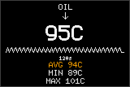](docs/images/gallery/widgets/full/widget-oil.png)<br>95 °C |
| **Coolant**<br>[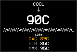](docs/images/gallery/widgets/full/widget-coolant.png)<br>90 °C | **DSG oil**<br>[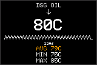](docs/images/gallery/widgets/full/widget-dsg.png)<br>80 °C; vehicle source unqualified |
| **Intake air**<br>[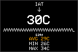](docs/images/gallery/widgets/full/widget-iat.png)<br>30 °C | **Exhaust gas**<br>[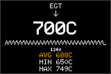](docs/images/gallery/widgets/full/widget-egt.png)<br>700 °C; vehicle source unqualified |
| **ECU voltage**<br>[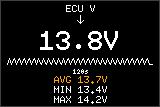](docs/images/gallery/widgets/full/widget-ecu-voltage.png)<br>13.8 V; not a battery-post measurement | **Lambda & AFR**<br>[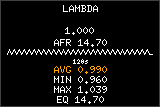](docs/images/gallery/widgets/full/widget-lambda-afr.png)<br>Lambda 1.00; gasoline-equivalent AFR 14.7 |

### Six styles, three sizes

The landscape 4×2 grid supports 1×1 (80×107), 2×1 (160×107) and 2×2 (160×214)
widgets below the 26-pixel header. Portrait uses two 120-pixel columns and four
rows alternating 73/74 pixels, with the same three spans. The landscape examples use the same synthetic boost
sample. Numeric companions work at every size; gauge companions need 2×1 or 2×2.

| Style | 1×1 | 2×1 | 2×2 |
|---|---|---|---|
| Numeric & history | [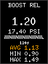](docs/images/gallery/widgets/full/gauge-numeric-1x1.png) | [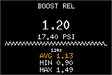](docs/images/gallery/widgets/full/gauge-numeric-2x1.png) | [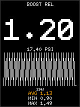](docs/images/gallery/widgets/full/gauge-numeric-2x2.png) |
| Circular arc | [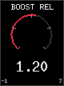](docs/images/gallery/widgets/full/gauge-circular-1x1.png) | [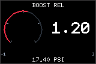](docs/images/gallery/widgets/full/gauge-circular-2x1.png) | [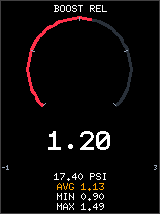](docs/images/gallery/widgets/full/gauge-circular-2x2.png) |
| Needle dial | [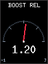](docs/images/gallery/widgets/full/gauge-needle-1x1.png) | [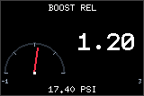](docs/images/gallery/widgets/full/gauge-needle-2x1.png) | [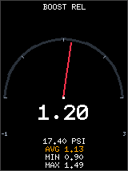](docs/images/gallery/widgets/full/gauge-needle-2x2.png) |
| Horizontal bar | [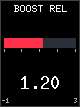](docs/images/gallery/widgets/full/gauge-horizontal-1x1.png) | [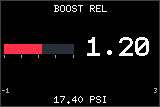](docs/images/gallery/widgets/full/gauge-horizontal-2x1.png) | [](docs/images/gallery/widgets/full/gauge-horizontal-2x2.png) |
| Vertical bar | [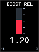](docs/images/gallery/widgets/full/gauge-vertical-1x1.png) | [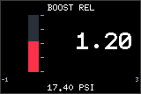](docs/images/gallery/widgets/full/gauge-vertical-2x1.png) | [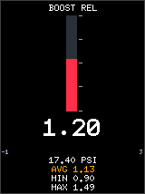](docs/images/gallery/widgets/full/gauge-vertical-2x2.png) |
| Segmented bar | [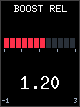](docs/images/gallery/widgets/full/gauge-segmented-1x1.png) | [](docs/images/gallery/widgets/full/gauge-segmented-2x1.png) | [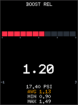](docs/images/gallery/widgets/full/gauge-segmented-2x2.png) |

- **Raw versus displayed:** smoothing changes the current number and gauge;
  warnings, extrema, peaks and recorded history use accepted raw measurements.
- **Shared history:** widgets of one channel share its duration and 60 buckets.
  Changing duration clears that history; missing or stale intervals remain gaps.
- **Ranges:** expanding scales keep observed extremes until statistics reset.
  Fixed scales clip the indicator, while the numeric value still reports the sample.
- **Units:** Follow dashboard boost responds to the bar/PSI toggle; fixed units do
  not. Thresholds and ranges remain canonical. AFR is derived from the declared
  fuel basis; `EQ 14.7` and an E5 label do not measure fuel composition.
- **Markers and bands:** peak holds, manual references and up to three bands are
  configurable. A manual reference is your setting, not an ECU-requested target.

[Units, history and warning details](docs/configurator/advanced-controls.md) ·
[Gauge colours and scales](docs/configurator/gauges-and-colours.md)

## Build & Flash from Studio

In a second terminal, run `./configurator/Studio.ps1 -Helper`. Open **Build & Flash**,
connect the helper and check prerequisites. Choose Demo or Vehicle, a named
profile or validated custom clocks, and inspect the actual frequencies and
compiler options before building the accepted project. Invalid drafts block a
new build; changes after a build mark its firmware as different. Identity includes
startup and converted artwork as well as dashboard configuration. Requested clocks
may differ from actual PLL/divider results; inspect CPU, peripheral and SPI values.
Payload-only transfer estimates do not measure physical display FPS.

[](docs/configurator/gallery.md#build-and-flash)

*Build, artifact validation and device operations are separate stages. See the
[profile and clock screenshots](docs/configurator/gallery.md#build-and-flash).*

After a build passes its artifact checks, Studio offers a checked UF2 download
and explicit flashing. The [practical image checks](docs/performance/memory-layout.md#practical-image-checks-and-experimental-proof)
bind source/configuration identities, ELF/UF2 contents, memory limits and
conservative stack bounds. The unfinished instruction-level proof is a separate
research check. Neither establishes physical hardware behavior.
The [validator allocation repair](docs/performance/memory-layout.md#experimental-validator-allocation-repair-2026-10-17)
records its measured memory/CPU tradeoff and the remaining proof work.

Hold BOOTSEL while connecting the isolated board, scan,
inspect the intended device and confirm it is a genuine Pico 2 W. Its 4 MB capacity
is manufacturer specified and user confirmed, not measured by picotool.
The job shows **transfer → verification → reboot request** separately. A reboot
request does not establish that firmware is running correctly. Interrupted jobs
never resume a write automatically; retained history explains the last known
outcome. The downloadable PowerShell recipe is a build-only fallback.

The helper currently runs on **Windows 10/11 x64**. Setup needs rustup, MSVC Build
Tools with a Windows SDK, Python, and Internet access for the pinned Rust/tool
downloads. Check reports missing tools before a build. Browser editing of an
already served Studio build does not require a Rust toolchain on the browser's
computer. No minimum PC RAM specification has been qualified. An experimental
instruction-proof workload previously sampled up to **16.5 GB of process private
memory**. That separate research run does not describe normal practical image
checks, browser editing or Pico RAM.
See [setup details](docs/configurator/setup-tools.md) and the
[flashing contract and clock references](docs/configurator/flashing-design.md).

## Firmware build and validation

Run firmware commands from `firmware/`:

```text
cargo build --locked -p dashboard-pico2 --release
cargo build --locked -p dashboard-pico2 --release --features demo
cargo build --locked -p dashboard-pico2 --release --features longan-rx12,frame-trace,te-trace
cargo clippy --locked -p dashboard-pico2 -- -D warnings
```

`demo` and `longan-rx12` are mutually exclusive. All Rust workspaces pin
`nightly-2026-10-16`, installed after `rustup update`; firmware also requests
`thumbv8m.main-none-eabihf` and `target-cpu=cortex-m33`. The root `rustfmt.toml` applies to the workspaces.
The [dependency review](docs/dependencies/upgrade-2026-10-16.md) records current
releases, compatibility constraints and reviewed local HAL corrections.

Run shared correctness checks from `host/`:

```text
cargo test --locked
cargo test --locked --no-default-features
cargo clippy --locked --all-targets -- -D warnings
cargo test --locked --benches
python scripts/test_benchmark_comparison.py
python scripts/test_telemetry_export.py
```

The [benchmark policy](docs/performance/benchmark-policy.md) describes frozen
sources, raw Rust Criterion samples and controlled comparisons. CI also checks
feature conflicts, UART ownership, nonblocking logging, vendor hashes, linked
RAM/flash boundaries and corrupted artifact rejection. Host checks and target
builds do not execute the hardware.

The [software failure-validation report](docs/validation/software-failure-validation.md)
records actual browser storage/worker/canvas/transport faults, deterministic
format and state tests, native recovery, ten-theme visual checks and final image
limits. CI runs the browser suite in an isolated profile and keeps strict nightly
Clippy. The instruction-level proof remains separate unfinished research.

The [overhaul acceptance record](docs/validation/overhaul-2026-10-11.md) maps
the implemented stages and review corrections to local test/build evidence and
the remaining hardware gates. The [fixed workload matrix](docs/performance/benchmark-coverage.md)
states exactly what each group of host benchmarks measures.

For hands-on testing, follow the [Pico 2 W and DNUC validation runbook](docs/validation/pico2-dnuc-runbook.md)
for isolated bench flashing, controls, RTT/timing capture, Longan qualification
and parked vehicle evidence collection.

For USB programming, first follow the power-domain isolation in the
[wiring and inspection record](hardware/wiring-diagram.txt): direct VSYS wiring
can backfeed the adapter/regulator from USB. With the assembly isolated and
BOOTSEL active, `cargo run --locked -p dashboard-pico2 --release` uses the bundled
`firmware/tools/picotool.exe` runner to load and execute the image. No hardware
was flashed during this software verification pass.

## Hardware protection and wiring for the DNUC Cupra

The hardware plan retains the owner's **Longan Serial CAN Bus V1.4**,
**Pololu #3782 D36V28F5**, **Adafruit 3218 covered switch**, Pico 2 W/PIM715 and
5880 encoder. The selected architecture isolates dashboard power and both UART
directions from the vehicle. These are **architecture diagrams**, not a finished
soldering schematic: component values, fault limits and bench measurements are
still being resolved. [Audit, BOM planning register and build order](hardware/protection-plan.md).

The owner's board is confirmed as **Pico 2 W**. Its header pins work with the
existing display/encoder/UART assignments; internal GP23/24/25/29 serve wireless.
The current firmware does not initialize the radio.
[Board and source audit](docs/hardware/pico2w-board-audit.md) ·
[Isolated Longan versus Bluetooth OBD comparison](hardware/transport-options.md).
Stable `pico2` package/path/command names remain compatible.

### Power domains

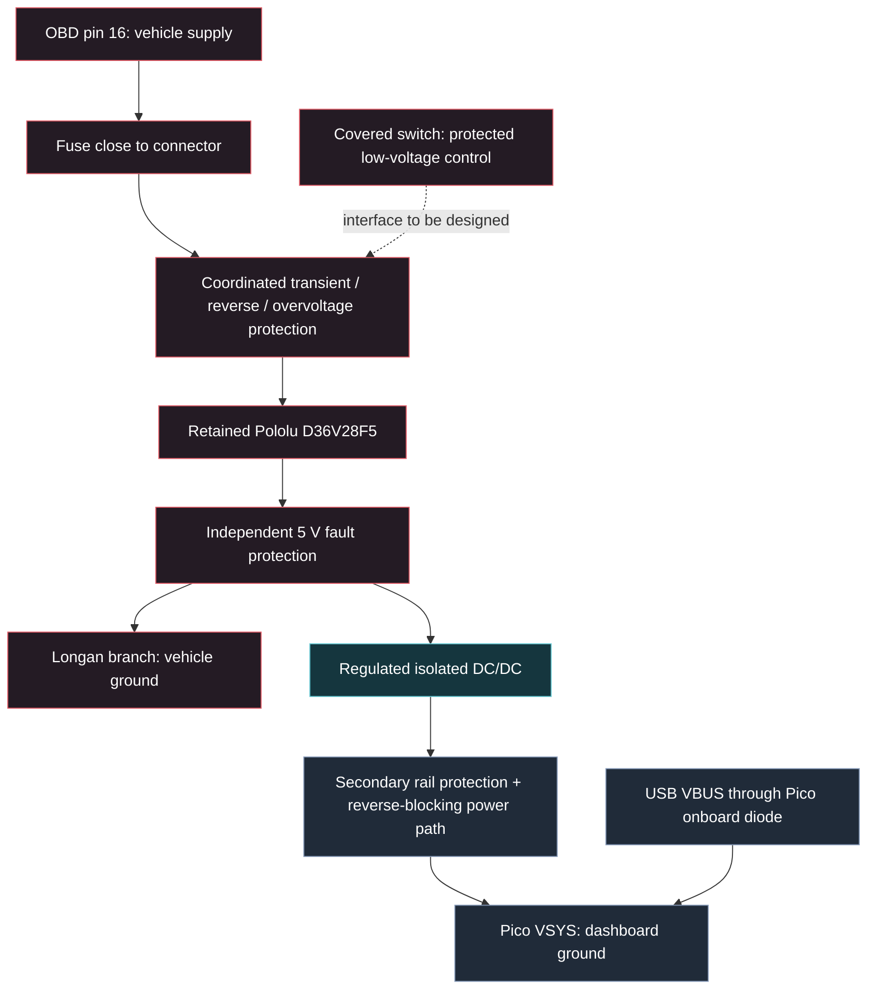

The isolated converter and UART barrier need **separate vehicle and dashboard
grounds**, including through USB, mounting hardware and the switch LED. USB can
still power the Pico when the vehicle branch is off. The covered switch's 12 V
maximum means its old raw-battery placement is being replaced by low-voltage
control. Final shutdown/standby behavior is an open design choice.

### CAN, UART and controls

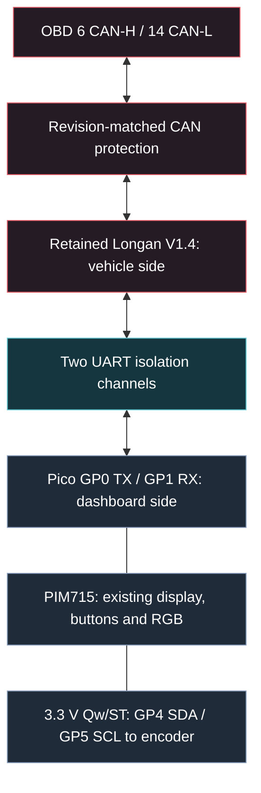

UART paths cross TX to RX. No extra CAN termination is assumed. OBD pin 4
(chassis ground) and pin 5 (signal ground) remain separately identified in the
return design. The pin labels above describe electrical nets, not connector-face
orientation. Use the [pin/reference document](hardware/wiring-diagram.txt) and
verify the actual harness by continuity.

The audit found that Longan's generic MCP2551 description conflicts with its
V1.3 schematic's SN65HVD230. The owner's **V1.4 photograph shows SIT65HVD230**;
TI limits cannot be transferred to it. The LDO/MCU and rail measurements remain
open. Isolation protects the dashboard/USB
boundary; it does not guarantee that a faulty adapter cannot disturb CAN.
The firmware's unqualified, no-diagnostic-polling mode is not electrical
listen-only certification. [Revision evidence and remaining gates](hardware/protection-plan.md#2-corrections-that-affect-the-design).

Local ceramics, intermediate storage and bulk capacitors will be sized together
with fuse, clamp, damping and inrush limits. Lowest ESR everywhere can worsen
cable-induced ringing. The old fuse/TVS/PTC list is provisional.
[Capacitor design and acceptance plan](hardware/protection-plan.md#4-capacitors-local-bypass-local-storage-and-bulk).

## Performance optimizations

The [measured optimization report](docs/performance/optimization-pass-2026-10-16.md)
records reproducible workloads, raw samples, source identities and limitations.
The pass preserves all gauges, animations, controls and validation gates.

- **Framebuffer fills:** an interleaved host comparison measured about 85% less
  time for full solid fills and 12% less for the complete configured view. A narrow
  one-pixel fill became 15 ns slower per 200-row call; the report records this
  accepted tradeoff and the separate, confounded full-suite comparison.
- **Studio artifact matching:** changing selection or build options reuses small
  display digests instead of repeatedly packaging artwork. A maximum-artwork
  native query measured about 5.5 ms before and 3.6 µs after; this is a host seam
  measurement, not browser latency. Content edits still recompute identity, and
  actual Build/Flash actions perform fresh checks.
- **Local builds:** reuse of the attempt's configuration compiler removed a
  duplicate compilation. One matched admitted build pair took 69.7 s before and
  45.8 s after. Firmware optimization settings remain unchanged; timings vary by
  PC and cache state.
- **Pico 2 W targeting:** every firmware route selects the RP2350's Cortex-M33
  with `-C target-cpu=cortex-m33` and the hard-float ARM target. The two RGB565
  framebuffers, DMA ownership and stack reserves remain unchanged.
- **Native orientation:** both shapes render directly into the existing buffers,
  with no transpose or additional framebuffer. A
  [matched landscape comparison](docs/performance/orientation-landscape-2026-10-17.md)
  found no repeatable regression in three selected workloads; desktop noise
  prevents a precise speedup claim. Rotation forces one complete transfer before
  partial updates resume. Compact six-byte damage rectangles recovered 264 bytes
  in the [traced firmware images](docs/validation/orientation-2026-10-17.md#traced-vehicle-image-regression),
  preserving the existing headroom checks and region capacity.

Host benchmarks do not establish physical FPS or target CPU-cycle gains.
For target measurements, use the [bounded on-device kernels](docs/performance/target-benchmarks.md)
and [frame timing capture](docs/performance/telemetry-windows.md).

## Architecture

- **Core0:** cooperative rendering, buttons, I2C encoder, PWM backlight, DMA
  display owner, recovery supervisor and optional TE observations.
- **Core1:** acquisition and per-measurement history before publication; optional
  UART parsing, bounded request scheduler, transport recovery and diagnostics.
  Static UART buffers, handles and IRQ remain on this core.
- **Handoff:** coherent typed samples carry source, sequence, timestamp and
  quality. Embassy Watch may coalesce display snapshots; it does not discard
  samples before acquisition statistics. Resets require producer acknowledgement.
- **Display:** two aligned 153600-byte framebuffers move through affine ownership
  and checked transfer tokens. Completion follows HAL return and CS high. A
  timed-out transfer is quarantined without cancelling DMA or reusing its buffer.
  Retained rendering and bounded damage regions preserve exact panel contents;
  `full-frame` and `serial-display` retain diagnostic fallbacks.
- **Persistence:** bounded two-sector settings journal, debounced writes and a
  coordinated display/I2C/UART pause. Reviewed flash-critical code executes in
  SRAM. Physical erase, power-cut and watchdog recovery tests remain pending.
- **Logs:** nonblocking ordinary RTT writes and bounded on-screen history with a
  protected latest fault. Cross-core locks cover bounded copies and updates.

Detailed contracts: [display ownership](docs/performance/display-pipeline.md),
[partial updates](docs/performance/partial-updates.md),
[acquisition](docs/performance/acquisition-handoff.md),
[typed quality](docs/vehicle/sample-quality.md),
[transport and qualification](docs/vehicle/diagnostic-transport.md),
[flash coordination](docs/hardware/flash-persistence.md).

The supplied CANChecked U-DNU profile is opaque evidence. It does not establish
DIDs, scaling or exact ECU compatibility. See the
[DNU evidence record](docs/vehicle/canchecked-dnu-evidence.md). Unsupported boost,
lambda, DSG and EGT remain unavailable in Vehicle mode. Vehicle alarms also
remain disabled until source-specific policies are qualified.

## Controls and startup

Studio **Device → Startup** configures Status → Splash → Dashboard. Defaults are
Brief status for 600 ms, then AEZAKMI for 2500 ms. Ten shared Rust animations
combine clean white backgrounds, large lettering and car/nerd jokes: the original
five, three Warhammer-inspired scenes, a turbo-levitating green mentor and an
OOGA BOOGA face beside a tiny spinning turbo: SMOL SNAIL GO WOOSH.
PNG, sprite-sheet and GIF imports convert to bounded RGB565 pixels; the
firmware does not decode the source image. Retain the original to change its
crop, matte or sampling later.

| AEZAKMI | Turbo / SUTUTU | Sanic |
|---|---|---|
|  |  |  |

| How much boost, bro? | Where Lambo? | Bless this machine spirit |
|---|---|---|
|  |  |  |

| Error 404: Apply incense | Red goes fasta | More boost, you need |
|---|---|---|
|  |  |  |

| OOGA BOOGA: Smol snail | The same theme in portrait |
|---|---|
|  |  |

*Actual shared-renderer animations, captured at 20 samples per second. Pico draws
these scenes directly in Rust; these GIFs are documentation exports. Playback is
not measured device FPS. [Portrait animations, static images and reproduction](docs/configurator/startup-gallery.md).*

Status and splash have independent durations: splash **0** skips only splash;
**Loop off** holds its final frame for the remaining duration. Reduced motion
uses a still. Preview offers seeking; full startup replay exercises simulated
controls and frame completions without resetting acquisition.

Acquisition and warning evaluation continue during startup. By default warning
text waits until Dashboard while the configured LED can indicate attention.
Hidden warnings cannot be acknowledged. Warning interruption and startup LED
indication are configurable; faults and protected Y recovery leave startup.
A fresh button tap or encoder action skips startup without also activating a
Dashboard action. See [startup settings and artwork](docs/configurator/startup.md)
and [startup screenshots](docs/configurator/gallery.md#startup-and-device-controls).

Valid saved preferences restore boost units and FPS mode; every boot starts at
Full brightness. Defaults apply when no valid journal exists. Persistence failures are
visible. See [startup status](docs/vehicle/startup-status.md) and
[settings](docs/performance/settings-journal.md).

The following tables show defaults. Accepted per-screen tap/hold and encoder
remaps follow [the controls and recovery contract](docs/configurator/control-mapping-design.md).
Ordinary assigned holds default to 800 ms and suppress the release tap. Dashboard
A/B holds select previous/next view; Debug A/B/X holds lower/raise/toggle brightness;
Logs A/B/X holds scroll older/newer/return live. A fixed two-second Y hold always
recovers Dashboard, the selected view and Full brightness, even from Off.
The [v4 release](docs/configurator/advanced-v4-release.md) describes advanced
units/history/markers/warnings/RGB. Studio also includes organized workspaces,
the ECU reference, startup artwork and local Build & Flash.

| Button | Default tap action |
|---|---|
| X | Dashboard FPS: Off, Instant, Average, Combined |
| Y | Dashboard, Debug, Logs |
| A | Dashboard FollowBoost unit: bar / PSI; fixed-unit widgets retain their unit |
| B | Request an acknowledged statistics reset on Dashboard |

| Encoder input | Dashboard | Debug | Logs |
|---|---|---|---|
| Clockwise | Next configured view | Increase legacy brightness by 5% | Newer entries |
| Counter-clockwise | Previous configured view | Decrease legacy brightness by 5%, down to off | Older entries |
| Press | Full -> Dim -> Off -> Full | Toggle backlight | No action |

The normalized direction follows the documented preassembled 5880 encoder;
physical direction remains an installation check. Every boot starts at Full
(100% PWM duty); Dim is exactly 50%, Off is 0%. Dashboard popups read `BL: FULL`,
`BL: DIM` and `BL: OFF`. Off remains visible for two seconds after its first
completed transfer, then a frame removing it completes before the backlight
switches off. Another click returns to Full; changing pages or replacing the
pending Off feedback cancels shutdown. The default configuration has one view;
rotation switches configured views and displays their names. Returning from
Debug/Logs preserves the selected view; reboot selects the configured boot view.

The following LED behavior describes the default policy; Device offers separate
normal/warning Off, Solid, Blink and Breathe patterns and off-screen policy.
Reduced motion makes Breathe solid while preserving explicit warning Blink.
See [LED policy](docs/configurator/led-policy-design.md).

Debug keeps its legacy 5% control scale and 1.5-second toggle popup. Button
feedback takes priority over dashboard warnings; warnings resume blinking after
feedback expires and stay off Debug/Logs. The RGB LED blinks red with the last
completed warning frame, suppressing green during both warning phases. Otherwise
the LED stays green; blue remains off. Green means no visible warning, not
verified vehicle health. GP20 PWM aims near 1 kHz from the actual configured clock
(132 MHz gives an integer 1015 Hz diagnostic; legacy 290.4 MHz gives 1001 Hz). Brightness is
runtime-only; unit and FPS choices remain persistent. See
[backlight and indicator controls](docs/hardware/backlight-controls.md).

The default lambda cell also shows derived AFR and an `EQ 14.7` scale label. This is
gasoline-equivalent AFR (`lambda * 14.7`), not a measured fuel composition.
The configurator can hide AFR or select an explicit fuel conversion with declared
assumptions. Lambda remains the primary value and graph; invalid or stale lambda hides both
readings. An E5 label does not establish an exact fuel-specific conversion. See
[measurement source and quality](docs/vehicle/sample-quality.md#lambda-and-derived-afr).

The FPS modes count successful software transfers: Instant is the recent
one-second-or-longer window; Average is since the last page change. An unchanged
scene can send no frames. These counters do not measure panel scanout. Optional
[frame/input/diagnostic windows](docs/performance/telemetry-windows.md) and
[TE observations](docs/hardware/te-observations.md) preserve separate metrics.
The default-off [target benchmark](docs/performance/target-benchmarks.md) records
finite CPU kernels with counter/timebase guards and reproducible ELF identity.

Logs retain 128 entries of up to 40 UTF-8 bytes, with truncation/overwrite
counters and a separately protected latest fault. Scrolled views use stable
sequence anchors. See [logging contracts](docs/performance/logging.md).

Studio **Diagnostics** provides filtered browser events and console output.
Its optional terminal relay forwards new warning/error context to the connected
helper: severity, approved event code, workspace, sequence, timing and accepted
revision. Raw messages, configuration and artwork remain in the browser. Terminal
output uses colours when supported; bounded queues may drop context under load
without blocking builds or flashing. The UI reports those drops. The ordinary
Trunk terminal cannot receive browser events by itself.

### Diagnostics, warnings and ECU evidence

The persistent simulator renders Dashboard, Debug and Logs and can inject
missing/stale/faulted samples, delayed reset acknowledgments and dropped frame
completions. Appearance preview uses synthetic reconstructed history; use the
simulator for timing and completion behavior. Resources distinguish encoded file
sizes from artifact-bound target figures; absent measurements remain explicit.

Warning rules support hysteresis, dwell, priority, latching and snooze. Dwell needs
new qualified measurements. Acknowledging an active warning does not clear it;
statistics reset is separate. Acknowledgment refers to the warning page actually
completed. A new episode interrupts snooze.

The offline ECU Reference provides searchable request/decoder definitions, source
links, runtime availability and qualification limits. Family evidence and candidate
signals do not establish exact-controller support or activate a decoder.
[Browse diagnostic and reference screenshots](docs/configurator/gallery.md#diagnostics-and-source-evidence),
[workspace guide](docs/configurator/workspace-and-diagnostics-design.md) and
[warning controls](docs/configurator/advanced-controls.md).

## Experimental clock profiles

Stock configuration is 150 MHz CPU and 37.5 MHz SPI. Optional mutually exclusive
profiles also include 132/66, 140/70 and 150/15 MHz, with their `cpu132-spi66-1v10`,
`cpu140-spi70-1v10`, `cpu150-spi15-1v10` features. Explicit Stock is
`cpu150-spi62-1v10`; absence of a clock selector still means Stock.
Existing profiles request 250/62.5, 280/70, 290/72.5 and 300/75 MHz CPU/SPI. Their feature
names are `cpu250-spi62-1v10`, `cpu280-spi70-1v30`, `cpu290-spi72-1v30` and
`cpu300-spi75-1v30`. These are experimental build settings; compilation proves
neither electrical margins nor reliable display operation. SPI limits depend
on `clk_peri`, divisors and the actual panel. Legacy290's actual 290.4/48.4 MHz
and user-reported failure remain distinct from exact custom 290/72.5 MHz.
See [the shared catalogue and build options](docs/configurator/building.md) and
[clock reporting](docs/performance/clock-reporting.md).

## Layout

```text
crates/dashboard-core/  Shared no_std rendering, models and diagnostic contracts
crates/dashboard-config/  Bounded schema, catalogue, fuel model and binary codec
crates/dashboard-config-tools/  Host validation and build snapshot tools
crates/dashboard-startup-tools/ Rust artwork conversion and worker contracts
configurator/       Rust/Wasm view editor, shared pixel preview and local saving
studio-helper/      Native prerequisites, builds, device inspection and flashing
configs/            Reviewed default JSON and compact runtime configuration
firmware/pico2/src/  Hardware application, tasks, profiling and drivers
firmware/vendor/    Reviewed Embassy RP source and provenance manifest
firmware/scripts/   Build, ownership, logging, vendor and ELF gates
host/               Same pure Rust modules, replay/pixel tests and Criterion
host/baselines/     Historical raw samples, source archives and metadata
hardware/           Proposed wiring and physical inspection requirements
docs/               Architecture, source checks and validation records
```

## License

[MIT](LICENSE).
