# Studio workflow gallery

[Back to project overview](../../README.md) · [Studio guide](studio.md) ·
[Widget comparisons](../../README.md#widget-gallery) · [Build guide](building.md)

Browser screenshots illustrate Studio controls and their visible state. Preview
readings and shared-renderer fixtures are synthetic. No screenshot establishes
DNUC source support, physical FPS, electrical safety or a successful device flash.
Click any image to open it at full size.

## Edit and repair

### Arrange a dashboard

[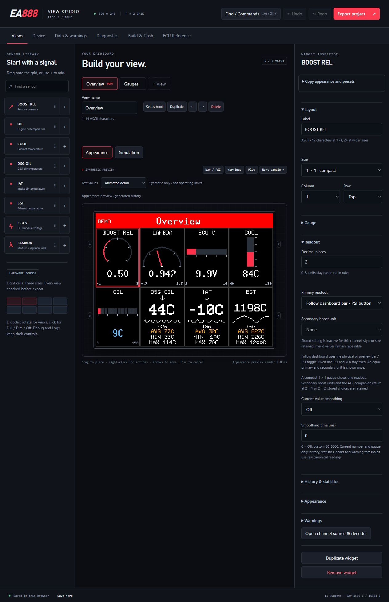](../images/gallery/workflows/editor.jpg)

Views combines the widget library, shared preview and inspector. Name/order views and choose the boot view; returning from Debug or Logs preserves the selected view.

### Repair rejected placement

[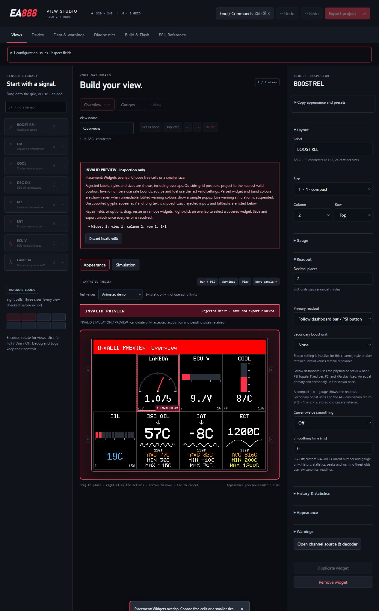](../images/gallery/workflows/invalid-overlap.jpg)

An invalid candidate remains inspectable. Repair overlapping placement or discard the rejected edits before export; accepted configuration remains protected.

### Reach covered widgets

[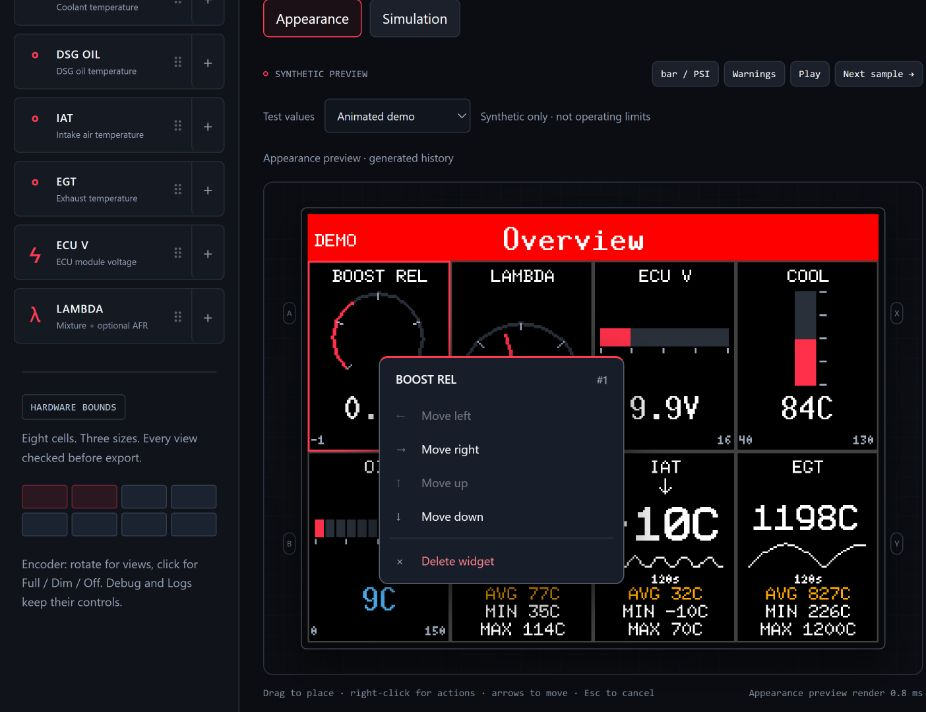](../images/gallery/workflows/widget-actions.jpg)

The widget menu exposes move/delete actions and selection alternatives when a widget is covered. Resize and placement obey the effective 4×2 landscape or 2×4 portrait grid.

### Review JSON before applying

[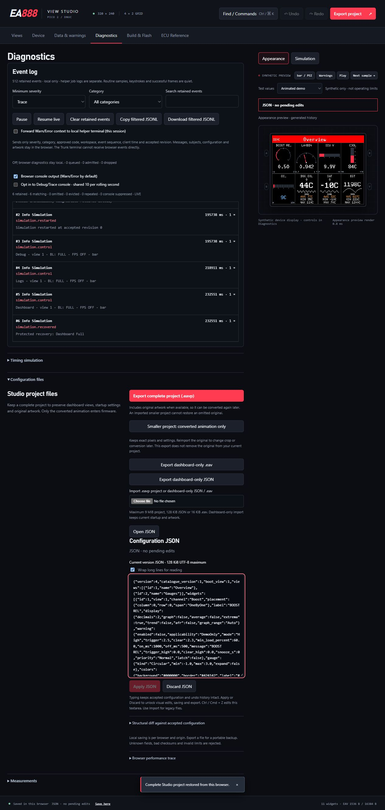](../images/gallery/workflows/json-editor.jpg)

JSON is a draft until Apply. Syntax/semantic errors and a valid unapplied candidate block project export; Discard returns to accepted state. Diff and resource views help inspect changes.

Complete `.eavp` exports include original artwork when available. Converted-only
exports retain usable pixels but require source reimport for conversion changes.
Dashboard-only `.eav` and JSON omit startup; importing them preserves existing
startup. Undo/Redo covers accepted project changes. Browser saving is local to
this origin and is not a portable backup. See [project storage](projects.md).

## Startup and device controls

### Configure status, animations and artwork

[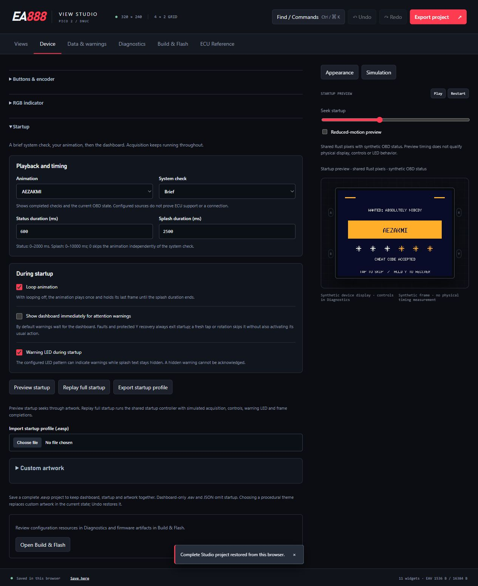](../images/gallery/workflows/startup.jpg)

Status and splash have separate timing. Splash zero leaves the independent status setting unchanged; Loop off holds the final frame. Retained originals support reconversion; only converted pixels enter firmware. Timing drafts require Apply/Discard, while malformed conversion options block conversion without replacing accepted artwork.

### Map controls and preserve recovery

[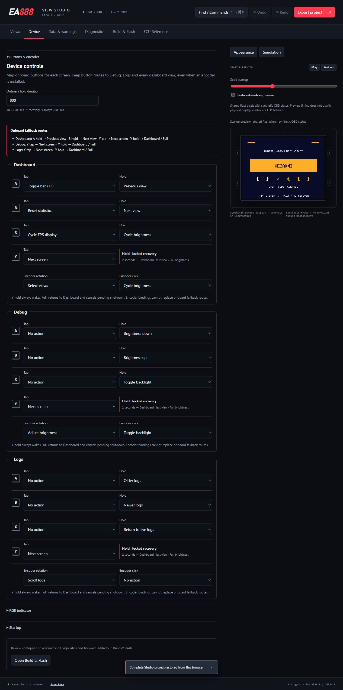](../images/gallery/workflows/controls.jpg)

Tap/hold and encoder actions are per screen. A fixed two-second Y hold restores Dashboard and Full brightness, including from Off. Full/Dim are 100%/50%; Off waits for completed feedback and its clearing frame.

### Choose normal and warning indication

[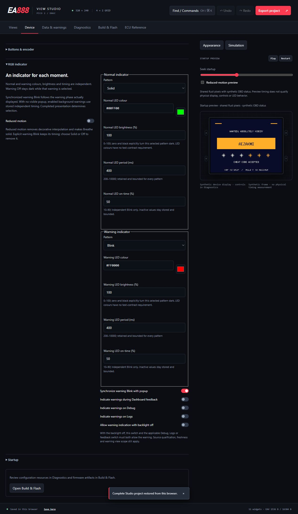](../images/gallery/workflows/led.jpg)

Configure normal and warning colours/patterns. During startup, warning text can wait while the LED indicates attention; hidden warnings cannot be acknowledged. Reduced motion holds Breathe solid and preserves explicit Blink.

### Configure qualified warnings

[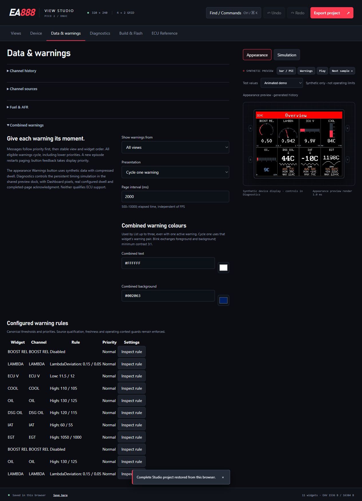](../images/gallery/workflows/warnings.jpg)

High/Low/window rules, dwell, priority, latch and snooze use qualified raw samples. Acknowledgment targets a completed warning page, does not force an active rule clear, and is separate from statistics reset. Thresholds shown are configuration examples, not DNUC recommendations.

[Startup guide](startup.md) · [Controls](control-mapping-design.md) · [LED policy](led-policy-design.md) · [Warnings](advanced-controls.md)

## Diagnostics and source evidence

### Inspect events and simulation

[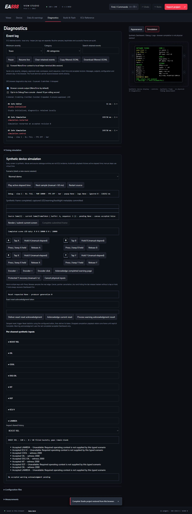](../images/gallery/workflows/diagnostics.jpg)

Filter bounded browser events and inspect shared Dashboard/Debug/Logs simulation. Optional warning/error context relay requires a connected helper; bounded drops are reported. Raw messages, configuration and artwork are not relayed.

[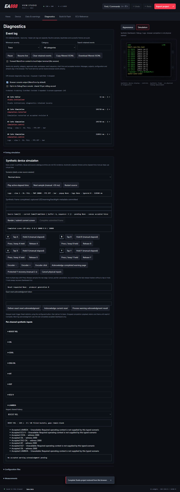](../images/gallery/workflows/logs-simulator.jpg)

This second capture shows Logs after the configured Y action and an explicit
simulated frame completion. These are host-generated log rows, not device telemetry.

### Browse ECU definitions and qualification

[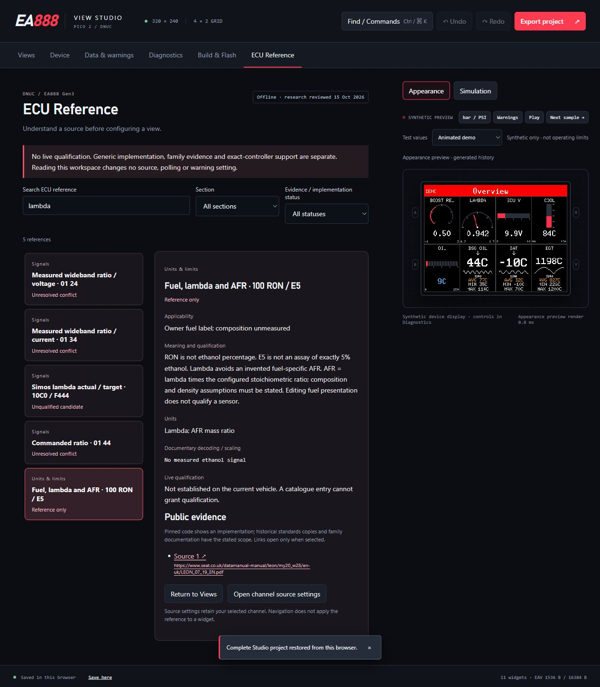](../images/gallery/workflows/ecu-reference.jpg)

Search the offline evidence library and inspect requests, decoder/scaling details and sources. Runtime availability, family-level evidence and exact-controller qualification remain distinct.

[Diagnostics guide](workspace-and-diagnostics-design.md) · [ECU workspace](ecu-reference.md) · [Technical library](../vehicle/ecu-reference/README.md)

## Build and flash

### Build the accepted project

[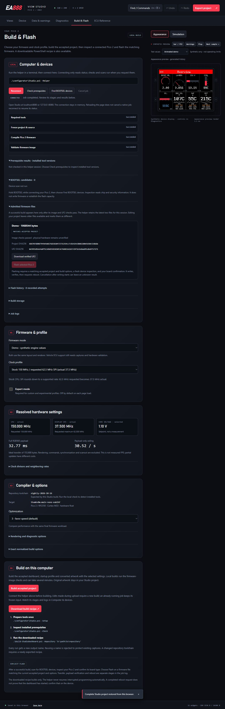](../images/gallery/workflows/build-flash.jpg)

Connect the local helper, check prerequisites, choose options and build an immutable accepted snapshot. Artifact identity includes dashboard, startup and converted artwork. Changed edits make a previous artifact different; logs and retained outcomes explain failures. A ready artifact is not proof of a flashed or running board.

### Inspect actual clock results

[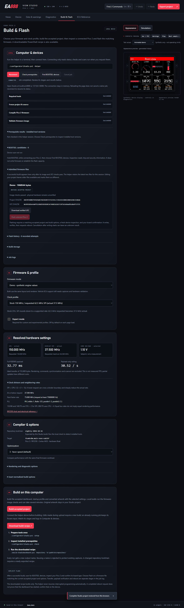](../images/gallery/workflows/clocks.jpg)

Compare requested and actual CPU/peripheral/SPI frequencies and divisors, toolchain and build options. Experimental choices need explicit admission. Payload throughput estimates and compilation do not qualify electrical margins or panel FPS.

Device transfer, verification and reboot request are separate operations. Genuine
Pico 2 confirmation and device identity must be current before a write. Interrupted
operations never resume a write automatically. See [build instructions](building.md),
[flash contract](flashing-design.md) and the [hardware runbook](../validation/pico2-dnuc-runbook.md).

Browser editing needs an already served Studio build. Local compilation/helper
operation additionally needs the supported Windows setup and pinned tools; see
[setup requirements](setup-tools.md). No minimum PC RAM has been qualified.

## Shared-renderer widgets

The [README comparison](../../README.md#widget-gallery) shows eight channels and
all six styles at three spans. Crops retain native dimensions and link to their
full 320×240 source frames. The fixture uses synthetic observations every 50 ms to
118,000 ms with FPS hidden, warnings disabled and a labelled SYNTHETIC view.
Boost is 1.20 bar with a PSI companion; temperatures are 95/90/80/30/700 °C,
ECU voltage 13.8 V and lambda 1.00. AFR 14.7 is gasoline-equivalent conversion,
not measured fuel composition or a target. These values are not recommended limits.

Reproduce the pixel source from the repository root:

```text
cargo run --locked --manifest-path host/Cargo.toml --example widget_gallery -- target/widget-gallery
```

The [example](../../host/examples/widget_gallery.rs) writes full frames, exact
widget crops, configuration EAVs and coverage.tsv. Committed PNGs are lossless
conversions of those PPM pixels. Rendering stills do not establish animation,
physical scanout or warning timing. The distinct measured performance pass is
separate; [benchmark scope](../performance/benchmark-coverage.md) remains explicit.

## Capture record

Workflow images were captured from the actual local Studio release built at
`6b051b1` on 16 October 2026. The invalid-overlap capture uses the preceding
`4d692f8` release; its placement behavior is unchanged. The native build shown
used `d9c493d`, completed its practical checks, and produced a hash-verified UF2
download. No device scan, transfer or reboot was performed. The images preserve
actual UI states, including the explicit unverified hardware labels.
