# Studio workflow gallery

[Back to project overview](../../README.md) · [Studio guide](studio.md) ·
[Widget comparisons](../../README.md#widget-gallery) · [Build guide](building.md)

Browser screenshots illustrate Studio controls and their visible state. Preview
readings and shared-renderer fixtures are synthetic. No screenshot establishes
DNUC source support, physical FPS, electrical safety or a successful device flash.
Click any image to open it at full size.

## Edit and repair

### Arrange a dashboard

[](../images/gallery/workflows/editor.jpg)

Views combines the widget library, shared preview and inspector. Name/order views and choose the boot view; returning from Debug or Logs preserves the selected view.

### Repair rejected placement

[](../images/gallery/workflows/invalid-overlap.jpg)

An invalid candidate remains inspectable. Repair overlapping placement or discard the rejected edits before export; accepted configuration remains protected.

### Reach covered widgets

[](../images/gallery/workflows/widget-actions.jpg)

The widget menu exposes move/delete actions and selection alternatives when a widget is covered. Resize and placement obey the effective 4×2 landscape or 2×4 portrait grid.

### Review JSON before applying

[](../images/gallery/workflows/json-editor.jpg)

JSON is a draft until Apply. Syntax/semantic errors and a valid unapplied candidate block project export; Discard returns to accepted state. Diff and resource views help inspect changes.

Complete `.eavp` exports include original artwork when available. Converted-only
exports retain usable pixels but require source reimport for conversion changes.
Dashboard-only `.eav` and JSON omit startup; importing them preserves existing
startup. Undo/Redo covers accepted project changes. Browser saving is local to
this origin and is not a portable backup. See [project storage](projects.md).

## Startup and device controls

### Configure status, animations and artwork

[](../images/gallery/workflows/startup.jpg)

Status and splash have separate timing. Splash zero leaves the independent status setting unchanged; Loop off holds the final frame. Retained originals support reconversion; only converted pixels enter firmware. Timing drafts require Apply/Discard, while malformed conversion options block conversion without replacing accepted artwork.

The [native animation gallery](startup-gallery.md) shows all ten procedural
themes in landscape and portrait, with matching stills and a source-hash manifest.
These shared-renderer exports are separate from the browser workflow captures below.

[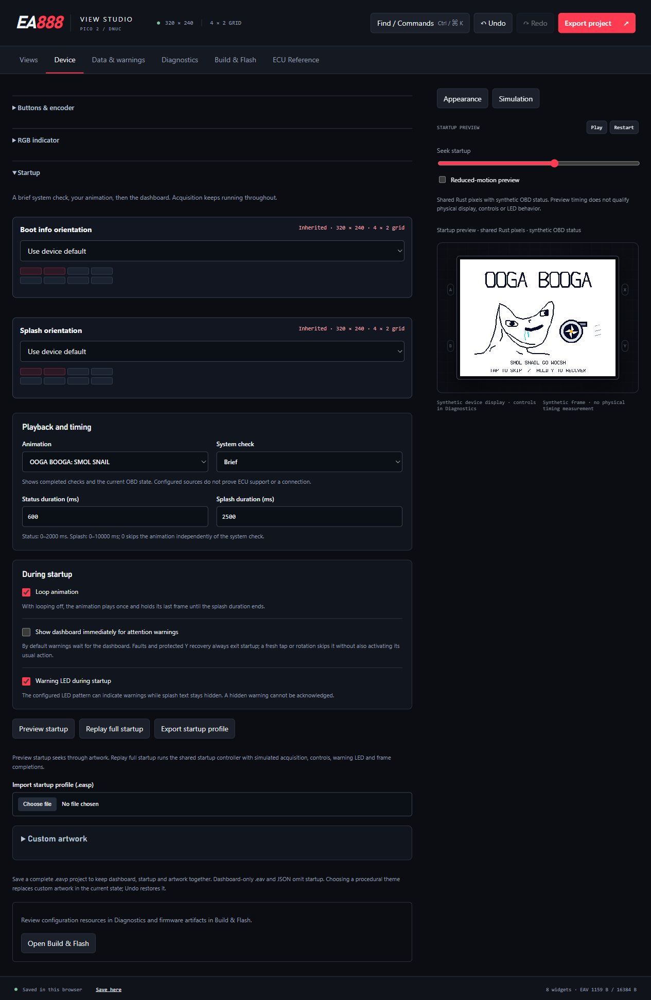](../images/gallery/workflows/startup-brainlet.jpg)

The theme selector includes OOGA BOOGA: SMOL SNAIL. Selecting a theme updates the
shared preview and creates an undoable project change. Seek and reduced-motion
preview let you inspect the art independently of the startup deadline.

### Map controls and preserve recovery

[](../images/gallery/workflows/controls.jpg)

Tap/hold and encoder actions are per screen. A fixed two-second Y hold restores Dashboard and Full brightness, including from Off. Full/Dim are 100%/50%; Off waits for completed feedback and its clearing frame.

### Choose normal and warning indication

[](../images/gallery/workflows/led.jpg)

Configure normal and warning colours/patterns. During startup, warning text can wait while the LED indicates attention; hidden warnings cannot be acknowledged. Reduced motion holds Breathe solid and preserves explicit Blink.

### Configure qualified warnings

[](../images/gallery/workflows/warnings.jpg)

High/Low/window rules, dwell, priority, latch and snooze use qualified raw samples. Acknowledgment targets a completed warning page, does not force an active rule clear, and is separate from statistics reset. Thresholds shown are configuration examples, not DNUC recommendations.

[Startup guide](startup.md) · [Controls](control-mapping-design.md) · [LED policy](led-policy-design.md) · [Warnings](advanced-controls.md)

## Diagnostics and source evidence

### Check layout and file budgets

[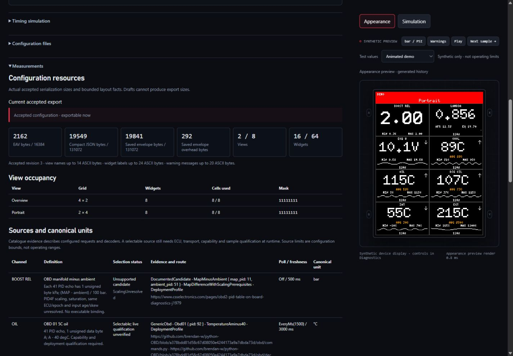](../images/gallery/workflows/maintenance-occupancy.jpg)

Open **Diagnostics → Measurements** to see the accepted configuration's encoded
size, saved-envelope overhead, view/widget counts and per-view occupancy. Each
row resolves the device default and view override independently: the example
contains a 4×2 Overview and a 2×4 Portrait view, each using all eight cells.
Drafts cannot supply export sizes; invalid edits remain repairable in the preview.
Source definitions below the table explain their runtime qualification limits.

[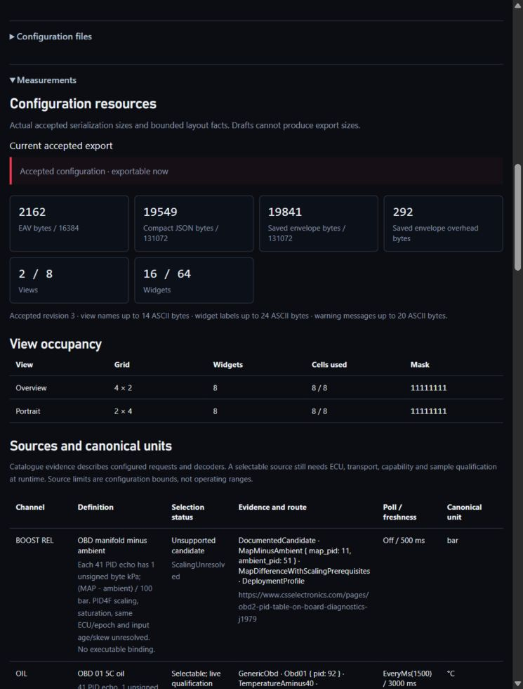](../images/gallery/workflows/maintenance-occupancy-narrow.jpg)

At narrower widths the budget cards wrap and the occupancy table stays readable.
The 760×1000 check had no document-wide horizontal overflow. These are browser
layout and configuration measurements, not Pico memory or vehicle telemetry.

### Configure and exercise the BLE prototype

[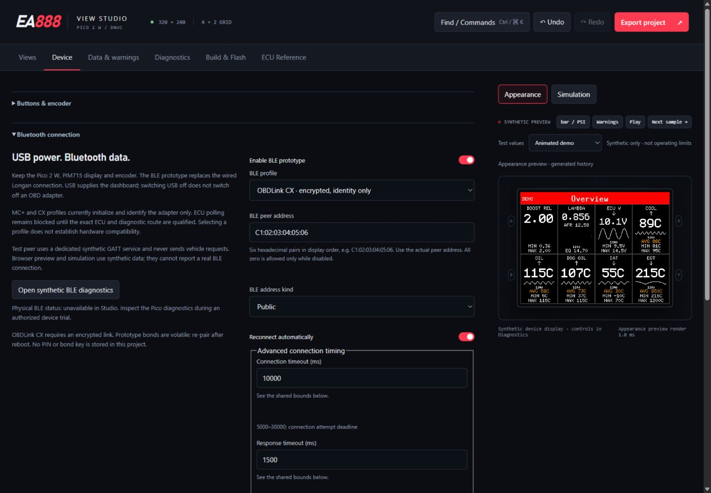](../images/gallery/workflows/ble-settings.jpg)

Device keeps the profile, explicit peer, reconnect policy and bounded timing in
the same validated project as views and controls. The address shown is illustrative.
MC+/CX are adapter-identity profiles; no live DNUC source is enabled.

[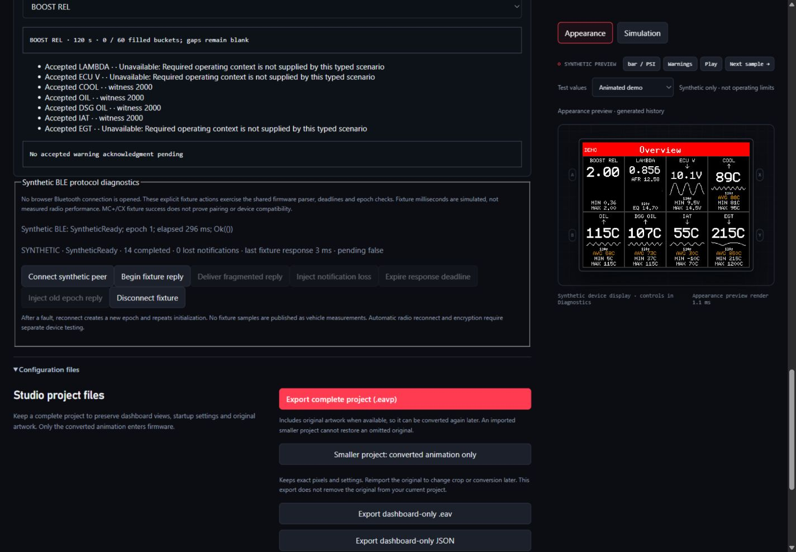](../images/gallery/workflows/ble-diagnostics.jpg)

The direct diagnostics shortcut focuses the protocol fixture. Its synthetic
milliseconds, loss/timeout/old-epoch controls and explicit reconnect exercise the
shared Rust session, without browser Bluetooth or physical connection telemetry.
See the [BLE workflow](ble-prototype.md) for repair and failure paths.

### Inspect events and simulation

[](../images/gallery/workflows/diagnostics.jpg)

Filter bounded browser events and inspect shared Dashboard/Debug/Logs simulation. Optional warning/error context relay requires a connected helper; bounded drops are reported. Raw messages, configuration and artwork are not relayed.

The Debug preview deliberately shows `--` for hardware measurements unavailable
in the browser. `Static` identifies linked allocations on the actual firmware;
it is not a browser memory reading. [Measurement definitions](../performance/diagnostic-measurements.md)
explain FPS, scoped work percentages and sampled stack depth.

[](../images/gallery/workflows/logs-simulator.jpg)

This second capture shows Logs after the configured Y action and an explicit
simulated frame completion. These are host-generated log rows, not device telemetry.

### Browse ECU definitions and qualification

[](../images/gallery/workflows/ecu-reference.jpg)

Search the offline evidence library and inspect requests, decoder/scaling details and sources. Runtime availability, family-level evidence and exact-controller qualification remain distinct.

[Diagnostics guide](workspace-and-diagnostics-design.md) · [ECU workspace](ecu-reference.md) · [Technical library](../vehicle/ecu-reference/README.md)

## Build and flash

### Select wireless firmware

[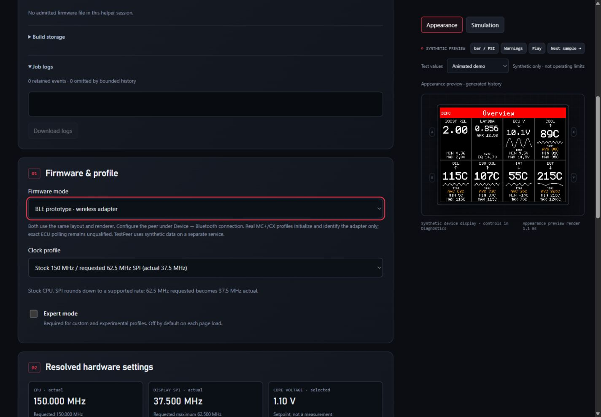](../images/gallery/workflows/ble-build.jpg)

BLE prototype mode uses the accepted Device settings. Demo remains a separate
build mode; disconnecting BLE never substitutes demo measurements. Stock stays
the default, and the retained 280/70 profile requires Expert mode. This capture
has no connected helper or admitted firmware and performs no device operation.

### Build the accepted project

[](../images/gallery/workflows/build-flash.jpg)

Connect the local helper, check prerequisites, choose options and build an immutable accepted snapshot. Artifact identity includes dashboard, startup and converted artwork. Changed edits make a previous artifact different; logs and retained outcomes explain failures. A ready artifact is not proof of a flashed or running board.

### Inspect actual clock results

[](../images/gallery/workflows/clocks.jpg)

Compare requested and actual CPU/peripheral/SPI frequencies and divisors, toolchain and build options. Experimental choices need explicit admission. Payload throughput estimates and compilation do not qualify electrical margins or panel FPS.

Device transfer, verification and reboot request are separate operations. Genuine
Pico 2 W confirmation and device identity must be current before a write. Interrupted
operations never resume a write automatically. See [build instructions](building.md),
[flash contract](flashing-design.md) and the [hardware runbook](../validation/pico2-dnuc-runbook.md).

Browser editing needs an already served Studio build. Local compilation/helper
operation additionally needs the supported Windows setup and pinned tools; see
[setup requirements](setup-tools.md). No minimum PC RAM has been qualified.

## Shared-renderer widgets

The [README comparison](../../README.md#widget-gallery) shows eight scalar channels,
all six scalar styles at three spans, and the four-cylinder ignition group. Crops retain native dimensions and link to their
full 320×240 source frames. The fixture uses synthetic observations every 50 ms to
118,000 ms with FPS hidden, warnings disabled and a labelled SYNTHETIC view.
Boost is 1.20 bar with a PSI companion; temperatures are 95/90/80/30/700 °C,
ECU voltage 13.8 V and lambda 1.00. AFR 14.7 is gasoline-equivalent conversion,
not measured fuel composition or a target. These values are not recommended limits.

Reproduce the pixel source from the repository root:

```text
cargo run --locked --manifest-path host/Cargo.toml --example widget_gallery -- target/widget-gallery
```

The [example](../../host/examples/widget_gallery.rs) writes full frames, exact
widget crops, configuration EAVs and coverage.tsv. Committed PNGs are lossless
conversions of those PPM pixels. Rendering stills do not establish animation,
physical scanout or warning timing. The distinct measured performance pass is
separate; [benchmark scope](../performance/benchmark-coverage.md) remains explicit.

### Ignition retard previews

[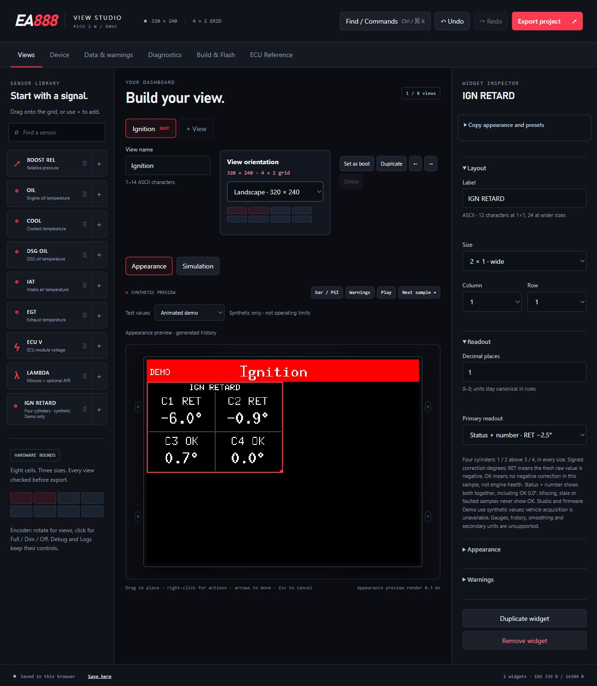](../images/gallery/ignition/studio-combined.jpg)

The readout selector offers numbers, status or both. These controls use the same
renderer and synthetic producer as firmware Demo. The following browser captures
show one global warning and all four separate cylinder lines; each uses the
explicit Channel minima test pattern, not a vehicle measurement.

| Global message | Separate cylinder lines |
| --- | --- |
| [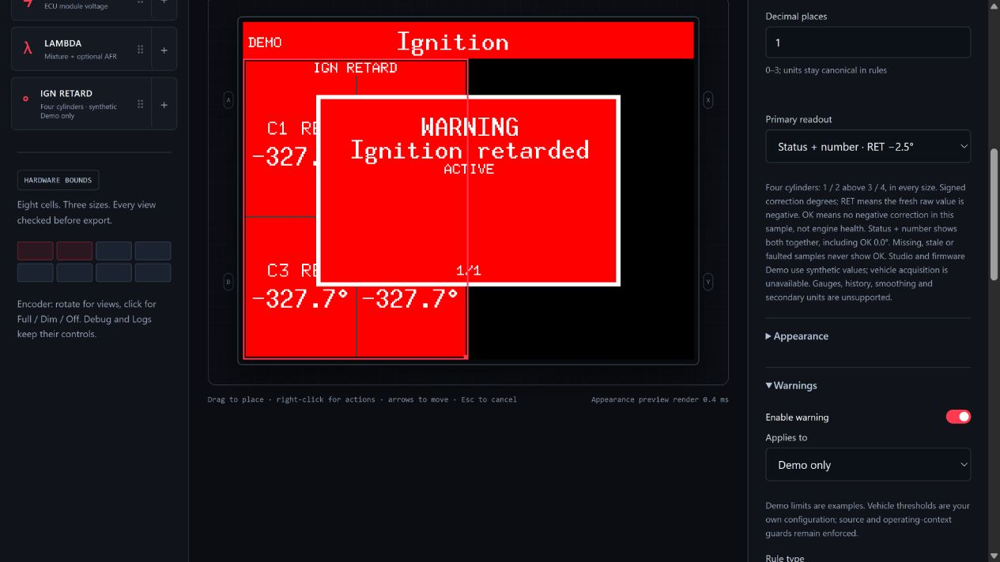](../images/gallery/ignition/studio-global-warning.jpg) | [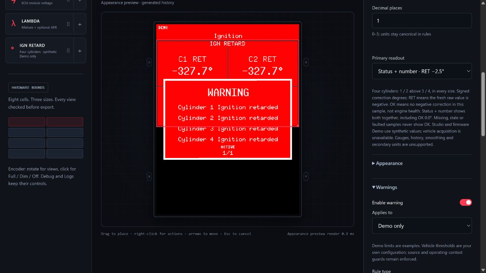](../images/gallery/ignition/studio-cylinder-warning.jpg) |

The same gallery command also emits all three ignition readouts at all three
spans in landscape and portrait, plus Global/CylinderLines warning frames.
The fixture admits signed degrees `[0,-2.5,0,-1.25]` every 50 ms for two seconds.
Readout examples disable warnings; warning examples use the shared default dwell
and actual warning pager. The SYNTHETIC label and hidden FPS avoid attributing
these pixels to a vehicle or physical display measurement.

| Combined readout | 1×1 | 2×1 | 2×2 |
|---|---|---|---|
| Landscape | [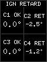](../images/gallery/ignition/full/ignition-combined-landscape-1x1.png) | [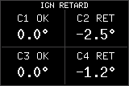](../images/gallery/ignition/full/ignition-combined-landscape-2x1.png) | [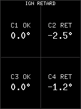](../images/gallery/ignition/full/ignition-combined-landscape-2x2.png) |
| Portrait | [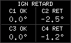](../images/gallery/ignition/full/ignition-combined-portrait-1x1.png) | [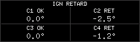](../images/gallery/ignition/full/ignition-combined-portrait-2x1.png) | [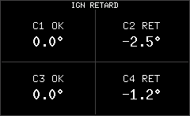](../images/gallery/ignition/full/ignition-combined-portrait-2x2.png) |

The [native PNG directory](../images/gallery/ignition/) contains every numeric,
status and combined case with full-frame counterparts. The smallest portrait
example still shows status and number together in each quadrant. Full portrait
frames are 240×320, landscape 320×240. Captions retain the signed input values;
one decimal rounds −1.25° to the renderer's visible −1.2°.
The compact-spacing revision centers each heading/value pair together, moving
cylinder/status headings down and keeping the number close. All three sizes use
the same layout rule, including short portrait cells with warning badges.

[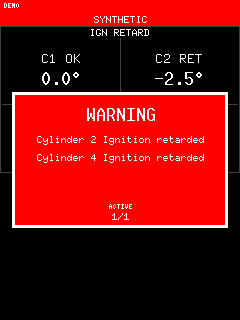](../images/gallery/ignition/full/ignition-warning-cylinders-portrait.png)

CylinderLines uses one bounded page with a separate line for each affected
cylinder, sharing threshold/message settings. These default examples identify
cylinders 2 and 4. Maximum text, all four lines, stale data, ACK/latch and retained
redraw boundaries have separate tests; optical legibility on the physical panel
is not established by a native PNG.

Captured from the optimized production bundle on 27 October 2026, on an isolated
loopback origin. [Capture identities](../images/gallery/ignition/capture.json)
record the Wasm, image and selected source hashes. Actual browser checks include
export/reimport, reload, all modes/spans/mountings, invalid-edit repair, extreme
text and independent missing/stale/faulted samples. The false scalar-only
portrait fit advisory was reproduced and corrected before final browser capture.
The later compact-spacing refresh repeats real size/mode/orientation checks and
preserves the existing font sizes; complete-glyph and partial-draw-failure tests
cover its constrained layouts. All 26 existing scalar gallery crops remain
pixel-identical. See the
[validation record](../validation/ignition-retard-widget-2026-10-27.md).

## Capture record

The Diagnostics capture was refreshed on 19 October 2026 from the production
bundle at `319ba79`, using an isolated origin at 1280×720. The configured Y button
selected Debug, followed by explicit simulated submission/completion. Timing and
file controls were collapsed for a compact view. The
[diagnostics capture manifest](../images/gallery/workflows/diagnostics-capture.json)
records the Wasm/image hashes. No horizontal page overflow or browser warnings
were observed. The temporary server/tab were closed; the user's Studio was preserved.

The two resource/occupancy captures were taken on 18 October 2026 from the normal
production bundle built at `23ef6e6`, at 1440×1000 and 760×1000. A fresh isolated
origin held the duplicated default view and its applied portrait override.
The [maintenance capture manifest](../images/gallery/workflows/maintenance-capture.json)
records exact Wasm/image hashes. The subsequent private Promise cancellation
repair changes no visible controls or pixels. The user's existing project/server
was preserved; the temporary server and tab were closed after capture.

The three BLE workflow captures were taken on 18 October 2026 from the normal
optimized production build at `394ac1f`, in an isolated origin at 1440×1000.
The [BLE capture manifest](../images/gallery/workflows/ble-capture.json) records
the Wasm and image hashes. The real browser checks included accepted peer edits,
CX help, the direct shortcut, a fragmented reply, old-epoch rejection, notification
loss and BLE build selection. The existing user project and server were preserved.

The following record describes the browser workflow images. Native startup
animations have their own current [capture manifest](../images/gallery/startup/capture.json)
and [reproduction steps](startup-gallery.md#reproduce-the-captures).

Startup and portrait-startup were refreshed on 17 October 2026, together with the
new brainlet workflow capture, using the normal ten-theme production build in an
isolated browser origin. The 1600×1100 desktop viewport shows accepted settings
and a paused 1800 ms startup seek (600 ms status, then 1200 ms splash). The
[workflow capture manifest](../images/gallery/workflows/startup-capture.json)
records the production Wasm and screenshot hashes. The user's existing Studio
project was not used for these captures.

The brainlet workflow image was refreshed again for the turbo-only artwork
revision, using a full-page capture at the browser's 1280×720 viewport. Its
per-image manifest override records the new production Wasm identity; the other
workflow images retain their original capture context.

Build & Flash was refreshed on 17 October 2026 for the Pico 2 W correction,
using the production application code committed as `7e06f28`. It shows a connected
protocol-2 helper after 15 successful installed-tool checks, with no device scan
or admitted firmware in that session. Detailed local tool paths and logs are
collapsed. The [capture manifest](../images/gallery/workflows/build-flash-capture.json)
records the production Wasm and screenshot hashes. No USB access, transfer or
reboot occurred during this capture.

The remaining workflow images were captured from the actual local Studio release
built at `6b051b1` on 16 October 2026. The invalid-overlap capture uses the preceding
`4d692f8` release; its placement behavior is unchanged. These dated captures
predate the Pico 2 W identity correction and retain their original pixels. They
preserve actual UI states, including the explicit unverified hardware labels.
