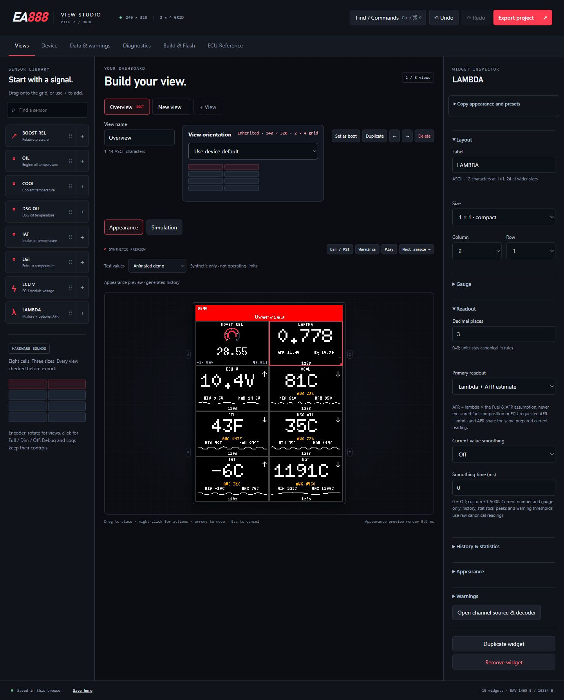
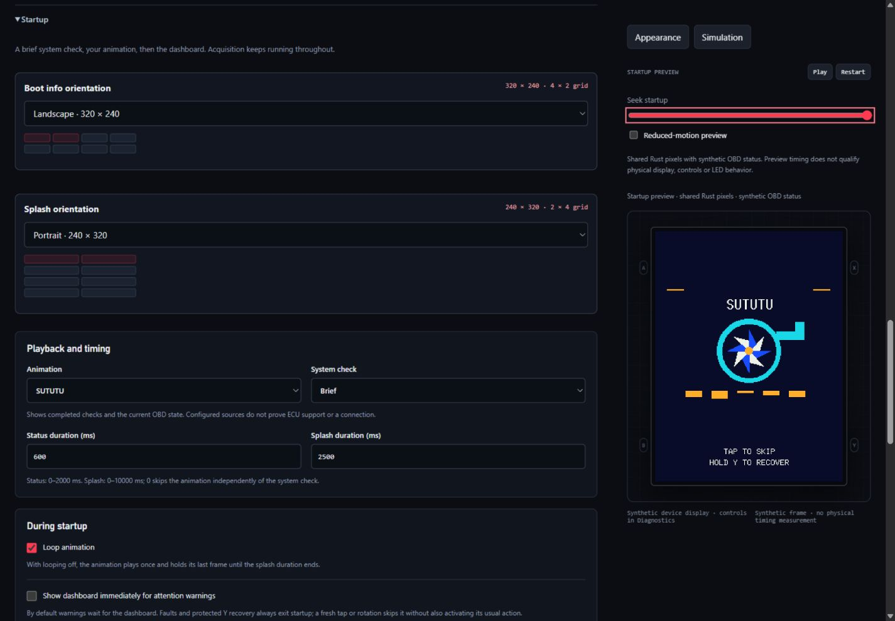
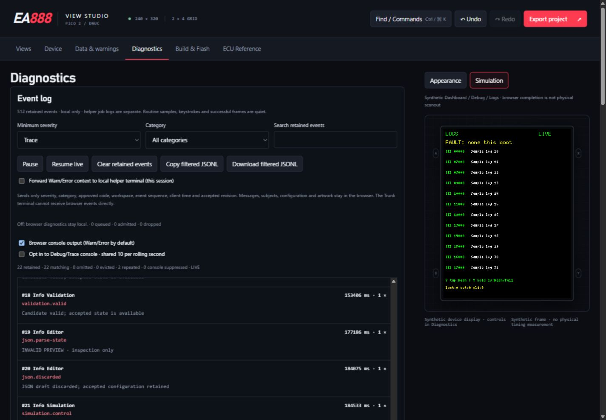

# Screen orientation

## Choose the effective screen

**Device → Default screen orientation** sets the device default. **Boot info**,
**Splash** and each **View** can independently select **Use device default** or
an explicit orientation. Debug and Logs always use the device default. Warnings,
feedback and brightness popups use the orientation of the screen beneath them.
Choosing the boot view does not change Boot info or Splash orientation.

| Choice | Logical pixels | Dashboard grid | Physical mounting |
| --- | --- | --- | --- |
| Landscape | 320 × 240 | 4 columns × 2 rows | Existing landscape convention |
| Portrait | 240 × 320 | 2 columns × 4 rows | Board turned clockwise from landscape |
| Landscape, flipped 180° | 320 × 240 | 4 × 2 | Opposite landscape mounting |
| Portrait, flipped 180° | 240 × 320 | 2 × 4 | Opposite portrait mounting |

The mounting convention is relative to the existing landscape image, not to an
assumed USB connector position. Studio shows upright logical content with the
chosen dimensions and physical button labels. Changing orientation does not
rename A/B/X/Y, reverse encoder direction or alter any assigned action. Protected
Y recovery remains a two-second hold on the same physical button.

## Repack a view

Select an orientation, inspect the proposed layouts and moved-widget count, then
choose **Apply orientation** or **Cancel**. Changing the device default repacks
views whose effective shape changes; explicit overrides retain their shape.
Changing a view override affects that view. A 180° flip retains its placements.

A shape change searches the eight cells deterministically, considering larger
widgets first, preferring their old placement and then row order. It preserves
widget IDs, vector order, settings and spans. A **2 × 1 remains horizontal** in
portrait. No widget is dropped or shrunk to make it fit. An impossible layout is
rejected without a partial edit. Applying the proposal is one project transaction;
one **Undo** restores the orientation and all affected placements.

The header is 26 pixels high in both shapes. Landscape cells are 80 × 107 pixels.
Portrait columns are 120 pixels wide; row edges are 26, 99, 173, 246 and 320, so
rows alternate 73 and 74 pixels. Placement, pointer hit testing, keyboard movement,
clipping and preview pixels use these same bounds. Invalid drafts remain visibly
marked and block saving/export. Check labels, values and overlays in the proposed
shape; portrait is a native layout rather than a stretched landscape image.

## Custom Splash artwork

Conversion targets the **effective Splash shape**, independent of the selected
view and Boot info. A shape change retains the existing converted pixels and
original source, but marks mismatched artwork invalid and blocks save, export and
build until repaired. Equal byte counts do not make a landscape asset portrait.
A 180° flip needs no reconversion because its logical dimensions are unchanged.

Use **Reconvert original with recorded fit and timing** to convert the retained
original to the new shape while preserving fit, matte, clipping and timing options.
Alternatively adjust conversion settings and use **Convert retained original**.
Successful conversion is another undoable transaction. Cancelled, failed or stale
worker results retain the previous artwork. An orientation change invalidates
pending operations so old geometry cannot be published by a delayed completion.

A converted-only project has no source to reconvert: reimport the original,
restore the previous orientation or Undo the change. Original bytes and converted
assets are immutable and shared with history; conversion does not rewrite the
source or its provenance. [Project storage](projects.md) explains retained sources,
full/converted-only exports and missing-source failures. Firmware decoding,
project admission and direct Cargo startup inputs reject mismatched Splash assets.

## Formats and compatibility

| Contract | Current output | Legacy input |
| --- | --- | --- |
| Dashboard EAV / JSON | v6: device/view orientation and bounded BLE selection | Frozen v1–v5 host migration; legacy BLE defaults disabled |
| Startup EASP | v2, 16 bytes: independent Boot info/Splash overrides | v1 with all former reserved bytes zero; both overrides inherit |
| Converted EASA | v2: exactly 320 × 240 or 240 × 320 | v1 remains exactly 320 × 240 |
| Complete EAVP project | v2: canonical EAV6, EASP2 and Recipe2 | v2 with frozen canonical EAV5 migrates BLE disabled; v1 uses frozen EAV4/EASP1/Recipe1 |
| Conversion recipe | v2: target geometry and source/output identity | Recipe1 upgrades to landscape while retaining converter/1 attribution |

Migrating an EAVP1 preserves converted EASA1 bytes, source bytes and their hashes;
it does not claim they were produced by converter/2. EAVP2 can retain that migrated
legacy artwork. Newly converted assets use EASA2 and `dashboard-startup-tools/2`.
Current firmware dashboard parsing accepts only EAV6; host tools normalize legacy
inputs before embedding. Unknown versions, fields, dimensions, noncanonical
encodings and malformed assets fail validation. See [configuration contracts](configuration-format.md#current-v6-contract),
[startup](startup.md) and [project format](projects.md#eavp-v2-format).

## Rendering and hardware boundaries

Shared Rust scenes render directly at native geometry. Two fixed 153600-byte
RGB565 framebuffers remain sufficient; portrait uses a 480-byte row stride and
landscape 640 bytes. There is no extra framebuffer or pixel transpose. Each queued
request carries its orientation, and a rotation forces a full repaint and complete
transfer even for identical black pixels. Partial updates resume from a matching
completed frame. A newer UI selection cannot change an older request's mode.

Host tests cover geometry, retained rendering, damage selection, transfer ordering,
delayed completions and injected failures. Browser previews are synthetic. Neither
establishes physical mounting, scanout, tearing, FPS, button/LED electrical behavior
or ECU compatibility. Use the [display orientation runbook](../hardware/display-orientation.md)
with the [device validation runbook](../validation/pico2-dnuc-runbook.md) for those checks.

The [orientation verification record](../validation/orientation-2026-10-17.md)
summarizes the software checks, linked ARM memory result and benchmark limits.

## Studio examples

The view inherits the device's 2×4 portrait grid. Widget controls and the canvas
use that geometry together; history curves retain a separate duration label.

The preview follows the current startup phase, so Boot info may be landscape
before a portrait Splash. The timeline is elapsed-time based.

Logs and Debug follow the device default and retain their physical controls.
These are synthetic browser screenshots, not photographs of a running Pico.
