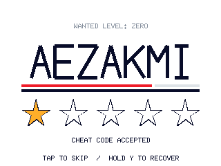
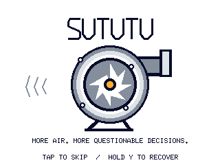
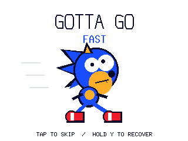
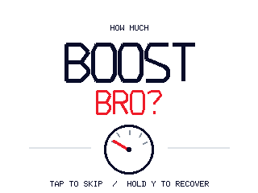
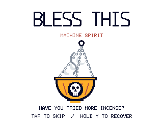
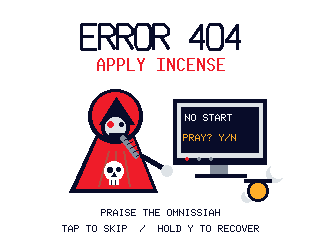
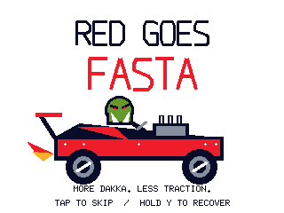
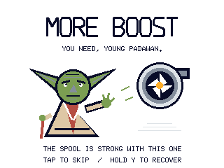
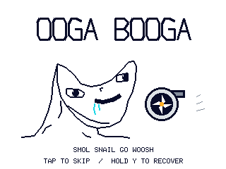

# Startup theme gallery

All ten procedural themes use a white background and the shared Rust renderer.
The animations below show native **320×240** landscape pixels. Each repeats a
**two-second cycle**, sampled at **50 ms** intervals. Every theme also has a native
**240×320** portrait animation and PNG stills at **1,200 ms**.

| Theme | Landscape animation | Scene and other captures |
| --- | --- | --- |
| AEZAKMI | [](../images/gallery/startup/aezakmi.gif) | Cheat-code lettering, red/black stripe and filling gold stars. [Portrait animation](../images/gallery/startup/aezakmi-portrait.gif) · [Landscape still](../images/gallery/startup/aezakmi.png) · [Portrait still](../images/gallery/startup/aezakmi-portrait.png) |
| SUTUTU | [](../images/gallery/startup/turbo.gif) | Shaded compressor housing, rotating blades and air marks. SUTUTU is visual text; there is no implied audio. [Portrait animation](../images/gallery/startup/turbo-portrait.gif) · [Landscape still](../images/gallery/startup/turbo.png) · [Portrait still](../images/gallery/startup/turbo-portrait.png) |
| GOTTA GO FAST | [](../images/gallery/startup/sanic.gif) | Blue caricature, crooked eyes, moving legs and speed lines. [Portrait animation](../images/gallery/startup/sanic-portrait.gif) · [Landscape still](../images/gallery/startup/sanic.png) · [Portrait still](../images/gallery/startup/sanic-portrait.png) |
| HOW MUCH BOOST BRO | [](../images/gallery/startup/boost-bro.gif) | Large lettering and an unnumbered animated dial; its needle is artwork, not a pressure reading. [Portrait animation](../images/gallery/startup/boost-bro-portrait.gif) · [Landscape still](../images/gallery/startup/boost-bro.png) · [Portrait still](../images/gallery/startup/boost-bro-portrait.png) |
| WHERE LAMBO | [](../images/gallery/startup/where-lambo.gif) | Bouncing hatchback, dented panels, rusty exhaust and a budget spent on the turbo. [Portrait animation](../images/gallery/startup/where-lambo-portrait.gif) · [Landscape still](../images/gallery/startup/where-lambo.png) · [Portrait still](../images/gallery/startup/where-lambo-portrait.png) |
| BLESS THIS MACHINE SPIRIT | [](../images/gallery/startup/machine-spirit.gif) | Mechanicus-inspired chains, swinging gold censer and drifting incense. [Portrait animation](../images/gallery/startup/machine-spirit-portrait.gif) · [Landscape still](../images/gallery/startup/machine-spirit.png) · [Portrait still](../images/gallery/startup/machine-spirit-portrait.png) |
| ERROR 404: APPLY INCENSE | [](../images/gallery/startup/ritual-diagnostics.gif) | Red-robed priest, optical implant, NO START / PRAY? terminal and blinking lamps. [Portrait animation](../images/gallery/startup/ritual-diagnostics-portrait.gif) · [Landscape still](../images/gallery/startup/ritual-diagnostics.png) · [Portrait still](../images/gallery/startup/ritual-diagnostics-portrait.png) |
| RED GOES FASTA | [](../images/gallery/startup/red-goes-fasta.gif) | Ork-inspired driver, exposed engine, exhaust flames and bouncing red hot rod. [Portrait animation](../images/gallery/startup/red-goes-fasta-portrait.gif) · [Landscape still](../images/gallery/startup/red-goes-fasta.png) · [Portrait still](../images/gallery/startup/red-goes-fasta-portrait.png) |
| MORE BOOST, YOU NEED | [](../images/gallery/startup/boost-padawan.gif) | Yoda-inspired mechanic with robe, cane and hovering turbo: YOU NEED, YOUNG PADAWAN. [Portrait animation](../images/gallery/startup/boost-padawan-portrait.gif) · [Landscape still](../images/gallery/startup/boost-padawan.png) · [Portrait still](../images/gallery/startup/boost-padawan-portrait.png) |
| OOGA BOOGA: SMOL SNAIL | [](../images/gallery/startup/turbo-brainlet.gif) | Low forehead, uneven eyes, grin and drool beside a little turbine snail: SMOL SNAIL GO WOOSH. [Portrait animation](../images/gallery/startup/turbo-brainlet-portrait.gif) · [Landscape still](../images/gallery/startup/turbo-brainlet.png) · [Portrait still](../images/gallery/startup/turbo-brainlet-portrait.png) |

These are synthetic native-renderer captures, not photographs or measurements of
the Pico display. GIF playback depends on the viewer and does not measure target
FPS, scanout or input response. Firmware draws these procedural scenes directly;
the GIF files are documentation exports. The [startup guide](startup.md) explains
profile timing, reduced motion, custom artwork and recovery. The exporter draws
the recovery hint but does not simulate button handling.

## Reproduce the captures

From the repository root, using the pinned Rust toolchain and Python with
Pillow **12.3.0 or newer**:

```text
cargo run --locked --release --manifest-path host/Cargo.toml --example startup_gallery -- target/startup-gallery --animation
python host/scripts/export_startup_gallery.py target/startup-gallery docs/images/gallery/startup
```

The [native exporter](../../host/examples/startup_gallery.rs) calls
`dashboard_core::startup::draw` with `St7789Renderer` for both geometries. It writes
PPM stills at 0, 350, 1,200 and 1,999 ms, plus 40 animation samples at 0 through
1,950 ms. Each profile uses the default timings and loop setting with its theme
changed; reduced motion is disabled. It draws `Phase::Splash` directly, so sample
times are splash elapsed time, excluding the preceding status screen. Its status
facts are Demo, configuration valid, saved preferences loaded and eight configured
sources; they are synthetic inputs.

The [packaging script](../../host/scripts/export_startup_gallery.py) writes one PNG
and one looping GIF per theme and geometry. It uses the renderer's exact RGB565
channel expansion through `Color::rgb888()`, with no resizing or interpolation.
The GIF palette retains every source colour and packaging fails if more than 256
colours would require quantization. It decodes each exported PNG and GIF to check
exact RGB pixels, all 40 samples and the complete 2,000 ms timeline. Identical
successive GIF samples may be combined into one longer frame.

The committed [capture manifest](../images/gallery/startup/capture.json) records
Pillow version, sampling/timing, renderer/profile/exporter source SHA256 values
(normalized to LF line endings),
and SHA256 values for all 20 PNGs and 20 GIFs. It identifies these captures without
relying on a historical source commit. Regenerate captures and the manifest
together after drawing changes. The exporter's separate `timings.csv` contains
host timing samples only; it does not establish RP2350 cost or physical FPS.
