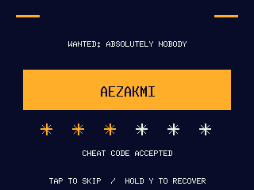
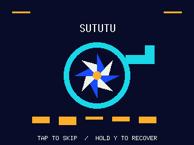
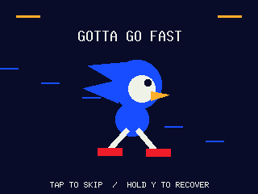
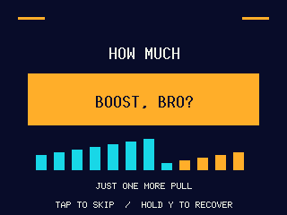
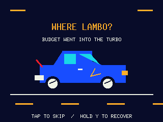

# Startup theme gallery

These five 320×240 previews are exact frames from the shared Rust startup renderer. Each shows **1,200 ms into the splash animation**, with looping enabled and reduced motion disabled. They are synthetic scene samples, not photographs of the Pico display or measurements of animation performance.

| Theme | Native-resolution frame | Caption |
| --- | --- | --- |
| AEZAKMI | [](../images/gallery/startup/aezakmi.png) | Cheat-code banner with animated stars. |
| Turbo | [](../images/gallery/startup/turbo.png) | Spinning turbine and pulsing bars. SUTUTU is visual text; this does not imply audio output. |
| Sanic | [](../images/gallery/startup/sanic.png) | Running character with moving speed lines. |
| How much boost, bro? | [](../images/gallery/startup/boost-bro.png) | Animated text panel and synthetic boost bars, not live pressure readings. |
| Where Lambo? | [](../images/gallery/startup/where-lambo.png) | Bouncing car and animated road details. |

See the [startup guide](startup.md) for timing, loops, preview, custom artwork and recovery controls. The native themes are procedural Rust animations. These static PNG exports do not imply that firmware decodes GIF files. The on-screen recovery hint is shared renderer content; this exporter does not simulate button handling.

## Regenerate the exact frames

Source: [`startup_frames.rs`](../../crates/dashboard-core/examples/startup_frames.rs), using `dashboard_core::startup::draw` and `St7789Renderer`. Captured against source commit `2b920839375478da75ae6b64738c9a8114121833`, with the repository-pinned nightly Rust toolchain and default `simple-outline` feature. No renderer modifications are needed.

Run from the repository root:

```sh
cargo run -p dashboard-core --locked --example startup_frames -- target/startup-gallery
```

The example emits big-endian RGB565 frames for all five themes at 0, 350, 1,200 and 1,999 ms. The gallery selects sample index `2` for every theme. Its profile is `StartupProfile::DEFAULT` with only the theme changed: 600 ms Brief status, 2,500 ms splash and looping enabled. It draws `Phase::Splash` directly, so the chosen 1,200 ms is animation elapsed time, not boot time including the status screen. Facts are Demo, configuration valid, settings not loaded and zero configured sources.

Convert the selected raw frames using Python and Pillow (captured with Pillow **12.3.0**):

```python
from pathlib import Path
from PIL import Image

source = Path('target/startup-gallery')
destination = Path('docs/images/gallery/startup')
destination.mkdir(parents=True, exist_ok=True)
names = ['aezakmi', 'turbo', 'sanic', 'boost-bro', 'where-lambo']
for index, name in enumerate(names):
    raw = (source / f'{index}-2.rgb565').read_bytes()
    assert len(raw) == 320 * 240 * 2
    rgb = bytearray()
    for offset in range(0, len(raw), 2):
        pixel = int.from_bytes(raw[offset:offset + 2], 'big')
        r, g, b = (pixel >> 11) & 31, (pixel >> 5) & 63, pixel & 31
        rgb.extend(((r << 3) | (r >> 2),
                    (g << 2) | (g >> 4),
                    (b << 3) | (b >> 2)))
    image = Image.frombytes('RGB', (320, 240), bytes(rgb))
    output = destination / f'{name}.png'
    image.save(output, optimize=True, compress_level=9)
    assert Image.open(output).tobytes() == bytes(rgb)
```

The conversion uses the same channel-bit expansion as `dashboard_config::Color::rgb888`. It changes only the file representation: no resizing, interpolation, palette reduction, added labels or decorative UI. All five output images were visually inspected and their decoded RGB bytes checked against the converted raw frames.
