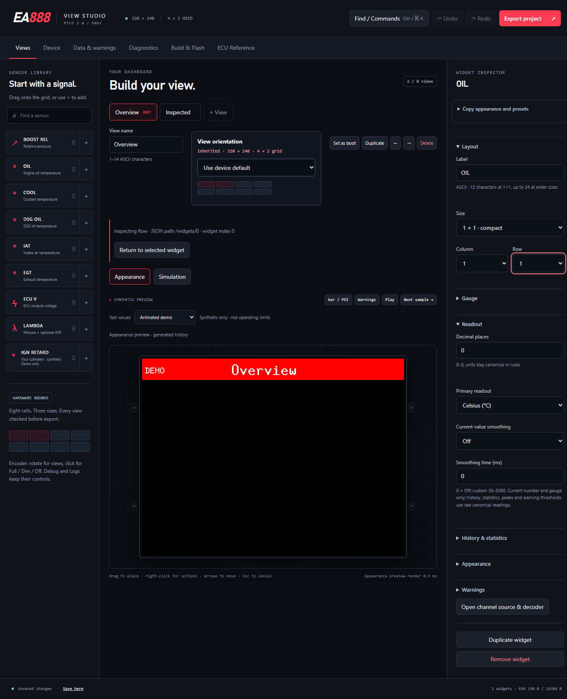

# Full firmware and tooling audit, 2 November 2026

Baseline: `9f56afcbb6614bdf716600f58d851a08964361f3`. This audit covers the
dashboard, BLE discovery and NGM identity utilities, shared libraries, retained
vendor paths, Studio, native helper, Python/PowerShell tools and CI. It follows
the [1 November NGM audit](ngm-identity-audit-2026-11-01.md); that earlier work is
retained and was challenged again in the larger context.

This is an offline software audit. No USB enumeration, flash, reboot, slot write,
radio connection or ECU command was performed. Image admission and physical
validation are separate. The observed post-reboot watchdog indication is still
ambiguous; this report does not claim to have reproduced or fixed its physical cause.

## Method and coverage

Engineer A explained each path from entry, admission and ownership through awaits,
publication, cleanup and recovery. Engineer B challenged those explanations from
the security, driver, radio, low-level and Python perspectives. For fixes, the
same cycle was repeated over the actual replacement code, callers and regression
results. The integrating reviewer independently read reports, diffs and relevant
source. Private local coverage records retain reviewer attribution, including
complementary production/test reads; a test pass was never counted as a source read.

The reconciled source/configuration inventory contains 958 files: 733 Rust,
175 Python, seven PowerShell, 27 TOML, two YAML, three CSS, three linker scripts,
one HTML, three templates and four upstream manifest originals. New vendored HCI
source is included. Generated browser glue, binary firmware and binary fixtures
receive identity/admission checks, not an invented exhaustive instruction audit.
The Rust documentation inventory covers 23,313 items with no uncovered items at
the source-review checkpoint. Presence and successful rendering do not prove
semantic accuracy; the state/path review remains necessary.

| Area | End-to-end boundaries reviewed |
| --- | --- |
| Dashboard firmware | Configuration and startup, both cores, all task/peripheral owners, frame completion, inputs, LED/backlight, acquisition, diagnostics, settings and watchdog |
| BLE/NGM utilities | Fixed entrypoint policy, scan/inspect/cancel, standard GATT inventory, INFO-only session, capture journal, overwrite/reset, USB read-only recovery, status and image gates |
| Shared Rust | Bounded schemas/migrations, acquisition/quality, units, warnings, rendering/history, startup assets, codec/session models, capture/export, helper protocol and provenance |
| Vendor | Complete retained HAL/radio/BLE/HCI source, security/crypto, ATT/GATT/L2CAP, packet pools, command/connection lifetimes, optional features and generators |
| Studio/helper | Candidate versus accepted project, imported data/artwork, worker/session revision, rendering/hit targets, storage, build/flash authority, processes and durable records |
| Tools/tests | Every tracked Python script including deferred proof research; wrappers, feature/build entrypoints, CI, fixtures, assertions and failure detection |

## Dashboard: ownership before presentation

**A explains:** the small boot task validates configuration before spawning the
large dashboard task. Settings are loaded before core 1 begins. Core 0 owns the
panel on SPI0/DMA0, encoder on I2C0 and optional radio on PIO0/DMA1. Core 1 owns
the acquisition model and its selected hardware source. Unsupported backend
combinations fail at build time. Demo is explicit; unavailable vehicle channels
are not replaced by synthetic readings in a normal build.

**B challenges:** initialization order must not authorize a conflicting owner or
turn a configuration fallback into vehicle qualification. The task constructors,
build guards, W-board pin map and resolved drivers were checked together. Radio
pins GP23/24/25/29 remain reserved. The PIM715 RGB LED on GP26/27/28 is distinct
from wireless GPIOs. No shared-pin VSYS measurement was introduced.

Two affine 153600-byte RGB565 buffers circulate between render and transfer.
Each request freezes orientation, scene identity and damage. Orientation changes
invalidate the reference and force a full update. Partial updates require the
matching completed base. A producer timeout cancels only its receive wait: it
quarantines the transfer/buffer and never frees memory while DMA may still own it.
The independent transfer owner keeps the write alive. HAL return plus CS high is
software completion; it is not observed panel scanout.

**B challenges:** enqueueing a frame cannot acknowledge a warning or turn off the
backlight. Startup, warning presentation, LED and delayed Off effects remain tied
to the matching completed frame token. Navigation, recovery and replacement
feedback can invalidate pending effects. Debug/Logs do not show Dashboard warning
popups. Button feedback retains priority without acknowledging an unseen warning.

Acquisition updates statistics before coalesced publication. Raw canonical values
drive warnings/history/extrema; smoothing affects presentation only. Missing,
stale, nonfinite or future samples stay unavailable. Reset acknowledgments retain
the producer generation, so a delayed observation cannot reset a newer run.
Fixed ranges clamp indicators without changing the displayed measurement.

The four-cylinder ignition widget was traced through schema/migration, synthetic
generator, shared rendering, Studio controls and warning presentation. Numeric,
status and combined modes use the same bounded renderer at all supported sizes.
Shared thresholds/messages may produce one global warning or separate affected
cylinder lines. This audit did not enable the photographed ECU identifiers as
live requests or claim a qualified decoder from their labels.

## Diagnostics: observed values and unavailable states

**A explains:** work windows accumulate time spent polling instrumented tasks;
pending waits are excluded. Interrupt execution during an instrumented poll may
be included. Completion timestamps, cycle/work fields and identity are published
coherently, including discarded render paths. Reversed/future/stale time invalidates
the observation instead of fabricating zero. A sampled stack pointer is not a
continuous high-water mark. Static bytes and remaining space come from the linked
image, not a guessed nominal task allocation.

**B challenges:** a plausible percentage is insufficient without its denominator,
clock and timing scope. DWT enable/progress, independent timer metadata, bounded
wrapping intervals and the actual clock profile were checked against source.
Benchmark admission rejects unavailable clock observations. Studio synthetic FPS
does not impersonate a hardware transfer observation. Saved-capture headers show
the current Pico's diagnostics; the body retains frozen boot-relative evidence.

The [diagnostic trace](diagnostics-reaudit-2026-10-20.md),
[memory contract](../performance/memory-layout.md) and
[display contract](../performance/display-pipeline.md) remain the detailed
definitions. CMSIS [Cortex-M33 register definitions][cmsis] corroborate the DWT
and trace-enable fields; they do not establish physical clock calibration.

## Utilities: selection, cancellation and evidence

The standard and identity binaries bind fixed inspectors and linked tool markers.
Compiling identity support does not change the standard binary's selected policy.
Their feature guard rejects security unification with the pairing-enabled dashboard.
Both boot into scanning. Only explicit selection/Inspect starts a connection.

| State | Admission/ownership | Exit or failure |
| --- | --- | --- |
| Scan | Exact address and address type; bounded raw reports and sourced names | Stop requires stack acknowledgment; dropped reports and malformed batches remain visible |
| Inspect | Fresh selected observation, request revision and exclusive operation lease | Cancellation ends inner owning scopes before disconnect; old events cannot update a new revision |
| Inventory | Bounded service/declaration/descriptor records and standard read allowlist | Invalid order/scope/length, exhaustion or terminal ATT failure retains partial evidence and stops dependent I/O |
| NGM parameters | One fresh scoped FFF1 service and readable 0081/0082/FFF2/FFF3 endpoints | Missing/duplicate/property/scope errors prevent transport opening; old saved handles are never reused |
| NGM INFO | One configured SPSM 129; one `1F110000` request permit | No alternate SPSM search, pairing, automatic retry, proprietary write sequence or ECU command |
| Cleanup | Inner GATT/CoC work dropped; full link disconnect and idle confirmation | Unconfirmed cleanup parks fatally with operation ownership retained; clean termination alone cannot erase an earlier error |
| Saved evidence | Validated immutable snapshot/journal identity | Saved success does not confer live green or authorize a connection |

**B challenges:** a timeout is not proof of destroyed work, and a normal disconnect
reason does not exclude a local receive error. Both conditions are checked
separately. The bounded INFO parser/session, raw chunks and pending observations
were followed through all cancellation points again. The earlier
[NGM state/deadline table](ngm-identity-audit-2026-11-01.md#live-state-machine-and-cancellation)
remains applicable. The response window does not renew on additional bytes;
one-credit receive ownership bounds subsequent traffic. The result records bytes
actually delivered to the session, not all possible radio traffic.

Legacy advertising admission now requires a legal batch count, data lengths and
exact exhaustion after the declared reports. Valid prefix observations remain
available, with one structural error. A bad batch count or trailing bytes is
described as a batch error in live/saved views and export, not an invented extra
record with a missing length. No capture format change was needed.

## Flash persistence and saved-slot recovery

**A explains:** each of four slots has two journal copies in the reserved 96 KiB
region. Save validates both copies and the complete bounded payload, erases the
inactive/older copy, writes/verifies data and commits last. Unknown formats in
either copy block normal overwrite. Explicit Reset is separate; generation wrap
and ambiguous equal generations do not become a usable latest record.

**B challenges:** timeout or a lost reply cannot promise rollback. The storage
owner continues after the UI wait ends, retaining its fence and byte lease until
the matching completion. A post-commit failure may leave the newer generation
valid. Reset is intentionally destructive for its selected slot. Existing
fault-injection, overwrite, cancellation and recovery tests were read and rerun;
physical torn-write qualification remains separate.

Flash maintenance quiesces both cores, display, encoder and radio by acknowledged
generation. Each erase/program operation requires a fresh watchdog ticket and
fresh producer progress between operations. The SRAM lockout parks core 1 before
the global critical section, waits for XIP activity and restores XIP before
resuming. Expired or unacknowledged maintenance does not silently resume feeding.

USB exposes List/Get only. It has a separate affine byte lease, bounded parser,
monotonic session generation and guards before/after endpoint polling. Reset or
unconfigure invalidates old I/O. Storage exchange cannot be abandoned while its
lease is outstanding. No save/export action starts BLE traffic.

The dashboard program boundary excludes **settings**, not the utility's capture
journal. Switching to a sufficiently large dashboard image may overwrite probe
captures; export them first. A misleading helper comment was corrected without
changing the ranges. See [persistence](../hardware/flash-persistence.md) and
[capture retention](../vehicle/ble-probe-captures.md).

## Bluetooth host: retaining authority across awaits

**A explains:** an HCI handle is reusable, so a queued item cannot use it alone as
authority. Security events, public connection commands, parameter-response tokens,
ACL send work and deferred disconnects now retain/validate the original connection
identity. Internal queued parameter data is inert; only dequeue creates the
external retained token, avoiding a reference cycle in the manager's own queue.
Wrong-stack operations reject before controller I/O.

**B challenges:** checking once before an await is insufficient. The common guard
checks the retained link before and after each controller poll. A stale operation
that has never polled returns without I/O. After a potentially submitted command,
identity loss or cancellation permanently closes that host because its effects
cannot be disproved. Split/combined control, receive and transmit workers all
observe the same fault; a ready callback cannot slip through a post-poll change.
Independent waiters avoid the previous single-waker replacement problem.

The internal disconnect request retains its exact lease through send/confirm/drop.
Allocation failure leaves the previous state unchanged. A delayed token cannot
disconnect a new link with the same handle. Security publication also validates
the original bond/IRK context; it cannot mutate a replacement peer.

**A explains the integration repair:** the new lifetime guards originally owned
large child futures. The compiler retained their argument storage as well as their
pinned local storage, multiplying static task and emitted-frame requirements.
Private guard APIs now borrow `Pin<&mut Future>`; each immediate caller pins its
child once. No unsafe pin projection, heap allocation or ownership check was added
or removed. The utility's completion latch and parameter-rejection call follow
the same rule.

**B challenges the destruction boundary:** dropping a pin borrow alone does not
destroy its owner. Actual caller scopes were checked through success, fault,
timeout, cancellation and early return. Owners drop before the next I/O or retry;
the terminal host latch still prevents uncertain work from being reused. A large
child-size regression fails on the original wrappers, and actual poll/drop tests
check that unpolled children stay inert and polled children drop exactly once.
Miri exercises the retained-connection and pinned-owner paths as well as the
intrusive command waiters below.

Identity resolution now requires the HCI random-address kind before interpreting
bytes as a resolvable private address. Both directions use the shared rule;
normalized identity equality and equal available IRKs remain. Resolution is not
authentication. No encrypted-session impersonation claim is made from this fix.
The normative address kinds are in [Core Link Layer][link-layer] and [HCI][hci].

Malformed SMP failure reporting previously reborrowed the same connection table
mutably and could panic. It now queues the error through the already-borrowed
exact slot. The distinct scan bug installed cancellation before acquiring scan
ownership; dropping a waiting request could stop the active scan. Installation
now occurs after admission, with no intervening suspension, for both scan types.

## HCI framing, storage and command completion

The locked 0.10.1 source is now vendored with archive/tree/overlay provenance.
A wholesale newer-API migration was not used: the observed upstream controller
mechanisms did not resolve the required lifecycle issues. See the
[vendor ledger](../../firmware/vendor/bt-hci/LOCAL_PATCHES.md).

**A explains:** command slots distinguish pending, responded and abandoned work.
Cancellation detaches the caller's response storage and quarantines an uncertain
opcode until its completion is consumed. Responses are bounded before copying;
duplicate completion cannot replace the first result. Intrusive independently
owned waiters are removed on cancellation and woken on actual resource changes.

**B challenges:** reported command allowance is absolute, not a value to maximize
against old credit. Zero stops new sends, including opcode-zero allowance updates.
Capacity exhaustion or incomplete quarantined work must not manufacture permission
to retry. A completely blocked controller requires rebuilding/recovery. This is
software containment of uncertain submission, not evidence that a failed command
never reached the controller. Core [command flow control][hci] supports these rules.

Fixed-value decoding validates the exact representation of every element before
typed construction. Zero-sized dynamic arrays, multiplication/count limits and
alignment promises were checked. Framing now preserves event tails, correctly
accounts for SCO headers and ISO's 14-bit length field, and rejects unrepresentable
local lengths before the serializer publishes bytes. Normal writer failure or
cancellation may still preserve a valid partial prefix; callers cannot assume
atomic transport writes.

Retained declarations also needed corrections: RF opcodes/PHY fields, the ISO
buffer count, CIG/CIS/BIG layouts, interleaved periodic/channel-sounding records,
bounded variable returns and the status-separated full-width Read Stored Link Key
counts. These are documented with independent wire fixtures in the
[declaration review](../dependencies/bt-hci-declarations-2026-11-02.md).
Selected applications do not issue the retained BR/EDR/ISO/RF-test commands.
Malformed controller input has no demonstrated direct peer-injection path.

## HAL and security dependency findings

| Finding | Source-based correction and boundary |
| --- | --- |
| RP2350 reset mask | Select all 29 silicon reset fields instead of the RP2040 25-bit mask; keep existing clock-stage exclusions. Actual PAC-field regression, no MMIO test. |
| I2C clock source | Derive timing from SYS as required by the peripheral, rather than PERI. Current application profiles keep those clocks equal; alternate retained trees exposed the error. |
| PIO placement | Bound allocation search to 32 unique starts; a conflict could previously cycle modulo instruction memory. This does not make hardware instruction writes transactional. |
| RP2040 alarm | Wait while enabled but not active using one register snapshot; an interrupt may retire activation before foreground observes it. Retained RP2040 only. |
| OTP wrappers | Use aligned little-endian storage and nonblocking boot lock 2 across permission/data reads and programming; Busy has no OTP side effects. ROM errors may follow irreversible partial programming. No OTP operation was performed. |
| CYW multicast | Validate returned byte count, entry count and complete addresses before publication/indexing. Malformed reply leaves output unchanged; no selected Wi-Fi caller. |
| Typed local CCCD | Associate the handle with its two-byte value type; literal notification/indication regressions preserve the characteristic value. This does not qualify remote permissions or big-endian support. |
| P-256 dependency | Scoped 0.14 migration removes advisory-affected bigint 0.5.5; retain unbiased scalar rejection, point validation, endian contracts and zeroize the explicit candidate. No target-specific side-channel proof. |

The [reset/RTC/multicast review](../dependencies/reset-multicast-2026-11-02.md)
and [P-256 review](../dependencies/p256-security-2026-11-02.md) distinguish
selected and retained paths, causal regressions and historical checkpoint totals.
The [Pico SDK I2C source][i2c], [boot-lock API][boot-lock] and
[RP2350 ROM OTP implementation][otp] were checked against resolved dependencies.
The [RustSec advisory][rustsec] describes compiler/target-dependent timing issues;
it does not establish an exploitable RP2350 radio side channel.

## Radio transfer storage and aligned views

**A explains:** WLAN framing previously copied the complete payload into a second
2052-byte SPI command/payload array. The runner now retains one initialized
513-word buffer: one command word followed by the unchanged 2048-byte payload.
SPI fills the prefix and sends the same contiguous command/payload sequence.
SDIO skips the prefix and preserves its exact block/tail lengths. IOCTL, Wi-Fi TX
and RX all use the payload region. The selected PIO/DMA/CS transaction is unchanged.
The manufacturer's [CYW43439 GSPI Figure 12][cyw-gspi] and
[SDIO platform guide][cyw-sdio] were compared with locked `cyw43-pio 0.10.0`.

**B challenges capacity and cancellation:** real adapter tests compare literal
command words and payloads at 1/3/4/63/64/65/2047/2048-byte boundaries. Pending
operations retain one stable buffer; only completion publishes returned status.
Private zero/oversized write lengths now reject before mutation or I/O. All actual
callers include nonempty headers. SDIO's formerly inert private zero-length call
therefore changes deliberately. Cancellation is not a hardware abort guarantee;
the existing permanent owner and acknowledged maintenance policy remain required.

Miri then exposed a separate memory-model defect in `aligned 0.4.3` range
indexing: it narrowed a byte borrow to 65 bytes and cast it to a 68-byte aligned
object. The original parent having spare initialized bytes did not preserve that
narrowed reference's authority. The same expression existed in retained RX and
SDIO paths. Checked shared/mutable helpers now derive from the whole aligned
parent, require an aligned start and `start <= end <= logical length`, and retain
its lifetime and exclusive borrow. These bounds keep the rounded child inside
the rounded parent. Logical lengths remain exact; alignment padding is neither
read nor promised initialized by the helpers. The proof uses the actual locked
crate layout and the [Rust layout guarantees][rust-layout].

**B verifies the replacement:** all dynamic callers and ordinary byte-copy
siblings were inspected. Tests cover empty views, real parent padding, nested
views, invalid order/alignment/bounds, `usize::MAX`, unchanged tails and an actual
65-byte runner receive. Clean Miri runs cover the complete default CYW library
(21 tests) and the selected Bluetooth IOCTL/RX test. No replacement serializer
model substitutes for those actual adapter and runner paths.

## Studio, helper and Python boundaries

**A explains:** Studio keeps accepted configuration separate from invalid or
unapplied drafts. Rendering and hit targets use coherent revisions/geometry;
asynchronous imports, artwork workers and storage results must match the current
operation. Failed admission preserves the accepted project and original artwork.
History shares immutable asset bytes. Bounded conversion and output limits apply
before firmware publication.

**B challenges:** inspecting a widget in another view must not borrow the selected
view's orientation or free space. The Find inspector and duplicate placement now
use the inspected widget's owning view. Ten real-browser cases cover both
orientation directions, invalid placement/repair, occupancy and refusal without
losing accepted state. Shared character-limit constants also drive visible hints.

This browser capture uses synthetic preview data. The selected view remains
Overview while Find inspects the other view's widget; it is not a vehicle reading.

**A explains:** helper requests pass loopback Host/Origin/capability and bounded
protocol admission before native work. A single activity permit travels into the
blocking closure; closing HTTP cannot release an operation still running. Windows
Job ownership, bounded pipes, output/deadline/scratch limits and cleanup apply to
the whole child process tree. Successful publication requires process exit, EOF
and no retained descendants. Frozen source/artifact leases bind later use.

**B challenges:** neither a historical success record nor interrupted work can
authorize a new flash. Durable intent precedes transfer, current selected artifact
and device identity are checked again, cancellation respects the owned write and
no interrupted write automatically resumes. Flash-history reads now reject every
unknown, malformed, oversized, nonregular or inconsistent generation member;
they no longer fall back to an older apparently Verified entry. Cleanup and read
admission share the same exact member rules.

All 175 tracked Python files, tests and vendor/research generators are inventoried
by Git and checked with hash-pinned Ruff formatting/lint and strict Mypy. The last
inferred constructor return was made explicit. Process supervision remains shared;
precise platform/ctypes boundaries are not replaced with broad Any suppressions.

Two validation defects were corrected as defects in the tests/tools themselves:
the flash-layout mutation test now reaches the intended geometry checker with a
real positive ELF and requires the specific negative diagnostic; the deferred
LedPattern instruction model now includes the error branch's output-byte write.
The latter remains unfinished research, outside production image prerequisites.
Independent literal GIF/LZW tests cover valid, missing/early end and excess-pixel
cases without relying on the tested decoder's own encoder as oracle.

CI multiline steps no longer mask an earlier native failure with a later success:
portable blocks use explicit fail-fast Bash and the PowerShell fetch checks its
native status immediately. The failure-17/success-0 reproduction demonstrated the
original masking. [GitHub's shell behavior][workflow-shell] was checked directly.

## Verification record and remaining gates

Local software results at the integrated source-review checkpoint:

- Shared workspace tests, core without defaults, all-target strict Clippy, shared
  Wasm/M33 compilation and strict private documentation passed. An initial run
  correctly rejected an in-progress vendor-ledger mismatch; the exact remaining
  provenance/startup suites and all doctests passed after the source/hash freeze.
- Host default/no-default tests, all-target Clippy, benchmark smoke and private
  library/example docs passed. Helper/Studio native tests and strict native/Wasm
  checks passed, with private docs and the complete release browser suite at
  1440x1000 and 760x1000.
- All Python lint/format/types passed for Windows and Linux settings. The 36-command
  runtime matrix passed; two exact linker-layout reruns required access to the
  pinned linker outside the local execution restriction, without code/test changes.
- Nine M33 application/utility strict Clippy contexts and 17 valid app/vendor
  private-doc contexts passed. HCI's defmt and log optional contexts were checked
  separately; enabling both is intentionally invalid. The 20-command native vendor
  matrix passed; the final HCI checkpoint contained 137 tests.
- After the final storage/alignment repairs, all three affected M33 application
  Clippy contexts and their private docs passed again, together with the selected
  CYW private docs. Final Trouble suites passed 366 expanded, 335 security and
  269 discovery tests; CYW passed 55 Bluetooth/log, 53 Bluetooth-only and 21 default
  tests. Final vendor provenance matched the complete reviewed source overlays.
- Clean Miri runs passed 18 HCI controller tests, 22 Trouble lifetime tests,
  21 default CYW tests and the selected Bluetooth runner regression. The full
  Bluetooth CYW run completed 55 test bodies but failed process shutdown because
  the locked Embassy standard timer leaves a background thread running. No leak
  suppression was used; this is not a full-suite Miri pass. CI retains the clean
  contexts plus the existing packet-pool ownership checks. Miri does not emulate
  radio, interrupts or DMA and does not prove untested paths sound.

Standalone retained HAL/CYW strict Clippy still reports pre-existing diagnostics;
it is not described as passing. Application strict checks remain enforced without
new suppressions. The optional retained Cortex C/assembly backend could not run
locally because `arm-none-eabi-gcc` is absent; exact-commit Linux CI installs it.
Two existing unused-inline dependency warnings and the CYW proc-macro future
compatibility notice remain visible.

**Linked-image integration is a separate gate.** The first stock dashboard image
passed; the first BLE image failed the unchanged 64 KiB core-0 headroom requirement,
and the first utility failed the unchanged 20480-byte emitted-frame aggregate.
Compiler type-size and independent ELF analysis traced duplication of owned
futures through the new private guards. The reviewed repairs above preserve all
fault, poll and cancellation checks while borrowing one pinned owner and removing
the redundant WLAN copy. P-256 stack admission now explicitly recognizes the
locked 0.14 arithmetic shape, including its ARMv7-selected four 64-bit limbs,
scalar/SEC1/inversion alternatives and required emitted boundaries. The old
fixtures, 4096-byte child allowance, 8192-byte reserve and all geometry limits
remain unchanged. Six causal failures and 46 checker tests cover the new shape;
its literal intermediate-ELF fixture is not an admission receipt. See the
[stack derivation](../performance/memory-layout.md#reviewed-p256-014-stack-shape-2026-11-02).
Final image admission and memory figures below come from fresh source-bound
builds. No failed image is a flash candidate.

## Final linked images

All eleven local builds passed their unchanged practical image gates with
`nightly-2026-10-18`, `thumbv8m.main-none-eabihf` and
`-C target-cpu=cortex-m33`. The dashboard wrapper disables implicit Cargo defaults
and explicitly includes `simple-outline` except in the full-outline row below;
utility captures use the separately guarded package. Utility
builds retain their reviewed binary-only LLVM inline threshold of 100000.
Each artifact retains its compiler/options, source hashes, ELF, admission receipt
and provenance evidence locally. Utilities additionally retain UF2 files checked
for exact program payload agreement and capture-range exclusion.

| Dashboard context | Additional features/options | Static RAM, B | Core-0 headroom, B |
| --- | --- | ---: | ---: |
| Stock | None | 401640 | 122648 |
| BLE 280/70 | `ble-obd,cpu280-spi70-1v30,frame-trace,te-trace`, Expert | 457600 | 66688 |
| Demo | `demo,frame-trace,te-trace` | 441792 | 82496 |
| Retained Longan | `longan-rx12,frame-trace,te-trace` | 451784 | 72504 |
| Serial/full frame | `serial-display,full-frame` | 401640 | 122648 |
| Full outline | `demo,frame-trace,te-trace`, `simple-outline` omitted | 441792 | 82496 |
| Target benchmark | `target-bench,ble-obd,frame-trace,te-trace` | 457600 | 66688 |

The traced BLE/benchmark images leave **1152 bytes above the 65536-byte floor**.
Their conservative named bounds are boot 3352, construction 18880, runtime 15536,
dashboard 28032 and radio 21016 bytes. The unchanged core-0/core-1 reserves remain
8192/4096 bytes. The retained Longan construction bound is 28152 bytes against
the same 32768-byte core-1 stack and 4096-byte reserve. None is physical high-water.

| Utility, both stock and 280/70 | Static RAM, B | Core-0 headroom, B | Emitted-frame sum / limit, B | Nonradio sum / limit, B |
| --- | ---: | ---: | ---: | ---: |
| Standard BLE probe | 407928 | 116360 | 18728 / 20480 | 11904 / 12288 |
| NGM identity | 408688 | 115600 | 20232 / 20480 | 12064 / 12288 |

NGM leaves only **248 bytes of aggregate-frame margin and 224 bytes of nonradio
margin**. These are conservative regression gates, not additional RAM allocations
or measured nested stack peaks. Utility named bounds remain boot 17112, core 0
17208, radio 24648 and render 17416 bytes. Both 153600-byte framebuffers, the
32768-byte core-1 stack and the 98304-byte capture reservation are preserved.
The utility program, erase and verification ranges exclude the capture region;
this does not establish slot preservation by an arbitrary later dashboard image.

Exact ELF SHA-256 values:

| Context | SHA-256 |
| --- | --- |
| Dashboard stock | `e0901487af2325ce5cf4b825a79c74e10bc6b95f5225b5d10146442334602bfc` |
| Dashboard BLE 280/70 | `25db72710dc0ed5cd0080785fd7fbf3b02a4e04fc41d5f2a121c4a5e355c04eb` |
| Dashboard demo | `5c32a0b59e8a73565e4c82ca9f9574e6ce0645d6de01c2733fcd81fce01d6ecc` |
| Dashboard Longan | `1e94db770236283b45d2a2ca86360d7a63b683c53e92f9a6ba36f62bb5ef7c39` |
| Dashboard serial/full frame | `0c7400dc80e535c10fd8d9463a8f67ab2ee905348dd47b0b9ed8805c5141bc63` |
| Dashboard full outline | `698a61041dc487fca81b5c0e034755e82a2dfed4a26e5b7e04c0acbdfde1cbea` |
| Dashboard target benchmark | `e0b771dbe39c2701bcb313e574d8c75cc0508ad97cb2870e7c8e366536dc0017` |
| BLE probe stock | `3cfa735f11e20f94e171a9edae795bee11ba91431f3d49ba662a9dbb070dddd6` |
| BLE probe 280/70 | `71d52fd1d58177cef28f990711976b78713debb922236332c77a971194a2c8cd` |
| NGM stock | `0d46dcd1c5c55317a00ce65459f46378a2ce02782e5bf3f575f4d0c245a46126` |
| NGM 280/70 | `ffd8f528abdfc6f73cc30eb6e50ca3739520943e00b1e6aa95d4a9b0a7638883` |

The checked NGM 280/70 UF2 SHA-256 is
`6a72bf4d6171f3b9ab42ff1e10d1461aceada9368a1ec658b9edf965756bdebd`.
The checked standard-probe 280/70 UF2 SHA-256 is
`a1a1bd4ce2734fb8406ffe4c515b34317791be19a5e28dbb9d15f9fcd6687542`.
Hashes identify these exact offline artifacts; they are not flash authorization.

Physical validation remains open for RF/adapter interoperability, actual stack
high-water, entropy/side-channel behavior, electrical margins, panel scanout,
power interruption and exact ECU decoding. Software evidence does not create
permission to flash or send vehicle requests. Preserve/export all four slots
before any later explicitly selected firmware transition.

[hci]: https://www.bluetooth.com/wp-content/uploads/Files/Specification/HTML/Core-62/out/en/host-controller-interface/host-controller-interface-functional-specification.html
[link-layer]: https://www.bluetooth.com/wp-content/uploads/Files/Specification/HTML/Core-62/out/en/low-energy-controller/link-layer-specification.html
[cmsis]: https://raw.githubusercontent.com/ARM-software/CMSIS_6/v6.0.0/CMSIS/Core/Include/core_cm33.h
[i2c]: https://raw.githubusercontent.com/raspberrypi/pico-sdk/master/src/rp2_common/hardware_i2c/i2c.c
[boot-lock]: https://raw.githubusercontent.com/raspberrypi/pico-sdk/master/src/rp2_common/hardware_boot_lock/include/hardware/boot_lock.h
[otp]: https://raw.githubusercontent.com/raspberrypi/pico-bootrom-rp2350/master/src/main/arm/varm_otp.c
[rustsec]: https://rustsec.org/advisories/RUSTSEC-2026-0387.html
[workflow-shell]: https://docs.github.com/en/actions/writing-workflows/workflow-syntax-for-github-actions#defaultsrunshell
[cyw-gspi]: https://www.mouser.com/datasheet/2/196/Infineon_CYW43439_DataSheet_v03_00_EN-3074791.pdf
[cyw-sdio]: https://www.infineon.com/assets/row/public/documents/30/44/infineon-sdio-platform-support-guide-usermanual-en.pdf?fileId=8ac78c8c8c3de074018c8ba3a9973619
[rust-layout]: https://doc.rust-lang.org/reference/type-layout.html
