# Standalone BLE discovery utility

`dashboard-ble-probe` is a separate, maintained firmware image for the Pico 2 W,
Pimoroni PIM715 and Adafruit 5880 encoder. It replaces the dashboard while installed
and runs without Studio, a phone or a computer. Its purpose is to collect
adapter evidence before attempting protocol integration. Four explicitly saved
captures survive power removal and can be viewed on the display or exported later
over normal USB. Photographs remain useful; the saved binary is the lossless record.

## Use it in the car

1. Power the Pico through USB. The display starts at full brightness and scans.
2. Close the phone app's adapter connection if the adapter stops advertising while
   connected. The utility cannot list a device that is not advertising.
3. Rotate the encoder to select a peer. The list keeps first-seen order so changing
   signal strength cannot move the selection. Four rows fit on each screen.
4. Press **X** for **Advert only**: pause and read a fresh snapshot of the selected
   advertisement without connecting. The heading is **ADVERTISEMENT**.
5. **Click the encoder**, or **hold A for two seconds**, to connect to that selected address and inspect GATT.
   During inspection, rotate to read pages as records arrive. No peer is connected
   automatically. X on a detail page provides the same **Inspect GATT** action.
   The heading changes to **ADVERTISEMENT + GATT**. Without an encoder, press
   **X → wait for Paused → X again**.
6. Wait for **Paused**. Hold **X for two seconds** to open the four capture slots.
   Select with the encoder or A/B, then tap X to save the current evidence.
   Replacing an occupied slot requires encoder click or a two-second A hold to
   confirm. A partial/error result is useful too; retain its failure context.
7. Open a saved slot with encoder click or a two-second A hold. Read its pages or
   take photographs. Y returns; holding Y for two seconds recovers scanning and
   clears live observations, while saved slots remain.
8. Later, plug normal USB into the PC, without BOOTSEL, and use the
   [capture exporter](ble-probe-captures.md#recover-captures-on-a-pc). No laptop or
   phone is required during capture in the car. Export before installing other firmware.

An advertisement older than 30 seconds cannot start an inspection: return with Y
and let scanning refresh it. Private addresses can change; an address/name is not
authenticated device identity. RSSI is signal strength, not measured distance.
Names and firmware/serial strings are untrusted peer claims. Redact unrelated
devices and private identifiers before sharing photographs publicly.

## Controls and evidence lifetime

The footer describes the action available **on the current screen**. `Click`
means pressing the encoder knob; `Turn` means rotating it. `Advert` means the
advertisement and scan-response packets already collected during scanning.
`GATT` is the additional service/characteristic inventory obtained by connecting.
The footer occupies three fixed rows below the evidence; telemetry has its own
two rows at the top. Longer explanations are here so evidence stays readable.

| Control | Device list | Evidence pages |
| --- | --- | --- |
| Encoder rotation | Select the previous/next device, clamped at the ends; does not connect | Scroll previous/next evidence page, clamped at the ends; never changes the selected device |
| Encoder click / hold A, 2 seconds | **Inspect GATT:** clear the old live inspection, stop scanning, connect to the selected device, discover GATT and allowed standard information, then disconnect | **Inspect GATT / Repeat GATT:** start the same fresh inspection for this device, reset to the first page and replace previous live GATT records |
| A / B short press | Select previous/next device; the onboard alternative to turning the encoder | Previous/next evidence page |
| X short press | **Advert only (fresh):** freeze the selected advertisement/scan response, open its first page and clear the old live GATT result; no connection is requested | **Inspect GATT / Repeat GATT:** identical to encoder click, including replacing old live GATT records |
| Hold X, 2 seconds | Open capture slots and pause the selected peer's live view | Open capture slots; does not repeat inspection |
| Y tap | Pause/resume scanning without clearing the device list | Cancel a pending inspection, finish radio cleanup and return to scanning; keeps the device list |
| Hold Y, 2 seconds | Clear the LED error latch, device list and live GATT result, then restart scanning; a terminal fault requests reset; saved slots remain | Same recovery action |

A, X and Y distinguish short presses from holds; a hold does not also perform its
short action. A two-second A hold is the onboard equivalent of encoder click,
including opening saved slots and confirming overwrite/reset. Slot selection and saved
pages wrap; live device selection and pages stop at the ends. See
[slot controls and confirmations](ble-probe-captures.md#save-open-replace-and-reset).
Both journal copies are checked before saving. An unknown journal/payload format
or malformed capture header requires explicit Reset; a supported sibling remains
openable with replacement blocked. USB and CLI recovery limits are documented
with the slot controls.

### Why the number of pages changes

**ADVERTISEMENT** contains the captured packets and decoded fields, followed by
**GATT not inspected** and a connection hint. This is an unrequested inspection,
not a failed one and not evidence that the device has zero services.
**ADVERTISEMENT + GATT** includes those packets plus the inspection's services,
characteristics and allowed Device Information values. Its status distinguishes
waiting for cleanup, connecting, discovery in progress, enumeration ended and
partial results. A timeout can leave zero or some records; it remains a partial
inspection with the error visible.

The owner's TV example used three advertisement pages and nine after finding
three services and twelve characteristics. Those counts are examples, not fixed
limits or adapter qualification. More records produce more pages as they arrive.

There is **one live GATT result plus four explicitly saved captures**. Save or
photograph needed evidence before replacing the live result. Opening a fresh advertisement view with X from
the list, starting another inspection, holding Y or restarting clears/replaces
that live result. These actions do not erase saved slots. After **Y → X**, fewer pages are therefore expected: X has opened a
new advertisement-only view. X never restores a previous inspection or connects
from the list. Use another X after Paused, or click the encoder, to inspect again.

Inspection clicks during stopping, connecting, discovering or disconnecting are
ignored; the footer says **GATT busy; please wait** and Y remains available.
Inspection is also unavailable during a terminal fault or with no selected peer.
If the selected advertisement is older than 30 seconds, the footer says the advertisement is old:
return to the list with Y, resume scanning if paused, and wait for a fresh report
before inspecting. Old advertising prevents a new connection; it does not
invalidate retained GATT evidence or prevent saving a paused result.
Y performs its short Back action on release; a long hold goes directly to recovery. Ordinary recovery
clears the catalogue/GATT evidence, including `full` and per-device report counts.
It does not reset uptime FPS or the global `lost`/`HCIbad` counters; reboot clears
all RAM-only state.
Turning in details never changes the peer being inspected. A missing encoder is
shown explicitly; onboard controls remain usable. The utility has a fixed
**320×240 landscape layout**, full backlight and its own controls, independent of
dashboard configuration and brightness preferences.

## RGB status and recovery

The probe uses the PIM715 RGB LED independently of the dashboard's configurable
warning LED. States below are in priority order; an error overrides activity.

| LED | Meaning |
| --- | --- |
| Fast blinking red | Terminal radio/display/progress fault; watchdog recovery is pending |
| Steady red | A probe, capacity, storage, USB, encoder, timing or watchdog error was recorded since recovery; overrides scan-only blinking |
| Slow blinking red | Only malformed HCI scan or advertisement-data reports were recorded since recovery; scanning can continue |
| Purple | A local capture directory/load/save/reset operation is pending, including one still finishing after leaving its page |
| Steady blue | Scanning for advertisements |
| Slow blinking blue | Starting, stopping scanning, connecting, inspecting, or disconnecting |
| Steady green | The current live inspection finished all four inventory stages, retained its negotiated link/timing evidence, acknowledged normal disconnect (`0x13`/`0x16`), and had no local receive fault, recorded errors, rejected/truncated records or failed/invalid-length standard reads |
| Amber | Paused without that clean live result, or browsing saved slots/evidence |

**Green means the probe finished cleanly and disconnected.** It does not mean a
connection remains open, every possible field was present, proprietary access
works, or the adapter/vehicle is healthy. An absent optional readable field is
not a read failure. Opening an old successful capture never creates live green.
Returning to scanning shows blue unless the error latch is still set.

Cleanup acknowledgment establishes that the connection ended. Its terminal
reason is checked separately: only remote-user `0x13` or local-host `0x16` may
qualify with otherwise complete work. A timeout such as `0x22`, another reason,
or missing reason on a connected attempt cannot qualify. A receive failure
retained by the host also prevents green, even if inventory finished before it
arrived. Live/saved link pages show the code and label; an older capture keeps
its original completion flag and gains a separate termination warning.
See the [hardware evidence and shared fix](../validation/probe-termination-followup-2026-10-20.md).

**Hold Y for two seconds to acknowledge red and recover scanning.** This clears
live peers/GATT and the volatile LED latch, preserving saved captures. A later
error sets red again, including an outstanding storage operation that fails after
recovery. A short Y press, successful retry, or saving the result does not clear
red. Historical `lost`/`HCIbad` counters remain until reboot; old counter values
alone do not relatch the LED. With no current radio error, the status row says
`Slow red: scan errors` or a steady-red source such as `Red: encoder I2C`.
An actual current radio error takes precedence in that row. Scan errors are
global; the selected device is not automatically their source. A later probe or
other error changes slow red to steady red until recovery.

Detail pages include the global first recorded fault, mask and every latched
source. This is atomic recording order, not a proven root cause. If scan errors
were first, a later non-scan source is used in the steady-red header, while the
detail list preserves the original first source. With no peer, **short X opens
fault details** and pauses scanning; click/hold A cannot connect without a peer.
Y returns to scanning. Saving still requires a selected peer. New captures freeze
these global causes and the configured radio rate; legacy v1/v2 show unavailable.

Recorded errors include rejected HCI/AD reports, report/catalogue capacity loss,
GATT and allowed-read failures (including protected/unavailable values), invalid
fixed-length standard values, storage errors/unsupported captures, malformed USB
commands or a failed transfer on its current USB session, loss of an established
encoder, and invalid FPS timing. A protected read reports an access restriction,
not a defective device. Global scan errors are not attributed to the selected
peer. Empty slots, normal cancellation, an encoder absent at startup, idle USB
timeouts and USB reset/unplug cancellation do not themselves latch red.

Blinking uses elapsed monotonic time: working blue and scan-only red have a 500 ms half-period;
terminal red has a 125 ms half-period, sampled by the 50 ms supervisor. No display
frame count controls it. A stalled supervisor cannot promise a visible blink.
A terminal transport, display or stalled-owner fault stops watchdog feeding:
both cores/peripherals restart after approximately two seconds. A watchdog timer
reset sets red again on boot. Both images now inspect raw watchdog reason and
ROM boot type; known intentional ROM reboot types are distinguished from a
watchdog fault. Unknown/unavailable ROM evidence keeps a watchdog warning
conservative. `HCIbad:0` does not contradict a watchdog reset: these are separate
observations. Power removal clears the ordinary RAM latch, but a startup stall
can produce a new watchdog reset after power returns. Only an explicit capture
persists a snapshot, which does not restore the live latch after reboot. The reset loses unsaved
evidence; valid committed slots remain. Ordinary connection/discovery timeouts
retain partial records and wait for input.

Live details (short X, even without a peer) include `BOOT RESET`: raw reason,
ROM boot type and a checked previous stage/time when available. Both firmware
routes retain Booting, Supervised or the first explicit supervisor failure in
watchdog scratch, with a checksum and commit marker. This is the last observation,
not a proven root cause, exact reset time or image identity. Power removal can
erase it. Y recovery acknowledges red while keeping the immutable boot evidence
inspectable; v4 captures freeze it. No timeout or watchdog deadline was relaxed.
[Source review, limits and next physical checks](../validation/probe-slot3-discovery-2026-10-20.md).

See the [LED source review and validation](../validation/probe-led-status-2026-10-19.md)
and [scan-only LED and discovery follow-up](../validation/probe-discovery-followup-2026-10-19.md),
and [pending physical checks](../validation/pico2-dnuc-runbook.md#standalone-probe-captures-and-diagnostics).

### Device names

The scanner retains a nonempty observed name when a later packet omits it.
Complete packet names take priority; otherwise a complete cached name precedes
shortened packet names. Empty shortened fields cannot hide a usable name. After
explicit selected-peer Inspect, a successful, nonempty, non-truncated GAP Device
Name read can label that exact address/type when no complete packet name exists.
Returning to scanning retains it; Y recovery clears the live catalogue/cache.
Details and exports identify the source, cached status and boot-relative time.
Raw advertisement/response bytes always remain the latest admitted packets.

Local Name is optional advertising data. Active scanning cannot force a device
to advertise, answer with a name or accept a connection. There are no automatic
connections, manufacturer-name guesses or cross-address identity matching.
An unnamed peer may remain unnamed after Inspect. The missing TV's cause remains
unknown; the clean NEEWER capture verifies only that separate attempt.

### Rejected characteristic evidence

When the probe's application guard rejects a returned characteristic declaration, its failure pages retain
the first rejected handle, original byte length and at most 19 bytes in wire
order, alongside the query range and last accepted declaration/value handles.
A five-byte declaration contains a 16-bit UUID; a nineteen-byte declaration
contains a 128-bit UUID. Longer malformed values retain a labelled prefix.
The displayed rejected value field is explicitly **unvalidated**, and is
unavailable when fewer than three bytes arrived. No later descriptor or standard
read is attempted after this rejection. Earlier valid records remain inspectable
and saveable, including the rejection context introduced in payload v2 and
retained in current payload v4.
Lower-layer decoding can fail before a tuple reaches that guard; those failures
retain their available error context and leave rejected bytes absent.

The earlier photograph lacked the rejected tuple. The later slot-1 USB capture
contains a value handle outside the received service range. Strict rejection is
correct; the evidence does not identify where the inconsistency originated.
See the [transport follow-up](../hardware/cyw43-transport-follow-up.md).
HCI `0x16` describes local-host
termination during cleanup, not the original declaration problem.

## Always-visible telemetry

Two fixed rows beneath the title remain visible while scanning, paused,
connecting, inspecting or showing faults. They do not replace device evidence or
change the controls. `K` means KiB, rounded up for these compact labels.

| Field | Meaning |
| --- | --- |
| FPS | Successful HAL display transfers divided by actual elapsed seconds in the latest window of at least one second; not an inverse render-time estimate |
| AVG | Total successful transfers divided by total elapsed time since probe UI startup; weighted by time, including pauses and idle windows |
| W C0 / C1 | Application task-poll work as a percentage of each core's actual wall-time window, to 0.1%; `W` means work, not whole-core utilization |
| Static | Linked static allocation / 512 KiB linker arena, including both framebuffers and the reserved 32 KiB core-1 stack |
| SP0 / SP1 | Greatest stack depth observed at task-poll boundaries / respective stack region; not a scan of stack memory or a physical high-water measurement |

FPS is **software completion, not LCD scanout**. Both rates initially show `--`
until the first complete window. Navigating, pausing scanning or clearing peers
does not reset the meter; reboot does. A paused radio still allows screen updates.
The existing 50 ms render cadence targets 20 updates/s; load can reduce that rate.
Failed transfers never add a frame, and their buffers remain quarantined.

Work uses the locked HAL's 1 MHz monotonic TIMER0 clock. Each top-level task is
wrapped once, including all radio child futures, and only time inside `poll` is
counted. Waiting on DMA, timers or another task is excluded. IRQ time inside a
poll is included; scheduler/IRQ work outside polls and the observer's recording
overhead are excluded. One-microsecond resolution limits tiny-poll accuracy.
Before a full window, after invalid timing, or more than two seconds after the
latest observation, work displays `--`, never an invented idle value.

The two cores publish bounded observations under one short critical section;
snapshot time and the completion counter are captured together. The lock covers
bounded timer reads and value copies/calculations, with no rendering or awaited
peripheral transactions. The current UI poll is
visible only after it returns. Stack samples can miss deeper calls between poll
boundaries. Static memory is not total live usage: do not add the framebuffers or
core-1 stack again. The RP2350 has 520 KiB physically; this linker leaves its two
4 KiB scratch banks outside the displayed 512 KiB arena.

See the [measurement contract](../performance/diagnostic-measurements.md) and
[detailed diagnostics re-audit](../validation/diagnostics-reaudit-2026-10-20.md)
for both firmware paths, numeric validity, tests and remaining device checks.

## What it collects and sends

| Item | Bound / behavior |
| --- | --- |
| Catalogue | 48 address/type identities; no eviction; excess **reports** counted as `full` |
| Scan | Legacy 1M active scan, 100 ms interval / 50 ms window; duplicate reports enabled |
| Raw advertising | Latest 31-byte advertisement and separate 31-byte scan response per peer, each with its own observation time, report kind and RSSI |
| Decoded advertising | Name, flags, advertised UUIDs, TX power, manufacturer ID; all other AD bytes remain in hex |
| Primary services | Up to 24; UUID and handle range |
| Characteristics | Up to 64 total; UUID, service, declaration/value handles, raw and decoded property flags |
| Descriptors | Up to 128 handle/UUID identities, with service and parent characteristic; only known characteristic ranges |
| Standard information | Eight Device Information fields under `180A`; GAP Device Name, Appearance and preferred connection parameters under `1800`; GATT Database Hash under `1801` |
| Values | Up to 16 read outcomes, 64 bytes each; readable-property required; raw bytes, service/handle, exact available error code and elapsed time; full buffer marked truncated conservatively |
| Link and completion | Observed connection interval, latency and supervision timeout; ATT MTU when negotiated; four stage flags, start/end timing and disconnect/cleanup outcome |
| Saved evidence | Four numbered slots; one selected peer per capture; maximum 8192 encoded bytes; binary/JSON/text USB export |
| Deadlines | Scan start 3 s; stop/terminal disconnect 5 s; connect 8 s; each ATT operation 3 s; entire GATT inspection 30 s |

Active scanning sends BLE scan requests to obtain scan responses. Manual inspection
sends connection, MTU, primary-service/characteristic/descriptor discovery and allowlisted
read requests, then disconnects. It **does not send OBD commands, characteristic
writes, subscription/CCCD writes, pairing, bonding or vendor authentication**.
Protected fields remain marked `Protected`; the tool does not try to unlock them.
The local `discovery-no-security` feature prevents accidental Cargo feature
unification from enabling pairing.

This is not an exhaustive Bluetooth inventory: Classic, extended-only advertising,
hidden/nonadvertising, already-connected and out-of-range devices can be absent.
Directed advertisements may target another central and fail to connect here.
Secondary services, included-service relationships, descriptor values and arbitrary
proprietary values are not read. Database Hash uses Read Using Characteristic UUID;
other allowed fields use their discovered readable handles. Appearance, preferred
parameters, System ID, PnP ID and Database Hash have fixed-length checks; malformed
lengths retain raw bytes with an explicit marker. Preferred parameters are not
the actual link parameters. ATT MTU is not L2CAP CoC MTU.
Some adapters expose their useful protocol only after authentication, so a successful
inspection does not establish NGM/OBDeleven interoperability or DNUC measurements.
See [adapter research and remaining evidence](adapter-research.md).

`lost` counts dropped host report-queue entries; `full` counts reports for new
identities when the catalogue is full, not unique omitted devices. `HCIbad` counts
scan report batches rejected by the HCI iterator, once at its first bad entry.
Malformed AD fields are separately identified on their detail pages.
Limits and malformed discovery are never labelled complete.
If the underlying client's 24-service capacity is exceeded, it returns a capacity
error before publishing its service list. Valid characteristic rows already
published before a later error remain available. UUIDs use conventional displayed
order; packet hex retains wire order. Non-ASCII/control bytes display as `?` with
their original bytes retained in hex.

## Understanding failures

An inspection failure moves to the first evidence page and retains the first
cause through disconnect/cleanup. The header may show a later terminal cleanup
fault while the detailed first cause stays intact. A fresh inspection replaces
the old result; there is no automatic retry. Available fields are:

| Field | Meaning and limitation |
| --- | --- |
| GATT FAILURE / stage | Connect, MTU, services, characteristics, descriptors, standard information, receive task, connection events or whole inspection |
| Reason and `0xNN` | Exact ATT/HCI/controller hardware code when supplied by the library; absent codes are not invented |
| Stage elapsed | Monotonic operation duration when measured; excludes later publication of retained rows; absent for events without a measured start |
| Query range | The application's requested service/read range, not the remote ATT Error Response handle or internal pagination cursor |
| Last accepted decl/value | Last validated characteristic in that service, not a guess at the failed handle |
| Host ingress | First local ACL receive error that requested disconnect, when available; separate from the original operation failure |
| HCI disconnect | Raw reason from a successful controller terminal event, retained even if its event queue was full; otherwise explicitly unavailable |

Standard-read durations are frozen before publishing retained rows, including
failed reads. Reliable-queue waits can lengthen the overall inspection but cannot
inflate only the read's failure duration.

Each 3-second ATT deadline covers the **whole operation**, including all pages of
one service's characteristic query. The 30-second deadline covers the entire
inspection after connection. A timeout may follow some successful responses.
Disconnecting can originate locally or remotely; a code-less disconnect does not
identify which side caused it. Some malformed ingress is rejected by the lower
host and closes the connection before the app can see the original decode error.
The retained ingress row can explain this path. The terminal reason may arrive
during cleanup. With an existing failure it enriches evidence without replacing
the original stage or moving the selected page. Otherwise an abnormal terminal
or local receive failure opens the first failure page, even after inventory ended.
A reason caused by deliberate cleanup does not establish
the original remote cause. Failed controller disconnect status faults the host
instead of falsely admitting terminal cleanup.

Connection events are serviced during MTU startup as well as inventory. Startup
consumes early valid-shaped notifications/indications while awaiting its reply;
there are no subscribers yet. No pairing, subscription or retry is introduced.
MTU replies advertise local receive capacity separately from the negotiated
minimum; below-default capabilities retain 23. Only a matching RequestNotSupported
refusal completes the default-MTU fallback. Other errors retain their actual code.

`HCIbad` and the **GLOBAL HCI SCAN ERRORS / since boot** pages describe all scanned
devices. They retain invalid-size/value counts and the latest failed batch's scan
revision, entry position and age. The actual HCI decoder stops at its first bad
entry: later entries in that batch are not individually counted. Valid preceding
entries remain available. These counters do not diagnose RF quality and cannot
be attributed to the selected TV/adapter. Raw AD-field decoding and rejected GATT
records are separate checks. With no accepted peer, X opens **SCAN DIAGNOSTICS**;
rotation/A/B scroll, Y returns to scanning, and click/X cannot connect without a
peer. Otherwise the global block follows the peer evidence pages.

A global observation newer than the UI's frame snapshot displays `age unavailable`
instead of a fabricated zero age. Equal-time observations legitimately show zero.
Saved evidence displays the original boot-relative time; capture admission rejects
an observation after its capture timestamp.

The final global lines show report bytes after the count field, bytes remaining
from the failed record's start, and its declared Data_Length (or a missing header
byte). One legacy record requires `10 + Data_Length` bytes, including RSSI.
This separates short fixed headers, missing data and missing RSSI on the next
capture. For a multi-report batch, remaining bytes also include subsequent
records. These are numeric shape diagnostics, not raw packet capture or proof of
where bytes became inconsistent. Existing decoder admission rules are unchanged.

`InvalidPeer` after reading paused evidence usually means the advertisement is
over 30 seconds old. Y returns to scanning; wait for a new report before clicking.
This rejection sends no connection request. The header does not assume staleness
for every InvalidPeer case: an unexpected connected address is also rejected.

The owner's LG TV photographs include a successful inventory, a partial result
and a later MTU disconnect after 215 ms with no available code. They do not
establish one common cause. That last elapsed time is below the 3-second ATT
deadline. Low RSSI does not establish why a host parser rejected a report.
Tests reproduced separate ATT, MTU and disconnect-state defects. Legal report
fixtures passed; the new length/connection context still needs a physical capture
to identify the particular failure path. See the [source and validation record](../validation/ble-probe-mtu-2026-10-19.md).

## Build from the command line

Windows prerequisites are the same pinned Rust, Python 3.11+, MSVC/SDK and
PowerShell 7 tools listed in the [README](../../README.md#requirements-and-first-run).
The checked wrapper uses picotool **2.3.1** from
`target/configurator-tools/bin/picotool.exe`; the existing explicit
`./configurator/Studio.ps1 -Setup` installs it. Serving/building Studio is unnecessary.

From the repository root:

```powershell
# Fresh name for each attempt. Stock CPU150 MHz / SPI37.5 MHz is the default.
./firmware/scripts/Build-BleProbe.ps1 -Name probe-stock-01

# Owner-requested experimental profile: CPU280 MHz / SPI70 MHz / 1.30 V.
./firmware/scripts/Build-BleProbe.ps1 -Name probe-280-01 -Profile 280-70 -Expert
```

`280-70` is the owner's reported working overclock, not a safe electrical rating.
See [clock limitations](../../README.md#experimental-clock-profiles). The radio
uses its own shared integer PIO divider, now capped at **2.5 MHz GSPI** at stock
and 280 MHz CPU, independent of display SPI. This is a conservative mitigation
pending hardware retest; it does not establish a corruption root cause.

The wrapper prints the dated compiler and options, uses two Cargo jobs, clears
ambient compiler/profile/dashboard/source-identity overrides in the child process, retains stack
symbols and explicitly passes **`-C target-cpu=cortex-m33`** for
**`thumbv8m.main-none-eabihf`**. It stores commands, sources, resolved clocks, ELF,
UF2 and a separate utility image receipt under
`firmware/target/ble-probe-captures/<name>/`. It checks source drift, radio/HAL
provenance, capture/settings boundaries, reviewed flash-lockout code, fixed buffers,
conservative stack reserves and exact UF2 payload equality. It embeds a digest of
the source inventory and checks the linked bytes against the manifest; that digest
does not mean firmware has verified its own image. It never accesses or flashes a device. Failed
attempts remain for diagnosis; use a new name after repairing the cause.

For a developer compile only, from `firmware/`:

```text
cargo ble-probe
cargo ble-probe-280-70-1v30
cargo clippy --locked -p dashboard-ble-probe -- -D warnings
```

These aliases are unchecked developer builds with the default compiler options;
the checked wrapper and CI additionally use a measured binary-only inlining
option described in the [dependency review](../dependencies/probe-captures-2026-10-19.md).
The aliases build without the capture/admission wrapper and normally mark the
source identity unavailable. They inherit the
firmware Cargo debug logging filter. Build the probe separately from the
pairing-enabled dashboard; a combined all-features workspace build is deliberately
rejected. Existing `cargo pico2` and default workspace builds still target the
dashboard. Linux compilation is covered by CI; the checked capture wrapper and
physical flashing instructions here target Windows.

## Explicit BOOTSEL flashing

1. Connect the confirmed genuine **Pico 2 W** while holding BOOTSEL. Capacity is
   owner-confirmed from the board specification; picotool's content-derived flash
   estimate does not independently measure it. The image retains the 2 MiB layout
   and excludes the four capture slots and final two settings sectors from its
   checked program/erase ranges. Export captures before replacing firmware: a
   dashboard, older image or erase-all operation may use or erase that region.
2. Select the exact USB serial (Windows Device Manager hardware instance path,
   `USB\VID_2E8A&PID_000F\<serial>`). Check `picotool info -d --debug` and
   `picotool partition info` with that selector: RP2350 A2/A3/A4, ARM available,
   secure boot off, both debug enables on, no partition table and secure ARM UF2
   allowed. Stop on ambiguous devices, unexpected state or failed commands.
3. Recheck the frozen image against current source before programming:

```powershell
$capture = './firmware/target/ble-probe-captures/probe-280-01'
python ./firmware/scripts/ble_probe_image.py "$capture/ble-probe.elf" "$capture/ble-probe.uf2" "$capture/manifest.json" --result "$capture/preflash.json"
if ($LASTEXITCODE -ne 0) { throw 'Image checks failed' }
$tool = './target/configurator-tools/bin/picotool.exe'
$manifest = Get-Content "$capture/manifest.json" -Raw | ConvertFrom-Json
if ((Get-FileHash $tool -Algorithm SHA256).Hash.ToLowerInvariant() -ne $manifest.converter_sha256) {
    throw 'Picotool changed since the checked build'
}
$selector = @('--vid', '0x2e8a', '--pid', '0x000f', '--ser', '<your-serial>')
& $tool info -d --debug @selector
if ($LASTEXITCODE -ne 0) { throw 'Device inspection failed' }
& $tool partition info @selector
if ($LASTEXITCODE -ne 0) { throw 'Partition inspection failed' }
```

4. After the device checks above, execute these **separate stages**. The
   `--ignore-partitions` load option is appropriate only after confirming the
   supported unpartitioned device state. Recheck identity before verification
   and reboot if the USB device was disconnected or changed.

```powershell
& $tool load -u --ignore-partitions "$capture/ble-probe.elf" -t elf @selector
if ($LASTEXITCODE -ne 0) { throw 'Transfer failed; do not reboot or retry automatically' }
& $tool verify "$capture/ble-probe.elf" -t elf @selector
if ($LASTEXITCODE -ne 0) { throw 'Verification failed; do not reboot' }
& $tool reboot -a -c arm @selector
if ($LASTEXITCODE -ne 0) { throw 'Reboot outcome needs inspection' }
```

Check the command output as well as exit codes: transfer and every verification
range must complete. Interruption leaves an unknown write outcome and must not
automatically resume. BOOTSEL can restore the normal dashboard later using its
own checked firmware artifact. A successful flash/readback is separate from
physical radio, encoder, display and overclock qualification.

## Rendering gallery

Actual shared RGB565 renderer output, with **synthetic peers and values**.
The header represents current synthetic running diagnostics; saved-page bodies
contain frozen boot-relative evidence. None of these values are hardware
measurements or observations of an actual adapter:

| Scan-only error latch | Rejected declaration | Continued failure context |
| --- | --- | --- |
| 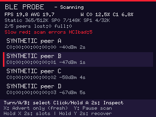 | 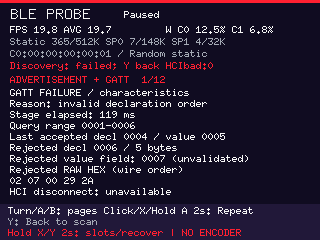 | 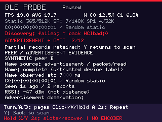 |

| Global first/all fault sources and radio clock |
| --- |
| 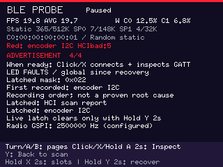 |

| Raw reset / ROM boot type | Retained previous stage and limits |
| --- | --- |
| 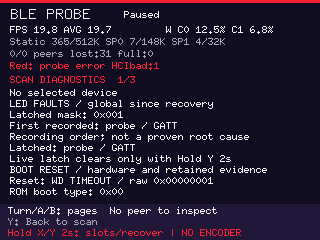 | 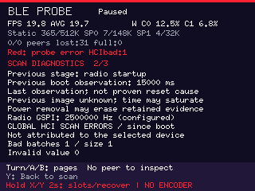 |

| Scanning | Paused photo view | Advertisement bytes |
| --- | --- | --- |
| 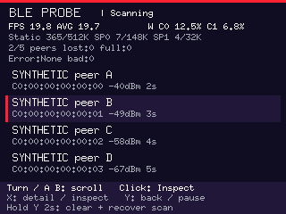 | 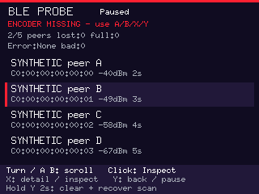 | 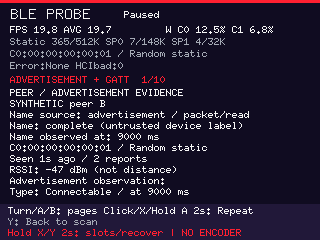 |

| Fresh advertisement view | No GATT inspection requested | Explicit inspection running |
| --- | --- | --- |
| 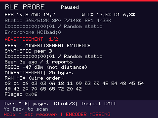 | 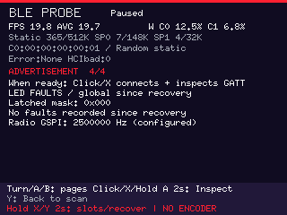 | 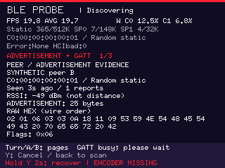 |

| Raw advertisement / service data | Name / scan response | GATT summary / connection timing |
| --- | --- | --- |
| 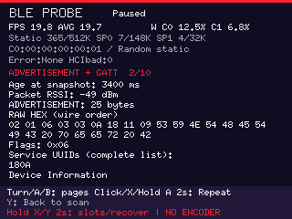 | 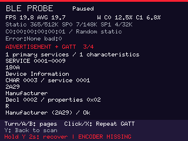 | 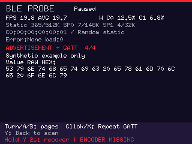 |

| Link / stages / cleanup | Services / characteristics | Characteristic properties |
| --- | --- | --- |
| 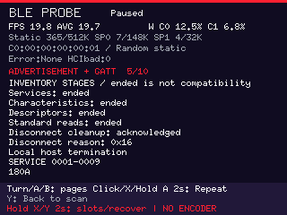 | 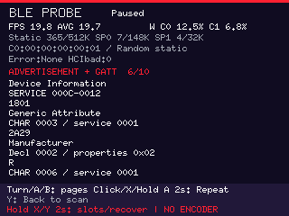 | 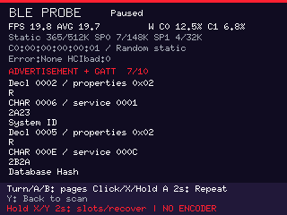 |

| Descriptor / standard read | Raw bytes / ATT 05 / database hash |
| --- | --- |
| 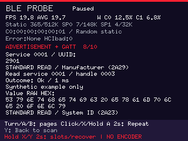 | 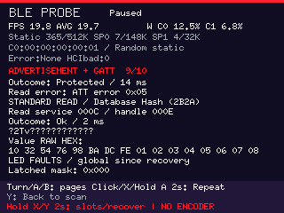 |

| Four slots | Confirm replacement | Confirm destructive Reset |
| --- | --- | --- |
| 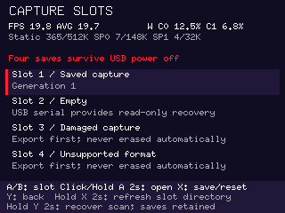 | 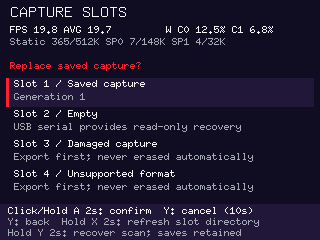 | 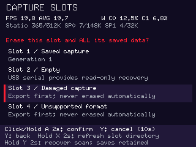 |

| Saving | Storage failure | Readable copy / replacement blocked |
| --- | --- | --- |
| 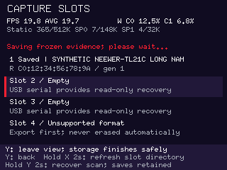 | 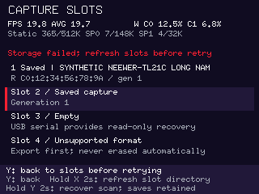 | 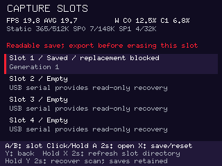 |

| Saved identity | Saved link / stages | Saved characteristic / descriptor |
| --- | --- | --- |
| 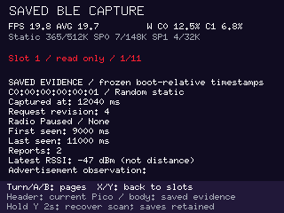 | 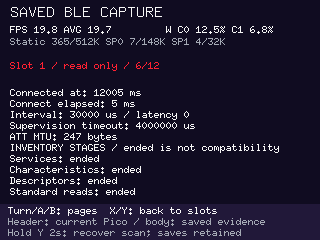 | 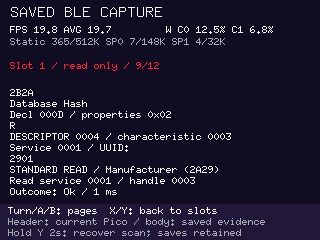 |

| Saved raw bytes / ATT 05 | Saved configured clocks / source digest |
| --- | --- |
| 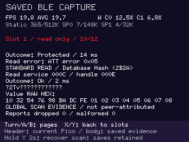 | 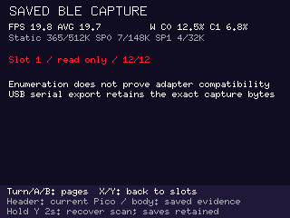 |

| Failure stage and retained context | Global scan errors without a peer |
| --- | --- |
| 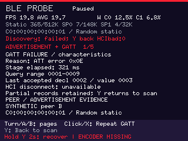 | 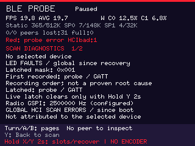 |

| Separate local/terminal evidence | Numeric report-length evidence |
| --- | --- |
| 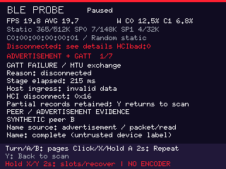 | 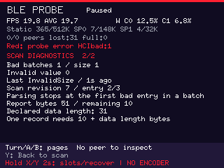 |

| Live terminal failure | Historical saved completion with abnormal termination |
| --- | --- |
| 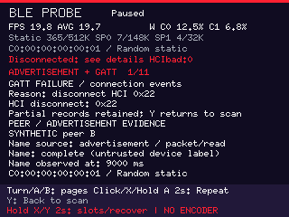 | 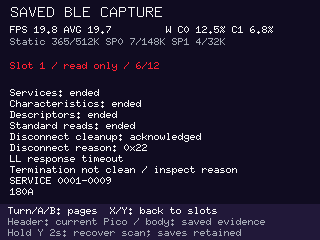 |

Regenerate the lossless RGB captures from `host/`:

```text
cargo run --locked --example ble_probe_gallery -- target/ble-probe-gallery
```

The generator writes 57 PPM files. To update the PNG documentation copies, use Python
with Pillow installed, from the same `host/` directory:

```python
from pathlib import Path
from PIL import Image

for source in Path("target/ble-probe-gallery").glob("*.ppm"):
    with Image.open(source) as picture:
        picture.save(Path("../docs/images/ble-probe") / source.with_suffix(".png").name)
```

## Implementation and verification

Core 0 owns CYW43439/PIO0 SM0/DMA1, SPI0/DMA0, I2C0, four buttons, backlight,
RGB and watchdog. Core 1 owns the bounded catalogue, inspection state and renderer.
Core 0 also owns USB CDC and the capture journal. Only owned messages and exclusive
framebuffer/capture-buffer/reply references cross cores through critical-section channels.
The sole storage owner waits for the reply reference to return before processing
another request. UI/supervisor startup messages are filled once before spawning;
the argument-free measured task futures avoid duplicate stack construction.
Explicit local saves/reset use bounded flash maintenance; USB list/export is
read-only. There are no ADC/VSYS reads or extra framebuffers. Rendering targets 20 software updates/s; this is
neither measured device FPS nor panel scanout.

The two 153600-byte buffers circulate through FREE/render/READY/transfer/FREE.
Transfer failure retains the buffer until watchdog reset; SPI/PIO/I2C futures
owning hardware are not timeout-cancelled. Separate input/status/report queues
and bounded drain counts prevent an advertising flood from starving controls.
Request generations reject late results; scan stop and terminal connection
cleanup precede any new operation. ATT timeout abandons the entire connection.
Cleanup snapshots retained local receive and controller reason evidence after
the wait, publishes it before the end event, and keeps the first operation
failure. An acknowledged abnormal termination stays saveable and latches red;
it does not falsely report an unacknowledged cleanup or discard the inventory.
Host-runner failure retains the CYW owner while recovery resets the device.

The shared progress monitor checks input/encoder/render/transfer work; radio
liveness observes actual bus boundaries, with a separate host-start deadline.
The checked build retains nonblocking RTT stage/revision/timing logs and filters
upstream info/debug traffic. RTT needs a debug probe to collect. USB CDC exports
saved captures, not a continuous log; the journal stores selected evidence, not
an RF trace or complete event history. Flash maintenance parks participating owners
for each bounded erase/program operation and resumes them between operations.

Tests cover malformed advertisement/GATT bytes, handle/offset overflow, standard
UUID aliases, capacities, stable selection, cancellation, stale results, missing
encoder progress, radio stalls, time-based animation, clipping and pagination.
Telemetry tests also cover suspended/cancelled polls, propagated errors, irregular
windows, counter wrap, clock regression, idle frames, stale work, invalid values
and pixel isolation from list/details/footer regions.
Failure regressions cover first-cause retention, late completion/cancellation,
repeat/recovery, valid partial rows, terminal handles, exact error-code mapping
and protected/unavailable values. Tests use the production report adapter with
the locked HCI decoder, including all 256 RSSI byte patterns, mixed valid/bad
batches and both parse-error kinds. Vendor wire tests exercise valid multi-page
discovery, normal end-of-list responses, malformed tuples and response matching.
Report tests cover every legal data length, payload/RSSI truncations, maximum
event-size batches, valid prefixes and missing length versus declared zero.
MTU tests cover both directions, crossed/early exchanges, all ATT error codes,
unsolicited values, one indication confirmation, local resource errors and remote
termination. Decoded HCI completion tests cover every status/reason byte; queue
overflow/drain and slot reuse check independent retained evidence. The production
session supervisor is tested with pending startup/inventory, simultaneous errors,
external cancellation, event completion and successful completion, including
dropping losing futures before cleanup. Stale context cannot cross generations.
Termination-policy tests cover all 256 reason bytes plus missing evidence,
receive faults arriving after completed inventory, first-cause retention,
inconsistent context, normal completion and recovery. The shared dashboard
policy preserves abnormal and specific operation faults during maintenance.
A deterministic 66,560-input ATT decoder sweep checks every opcode at lengths
0 through 64 with four seeded byte patterns and exhausts accepted iterators.
Explicit valid request families, empty values and 16/128-bit UUID cases check
that short-packet guards preserve valid traffic. This is bounded regression
coverage, not exhaustive enumeration of every possible packet or handler.
Maximum diagnostic values and every failure label are checked for text bounds;
pixel tests keep evidence separate from telemetry and the control footer.
CI checks stock/280 builds, strict nightly Clippy, Python gates and security-feature
exclusion. Software tests and conservative stack estimates do not qualify RF
interoperability, physical stack high-water, electrical margins or car data.

### Historical image measurements before persistent capture

The earlier checked 2026-10-19 build (`nightly-2026-10-18`, CPU280/SPI70, bounded info
logging) used **374632 bytes of static RAM** and left **149656 bytes for the
main stack and headroom**. Static RAM includes both 153600-byte framebuffers and
the 32768-byte core-1 stack. The largest emitted function frame was 5432 bytes;
the aggregate emitted frames totalled 19344 bytes against the unchanged 20480-byte
limit. The aggregate is a regression check, not simultaneous stack use;
the conservative named-path budgets include additional child and interrupt
reserves. These are linked-image/source-review results, not physical stack
high-water measurements. The frozen ELF, UF2, compiler options and source hashes
are recorded together by the checked wrapper.

The permanent telemetry added 440 static bytes against its preceding utility
image; the initial failure diagnostics added another 136 bytes. Retained
connection/scan context and startup supervision add 1336 bytes to that image.
A concrete pinned poll wrapper keeps each task future in one allocation;
bounded integer formatting avoids adding general float-formatting stack frames.
Synchronous ATT packet preparation keeps its temporary encoder out of the request
future. That preceding 280/70 image passed the practical image checks. These
historical figures do not describe the new capture/USB image. Its own linked
receipt must pass the unchanged memory/stack limits; host tests alone do not
establish this. CI also checks the stock profile. See the
[capture contract](ble-probe-captures.md) and
[dependency/source audit](../dependencies/probe-captures-2026-10-19.md).

References checked against actual locked sources:
[Pico 2 W datasheet](https://datasheets.raspberrypi.com/picow/pico-2-w-datasheet.pdf),
[PIM715](https://shop.pimoroni.com/products/pico-display-pack-2-8),
[Adafruit encoder pins](https://learn.adafruit.com/adafruit-i2c-qt-rotary-encoder/pinouts),
[board audit](../hardware/pico2w-board-audit.md),
[Trouble local corrections](../../firmware/vendor/trouble-host/LOCAL_PATCHES.md),
[utility ownership](../../firmware/ble-probe/src/tasks.rs),
[radio lifecycle](../../firmware/ble-probe/src/radio.rs).
