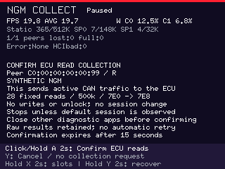
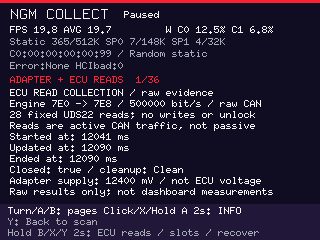
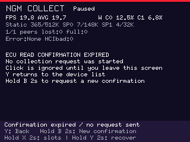

# NGM fixed ECU read collector

The separate `ngm-collector` research image adds a confirmed, finite engine-read
collection to the Pico 2 W/PIM715/5880 probe platform. Ordinary **Inspect remains
adapter-only**. Collection retains raw results for offline analysis; it does not
feed dashboard widgets, warnings or live measurements.

**Status, 2026-11-03:** offline implementation, paired review, native/ARM checks,
Python typing, documentation and source-bound stock/280-70 ELF/UF2 admission pass.
The [validation record](../validation/ngm-collector-2026-11-03.md) identifies the
checked artifacts, resource margins and remaining physical work. No collector
connection, CAN observation, exact-ECU qualification or physical stack/power-loss
test is claimed. The earlier
[INFO-only audit](../validation/ngm-identity-audit-2026-11-01.md) remains historical
evidence for that narrower image, not admission of this extension.

## Three separate policies

| Image | Linked tool byte | Explicit operation | USB product |
| --- | --- | --- | --- |
| `ble-probe` | 0 | Standard GATT inventory/read allowlist | `Pico BLE Probe Captures` |
| `ngm-identity` | 1 | Standard inventory, four vendor reads, one INFO | `Pico NGM Identity Captures` |
| `ngm-collector` | 2 | Adapter-only Inspect, or separately confirmed fixed ECU collection | `Pico NGM Collector Captures` |

The collector requires Cargo feature `ngm-collector`, which includes
`ngm-identity`; each binary still fixes its own tool kind and inspector alias.
Feature unification cannot turn the standard or INFO binary into a collector.
Radio dispatch and the collector path independently check the linked kind and
explicit selected peer. Boot scans only. USB, stored captures, names and saved
handles cannot authorize a collection. No utility pairs or bonds.

The collector is not a general adapter-information console. It adds the verified
adapter voltage primitive and the fixed reads below. RPC health/crash/filesystem
methods, periodic scheduling and undocumented vendor values remain outside the
allowlist even if another client exposes them.

## Confirmation and lifecycle

1. Select a fresh peer. Encoder click, two-second A hold, or X from live details
   still performs [INFO-only Inspect](ngm-identity.md#what-an-explicit-inspect-does).
2. Hold B for two seconds to open the ECU collection prompt. B release does not
   also advance selection. The prompt identifies the peer, fixed route and active
   CAN traffic. Confirm with a new encoder click or two-second A hold after the
   prompt frame has completed its display-driver transfer. Queued clicks from
   before that transfer cannot confirm it. Transfer completion is a software
   presentation boundary, not a measured LCD scanout instant.
3. Confirmation expires after 15 seconds. Expiry revokes consent but leaves the
   expired prompt visible; a late click cannot fall through into Inspect. Use Y
   to return or hold B to request a new prompt. Changed peer/type, request generation,
   busy phase, backward time, navigation, slot entry or recovery invalidates it.
   The selected advertisement must be no older than 30 seconds. Y cancels the
   prompt without requesting collection.
4. A confirmed collection creates one fresh connection, performs complete standard
   inventory and the same four scoped vendor reads and INFO as Inspect, then
   requests capacity admission on core 1. Missing/ambiguous endpoints, limited
   inventory, failed/truncated vendor reads or invalid INFO stop before collection.
5. Admission reserves the worst-case capture before even the adapter voltage query.
   Only then run Voltage, raw OPEN, fixed arbitration and `22 F1 86`. Continue only
   after the complete response **`62 F1 86 01`**. A new BLE connection does not
   establish the ECU's diagnostic session. Denial or any other session result
   stops later reads; there is no `10 01` fallback. This is one correlated
   observation of the reported session, not a session lock or proof that another
   tester cannot change it before a later read.
6. Read the remaining manifest once in order. A well-formed nonpending negative
   response is retained and the next listed read may run; it never triggers an
   unlock, alternate service, repeat or numeric result. After the final read, or
   a well-formed F186 denial/nondefault result, close only the fresh known handle.
   A malformed/uncertain/timeout/canceled exchange revokes further command permits
   and disconnects the transport instead of guessing a cleanup command.
7. Wait for actual link cleanup. Y during active collection requests cancellation
   while retaining the evidence generation and details until terminal publication;
   it does not discard pending raw evidence or start a new scan. Save the canceled
   result after Paused. A later Back resumes scanning; recovery deliberately clears
   live observations. Save before another inspection or recovery.

A matching adapter CLOSE acknowledgment is recorded separately from completion of
all reads and physical BLE cleanup. Green requires the ordinary live checks,
clean INFO, all 28 complete positive responses, the exact F186 default result,
complete retained terminal bytes and normal actual cleanup. Negative, partial,
unknown-send and early-stop outcomes remain non-green. Saved results never create
live green status. Positive raw data still do not qualify a numeric schema.

## Exact outbound application bytes

CANyonero framing is `1F TYPE LEN_HI LEN_LO BODY`, with a big-endian body length.
`H` below is the one-byte handle returned by this connection's OPEN response;
zero is not assumed invalid. There is no imported/default/all-channel handle.

| Operation | Exact request / expected response |
| --- | --- |
| INFO before collection | `1F 11 00 00`; bounded type `91` INFO reply |
| Adapter supply | `1F 12 00 00`; `1F 92 00 02 MV_HI MV_LO`, unsigned BE millivolts |
| Raw classical CAN OPEN | `1F 30 00 06 00 00 07 A1 20 00`; `1F B0 00 01 H` |
| Fixed arbitration | `1F 34 00 0F H 00 00 07 E0 00 00 00 07 E8 00 00 07 FF 00`; `1F 80 00 00` |
| One DID read | `1F 33 00 09 H 03 22 DID_HI DID_LO 00 00 00 00` |
| Correlated receive CTS | `1F 33 00 09 H 30 04 05 00 00 00 00 00` |
| Normal close | `1F 31 00 01 H`; exact `1F B1 00 01 H` |

OPEN selects protocol `00`, 500,000 bit/s, zero separation nibbles. Arbitration
uses normal 11-bit physical addressing: request `7E0`, response `7E8`, mask `7FF`,
zero extensions. Incoming `B2` requires the same handle, full numeric CAN ID
`000007E8`, zero extension and classical CAN payload bounds. Compressed `B3`,
coalesced envelopes/suffixes, unsolicited setup ACKs and unmatched replies fail
closed. Fragmented envelopes are retained within 245 bytes. Already queued
complete SDUs are checked before a subsequent request/CTS permit. This queue
check cannot observe incomplete assembly, lower-layer buffering or the instant
of physical arrival, and is not a guarantee that no other traffic exists.

There is no SEND acknowledgment accepted as a substitute for an ECU response.
Local SDU completion proves only local submission. ISO-TP CTS is transmitted only
for the outstanding read's correlated first frame/block: four CFs per block,
5 ms advertised separation and zero padding. A maximum 67-byte UDS response needs
at most three CTS frames. Oversized/foreign/unmatched first frames produce no CTS;
this collector does not send overflow FC. No host multi-frame request is needed.
The [Linux ISO-TP description](https://docs.kernel.org/networking/iso15765-2.html)
explains why response reception itself can require active FC traffic.

### Prohibited actions and trust boundary

Only the fixed bytes above can be constructed by the collector's request owner.
There is no arbitrary address, DID/PID, service, raw CAN payload or command input.
In particular, it does not request:

- UDS session control `10`, reset `11`, clear DTC `14`, security access `27`,
  communication control `28`, authentication `29`, dynamic DID definition `2C`,
  write DID `2E`, I/O control `2F`, routine control `31`, download/upload/transfer
  `34`–`38`, memory write `3D`, tester-present `3E`, timing/control services
  `83`/`85`/`86`/`87`, arbitrary memory read `23` or periodic DID service `2A`.
- OBD clear/control services `04`/`08`, functional `7DF` scans, TCU routes,
  identifier-range searches, alternate protocols or background polling.
- Adapter ISO-TP mode `01`, automatic-FC raw mode `05`, periodic start/stop,
  abort-transfer `39`, firmware update `40`–`42`, reset `43`, RPC `50`, binary-file
  retrieval `51`, compressed sending, alternate SPSMs or retries.

Tester-present is a diagnostic keepalive service and is prohibited. ISO-TP CTS
is a separately correlated transport response and is intentionally allowed.
Raw OPEN/configuration are adapter channel operations, distinct from a CAN SEND;
they still change adapter state. Reads themselves are active ECU communication
and can affect processing/timers or keep a network awake.

Public client implementations establish intended raw-mode semantics, not the
private NGM server's complete behavior. This software cannot prove absence of
adapter-autonomous traffic, prior periodic jobs, CAN controller ACK/error/retry
activity, stale internally queued frames, or all electrical/ECU side effects.
The incoming envelope also does not independently expose every physical IDE/RTR
flag. The defensible guarantee is the closed **host-requested command policy**,
not a claim that the adapter or car cannot change any state.

## Fixed manifest and interpretation

The order below is compiled: nine identity/session entries, seven widget-related
entries, then twelve owner-confirmed OBDeleven channels, each unique once. Every
UDS request is `22` followed by the displayed two-byte DID. Positive replies must
start `62 DID_HI DID_LO` and retain 1–64 data bytes; a negative reply is exactly
`7F 22 NRC`. NRC `78` may occur three times within the original deadline; a fourth
stops the collection. Other NRCs remain exact raw values.

`u16BE`/`i16BE` are unsigned/signed big-endian 16-bit values. Widths below exclude
the three-byte positive header. A known width enables only the stated **unqualified
family interpretation**. Wrong widths remain raw with a mismatch marker; unknown
schemas never acquire a guessed value. No sentinel/plausibility or exact ECU
qualification is implied by a formula.

| Order | DID | Meaning | Data bytes / optional candidate |
| --- | --- | --- | --- |
| 1 | F186 | Active diagnostic session | Raw; continuation requires exact one-byte `01` |
| 2 | F19E | ASAM/ODX identifier | Raw, no assumed string/width |
| 3 | F1A2 | ASAM/ODX version | Raw |
| 4 | F187 | VW spare-part number | Raw |
| 5 | F189 | Application software version | Raw |
| 6 | F191 | ECU hardware number | Raw |
| 7 | F1A3 | ECU hardware version | Raw |
| 8 | F197 | System name / engine type | Raw |
| 9 | F1AD | Engine code letters | Raw |
| 10 | 39C0 | Manifold absolute pressure | 2, `u16BE / 10` kPa absolute |
| 11 | 13CA | Ambient absolute pressure | 2, `u16BE / 120.60176665439` kPa absolute |
| 12 | 202F | Oil temperature | 2, `(u16BE - 2731.4) / 10` °C |
| 13 | 11CD | Coolant temperature | 1, `A - 40` °C |
| 14 | 1001 | Simos intake temperature | 1, `0.75*A - 48` °C |
| 15 | 14A6 | ECU module voltage | 1, `13*A / 128` V |
| 16 | 10C0 | Actual lambda | 2, `u16BE / 1024`, dimensionless |
| 17 | 2006 | Oil fill level | Owner-confirmed channel; raw schema unknown |
| 18 | 200A | Timing retardation, cylinder 1 | Owner-confirmed; 2, `i16BE / 100` degrees |
| 19 | 200B | Timing retardation, cylinder 2 | Owner-confirmed; 2, `i16BE / 100` degrees |
| 20 | 200C | Timing retardation, cylinder 3 | Owner-confirmed; 2, `i16BE / 100` degrees |
| 21 | 200D | Timing retardation, cylinder 4 | Owner-confirmed; 2, `i16BE / 100` degrees |
| 22 | 2029 | Charge air pressure, specified | Owner-confirmed; 2, `u16BE / 10` kPa absolute |
| 23 | 202A | Charge air pressure, actual | Owner-confirmed; 2, `u16BE / 10` kPa absolute |
| 24 | 2065 | Charge Pressure Actuator, acknowledgment | Owner-confirmed; raw schema unknown |
| 25 | 293E | Charge press. ctrl., adapt. higher than max. threshold | Owner-confirmed; raw schema unknown |
| 26 | 293F | Charge pressure control, less than min. threshold adaptation | Owner-confirmed; raw schema unknown |
| 27 | 29BF | Intake air temperature, unconditioned voltage | Owner-confirmed; raw schema unknown |
| 28 | F40F | Intake air temperature | Owner-confirmed; raw only; no OBD-mirror decoder assumed |

Owner confirmation establishes that the twelve labels work in OBDeleven; it does
not independently provide their raw wire layouts. Identity labels and the other
formulas are public family evidence. Exact support/default-session access on the
2019 DNUC ECU remains unqualified. The `7E0/7E8` route and 500 kbit/s configuration
are source-backed candidates, not a measured connection on this deployment.

Existing boost, oil, coolant, IAT, module-voltage, lambda/AFR and four-cylinder
retardation research is represented. Gauge boost requires qualified manifold and
ambient samples with appropriate age/skew; absolute charge pressure is not gauge
boost or interchangeable with manifold pressure. AFR needs an explicit fuel
assumption. The four retardation reads are separate observations, not an atomic
snapshot. DSG oil/TCU and EGT remain unavailable; no speculative substitute was
added. Oil level is not oil temperature, and unconditioned sensor voltage is not
a temperature measurement. No VIN, ECU serial or workshop fingerprint read is
included. Additional research candidates remain outside this manifest.

## Deadlines, failure and evidence capacity

The unchanged prelude uses connect 8 s, discovery 30 s, vendor/parameter phase
15 s (each read at most 3 s), CoC open 5 s, INFO send 2 s and reply 2 s. Only the
explicit collector gives the post-INFO owner a 90 s ceiling including admission,
collection and cleanup. Final INFO publication must still finish strictly before
the original INFO reply deadline; it cannot consume the longer collector allowance.
Admission has a 2 s deadline. Collection has an immutable
80 s total deadline and 2 s per command/read, including local submission. CTS
and NRC78 do not renew that deadline; ISO-TP inter-frame/CTS completion is capped
at 1 s and by the read deadline. Actual teardown shortens the remaining allowance
to at most 5 s; failure before valid INFO retains the original short cleanup policy.
Reliable terminal evidence publication can then wait for queue capacity; these
wire/cleanup deadlines are not a promise that the UI reaches Paused within 90 s.

Partial send is recorded as attempted with unknown effects until full local
completion is observed. It cannot authorize retry, a guessed CLOSE or another
request. First failures, actual cleanup and retained bytes remain distinct.
The latest envelope/payload prefix is not a full wire transcript. Watchdog/reset
or unconfirmed cleanup can lose unsaved RAM evidence; software cannot guarantee
a save after every failure.

[Capture v6](ble-probe-captures.md#collection-evidence-v6) keeps exactly 28 rows,
including unattempted entries, plus an optional terminal prefix up to 245 bytes.
Each row retains up to 67 raw UDS bytes and attempt/submission/result times. The
four GATT record counts remain separate. Metadata contains only a small summary;
raw rows are borrowed during decode/export.
The pending NRC count is published with the completed reply's row header. A
timeout or incomplete exchange may retain zero despite earlier pending replies;
this field does not preserve intermediate pending history.

The shared ISO-TP receiver now lends completed payload bytes to the collector;
the collector copies only its admitted response of at most 67 bytes into its
existing evidence buffer. The borrowed receive API uses the same parser as the
owned API and does not enlarge the collector's wire allowlist. Cross-core updates
still carry owned chunks of at most 64 bytes. The live UI keeps one resident model,
capture workflow and decoder; collection storage initializes its 28 rows in place
only when activated and hides inactive capacity. These ownership choices avoid
whole-evidence moves in the source, but do not themselves establish linked stack
or RAM admission. Current image/resource gates remain required.

Before collection Voltage, the same production serializers reserve 3,260 bytes
for maximal collection summary/rows/terminal data plus 512 bytes for later
metadata growth. The bounded remaining growth is conservatively at most 430
bytes; frozen GATT/vendor/raw INFO bytes cannot expand afterward. Admission
refuses the whole collection if the existing evidence plus reserve exceeds the
unchanged 8,192-byte slot payload. It does not silently drop inventory or rows.
The four-slot journal, USB protocol and explicit replacement/Reset policy remain
unchanged. No save/export action creates BLE or CAN requests.

## Build and prepare one useful visit

From the repository root, after the current integration gates have passed:

```powershell
./firmware/scripts/Build-NgmCollector.ps1 -Name ngm-collect-stock-01 -Profile stock
# Optional explicitly selected experimental profile:
./firmware/scripts/Build-NgmCollector.ps1 -Name ngm-collect-280-01 -Profile 280-70 -Expert
```

The wrapper mirrors [identity build admission](ngm-identity.md#build-and-image-identity):
unique 1–64 character ASCII attempt name, stock default, explicit Expert for
`280-70`, no automatic device opening or flashing. Artifacts are
`firmware/target/ble-probe-captures/<name>/ngm-collector.elf` and `.uf2` with the
source/build/check receipts. Utility manifest schema 2 binds tool `ngm-collector`
to linked discriminator 2; this is separate from capture payload v6. Preserve
Cortex-M33 target, two fixed framebuffers, stack reserves and every image gate.
A prior INFO image receipt cannot admit this new image.

For a later separately authorized visit:

1. Export and byte-check all four existing slot binaries before any firmware
   change. Keep their JSON/text and exact build receipts. Select and explicitly
   authorize the checked collector image/device through the existing flashing
   process; this document grants no flash authorization.
2. Bring the checked image, USB power/data cable and a plan for which slot may be
   replaced. Record adapter identity, ECU/software information already known,
   ignition/engine state, phone/app connection and exact operator action in notes.
   These are operator observations, not inferred capture fields.
3. Close other diagnostic applications. Select the intended fresh peer and use
   the separate B-hold confirmation. One confirmed connection includes INFO and
   the finite read collection; a preliminary Inspect is optional, not required.
4. Wait for Paused/cleanup and save useful negative, partial or canceled evidence
   before navigating away or retrying. Use hold X for slots and explicit overwrite
   confirmation when needed. A healthy full slot can be replaced without Reset.
5. Reopen the saved slot, then export using the [read-only PC workflow](ble-probe-captures.md#recover-captures-on-a-pc).
   Keep `.blecap`, JSON, text and notes together. Inspect raw widths/results offline
   before proposing any decoder change. A repeat requires a concrete evidence
   question and another explicit confirmation; there is no automatic retry.

USB power removal does not power off an OBD-powered dongle. No one-visit guarantee,
physical adapter compatibility or exact ECU support follows from these preparations.
Studio capture import and vehicle-profile qualification remain separate future work.

## Source evidence and implementation

Reviewed immutable primary sources:

- [CANyonero constructors](https://github.com/Automotive-Swift/Swift-CANyonero/blob/78091bb5599c4f5e3002fbd5700b826a625e8b04/Sources/libCANyonero/Protocol.cpp#L295-L339),
  [protocol modes](https://github.com/Automotive-Swift/Swift-CANyonero/blob/78091bb5599c4f5e3002fbd5700b826a625e8b04/Sources/libCANyonero/include/Protocol.hpp#L82-L100)
  and [raw client setup](https://github.com/Automotive-Swift/Swift-CANyonero/blob/78091bb5599c4f5e3002fbd5700b826a625e8b04/python/ecuconnect_tool/ecuconnect_tool/ecuconnect.py#L346-L382).
  Current upstream `a02493cfc7ae8a1c34e63a882c94c96feedfec8f` was compared for these
  primitives; newer periodic/abort facilities are not admitted.
- [VW_Flash parameter table](https://github.com/bri3d/VW_Flash/blob/293f46d782bae2ced930497889b71eb782f122cb/logs/csv/parameters_22.csv),
  [logger byte interpretation](https://github.com/bri3d/VW_Flash/blob/293f46d782bae2ced930497889b71eb782f122cb/lib/simos_hsl.py)
  and [identity/route catalogue](https://github.com/bri3d/VW_Flash/blob/293f46d782bae2ced930497889b71eb782f122cb/lib/constants.py).
- [SimosTools definitions](https://github.com/Switchleg1/SimosTools/blob/f99771ceb0442c863601a84a282c6e67e6b311a8/app/src/main/java/com/app/simostools/PIDs.kt)
  and [MQB exported variables](https://github.com/bri3d/MQBSimosLogVariables/blob/747b50e1af650c39cd9c5f6b4d58905db6debb45/exportedPIDs.csv)
  corroborate selected family candidates, not this ECU's exact support.
- [AUTOSAR DCM R21-11](https://www.autosar.org/fileadmin/standards/R21-11/CP/AUTOSAR_SWS_DiagnosticCommunicationManager.pdf),
  SWS_Dcm_00433/00434/00435/00819, describes read/session/security/mode gates;
  [Linux ISO-TP](https://docs.kernel.org/networking/iso15765-2.html) describes physical
  addressing and frame/flow-control semantics. Neither identifies this ECU's implementation.

The actual policy resides in the [closed catalogue](../../crates/dashboard-core/src/ble/canyonero/reads.rs),
[command owner](../../crates/dashboard-core/src/ble/canyonero/collection.rs),
[portable collector flow](../../firmware/ble-probe/src/collection_flow.rs),
[radio adapter](../../firmware/ble-probe/src/identity_radio.rs),
[evidence model](../../crates/dashboard-core/src/discovery/collection.rs) and
[capture codec](../../crates/dashboard-core/src/discovery/capture/collection_codec.rs).
The [shared ISO-TP receiver](../../crates/dashboard-core/src/diagnostics/isotp.rs)
and [resident UI owners](../../firmware/ble-probe/src/ui.rs) define the bounded
buffer lifetimes; these are implementation contracts, not physical observations.
Host tests cover literal command vectors, stale/duplicate/foreign/oversized input,
ISO-TP sequence and FC authority, deadlines, cancellation/unknown submission,
raw publication, format limits, legacy fixtures and status qualification. Target
image/stack gates and physical observations remain separate evidence classes.

## Synthetic renderer examples

These images use the production renderer and synthetic evidence. They are not
photographs, actual ECU values, or proof of hardware operation.






