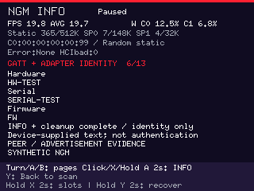
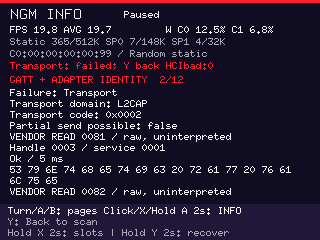

# NGM INFO-only identity utility

The separate `ngm-identity` firmware reuses the Pico 2 W/PIM715/5880 probe's
display, controls, diagnostics, four capture slots and USB exporter. It performs
one explicitly selected adapter identity trial and preserves enough raw evidence
for later offline analysis. It does not provide dashboard vehicle measurements.

**Status, 2026-10-27:** offline implementation, regressions, source provenance and
linked ELF/UF2 admission passed for both utilities at stock and 280/70 clocks.
The dashboard's shared BLE path also passed its practical image gate. Exact
artifact identities and limits are in the [validation record](../validation/ngm-identity-2026-10-24.md).
There has been no live NGM identity-tool connection, flash, CoC acceptance test or
physical power-cut validation in this implementation wave. The runbook below is
for a future separately authorized device session; it is not a record of one.

## Separate images and policy

| Identity | Standard discovery | INFO-only trial |
| --- | --- | --- |
| Cargo package | `dashboard-ble-probe` | `dashboard-ble-probe` |
| Binary / output basename | `ble-probe` | `ngm-identity` |
| Required identity feature | None | `ngm-identity` |
| Firmware program name | `pico2w-ble-probe` | `pico2w-ngm-identity` |
| Display title | `BLE PROBE` | `NGM INFO` |
| Normal USB product | `Pico BLE Probe Captures` | `Pico NGM Identity Captures` |
| Linked tool discriminator | 0 | 1 |
| Selected-peer work | Standard inventory and allowlisted reads | Standard inventory, four scoped vendor reads, one candidate CoC and INFO |

Tool kind is a private compile-time constant in each binary. Labels and the
linked discriminator derive from that constant; a fixed inspector alias in the
same entrypoint selects the operation. Compiling the ordinary binary with
the identity feature still selects the ordinary standard-only path. There is no
runtime switch, USB command or saved capture that upgrades its traffic policy.
Default firmware builds remain the dashboard, and neither utility is a Studio
flashing option. Both retain the no-security feature guard, no pairing/bonding,
no characteristic/CCCD writes and no saved-handle reuse.

The only outbound application message on the identity channel is **`1F 11 00 00`**,
the public CANyonero INFO request. No automotive OPEN/SEND, ECU read, voltage
command, reset, RPC, free-form command console, background polling, alternate PSM
search or automatic retry is available. BLE discovery/control messages and the
four scoped GATT reads are separate transport operations.

## What an explicit Inspect does

1. Start identity evidence before connecting to the selected fresh advertisement.
   An old selection requires scanning again; nothing connects automatically.
2. Perform the ordinary bounded standard inventory/read procedure. Require exactly
   one freshly inventoried `FFF1` service and exactly one readable characteristic
   for each of `0081`, `0082`, `FFF2`, `FFF3` within it. Missing, duplicated or
   nonreadable endpoints stop the attempt; historical handles are never inputs.
3. Read those four discovered values, retaining at most 64 bytes each. Protected
   or unavailable ATT outcomes remain evidence; no unlock or security escalation
   follows. A full 64-byte read is conservatively truncated. Such limited reads
   prevent clean success even when a subsequent INFO reply parses. Local read or
   timeout failures stop work and clean up the connection.
4. Try **one configured SPSM 129** channel. This is a compatibility candidate from
   public source pinned at `78091bb5599c4f5e3002fbd5700b826a625e8b04`, not a discovered
   or measured dynamic SPSM. Vendor values remain opaque. No candidate enumeration
   or fallback occurs. The local offer is MTU 245 bytes, MPS 247 bytes and one
   initial receive credit, backed by the bounded packet pool.
5. Submit the four INFO bytes once as one SDU and receive a bounded reply. The
   decoder requires marker `1F`, INFO response type `91`, a big-endian body length
   and five LF-separated UTF-8 fields: vendor, model, hardware, serial, firmware.
   One final LF is accepted. Empty fields mean unavailable. Each field is at most
   64 bytes and the complete frame at most 245 bytes; control characters, wrong
   count/type/length, extra bytes and remote negative replies are explicit faults.
6. Close the channel and complete link cleanup. There is no second request on that
   attempt. Generation changes cancel work and stale events cannot attach to the
   next peer/inspection. Confirmed normal termination is checked separately from
   application parsing and local submission.

Whole-stage budgets are connect 8 s, discovery 30 s, parameter/vendor-read phase
15 s, CoC open 5 s, INFO send 2 s, INFO reply 2 s and cleanup 5 s. Each vendor read
also has a 3 s cap within its phase budget. Receiving more bytes does not extend
the reply deadline. An unconfirmed cleanup is a terminal fault; it does not
release the connection's journal-mutation exclusion or promise a save before
watchdog recovery. Unsaved RAM evidence can be lost on reset.

These are local resource and admission policies. They are not measured adapter
limits, interoperability guarantees, authentication or evidence of ECU support.
The source contract is documented by the shared
[codec](../../crates/dashboard-core/src/ble/canyonero.rs),
[session](../../crates/dashboard-core/src/ble/canyonero/session.rs),
[portable flow](../../firmware/ble-probe/src/identity_flow.rs) and
[radio adapter](../../firmware/ble-probe/src/identity_radio.rs).

## Build and image identity

Use the [probe's Windows prerequisites](ble-probe.md#build-from-the-command-line).
From the repository root, choose a fresh attempt name:

```powershell
./firmware/scripts/Build-NgmIdentity.ps1 -Name ngm-stock-01 -Profile stock
# Explicit experimental owner-requested profile:
./firmware/scripts/Build-NgmIdentity.ps1 -Name ngm-280-01 -Profile 280-70 -Expert
```

`Name` is required, 1–64 ASCII letters/digits/underscore/hyphen, starting with a
letter or digit. `Profile` is `stock` (default) or `280-70`; the latter requires
`-Expert`. The owner's reported working overclock does not qualify electrical
margins. The wrapper builds/checks only and never opens or flashes a device.

Both utility wrappers use `firmware/target/ble-probe-captures/<name>/`; names must
be unique across both tools. This image's files are `ngm-identity.elf` and
`ngm-identity.uf2`, alongside commands, source inventory, clocks, `manifest.json`
and the image-check result. Utility **manifest schema 2** records
`tool: "ngm-identity"`; the checker compares it with the one-byte value 1 in ELF
`.probe_tool`/`BLE_PROBE_TOOL_KIND`. The source digest has a separate 32-byte marker.
Changing filenames or pairing the wrong manifest with an image cannot select a
different tool. Both retain `thumbv8m.main-none-eabihf`, Cortex-M33, two fixed
153600-byte framebuffers, the 32 KiB core-1 stack and existing memory/flash gates.

A developer compile alone is not image admission. For future flashing, first
obtain a passing receipt for the exact current source/image and follow the
[explicit device checks](ble-probe.md#explicit-bootsel-flashing), substituting
the identity attempt directory and `ngm-identity` basename throughout. Export
existing captures before changing firmware. A build, readback or reboot request
does not validate radio interoperability or physical operation.

## Future garage runbook

The aim is one prepared visit for useful evidence, including a failed attempt;
no procedure guarantees that one visit will resolve every transport question.

1. **Prepare at the PC.** Preserve existing slot exports; obtain/check the exact
   identity artifact and separately authorize/select the device for flashing.
   Check the `NGM INFO` title and that a slot can be intentionally reused.
   Record the build receipt. Plan operator notes for adapter model, power/ignition
   state, connected phone/app and exact action; firmware cannot infer these.
2. **At the adapter.** Power the Pico by USB and close any phone connection that
   prevents advertising. Select the intended fresh peer by observed address/name;
   these are labels, not authenticated identity. Short X on the list opens only
   advertisement evidence. Encoder click, two-second A hold, or X in evidence
   starts the explicit identity inspection. Do not repeat automatically on error.
3. **Retain the result.** Wait for Paused and review the first fault, cleanup and
   identity evidence pages. Save partial/read-denied/open-refused/malformed/timeout
   results too. Hold X for two seconds, choose slot 1–4, tap X and explicitly
   confirm replacement if occupied. Wait for the new generation, then reopen that
   saved slot. A later inspection replaces live evidence, so save first.
4. **Keep saved evidence intact.** Photograph the failure/summary if helpful.
   Two-second Y recovery clears live observations and the fault latch, not saves.
   Reset is a distinct destructive action for a selected blocked/damaged slot;
   it is not required before replacing a healthy slot. A terminal watchdog fault
   can lose unsaved evidence and may prevent step 3; record what remains visible.
5. **Back at the PC.** Leave the utility installed, connect normal USB without
   BOOTSEL and follow the [read-only export workflow](ble-probe-captures.md#recover-captures-on-a-pc).
   The same `ble_probe_captures` CLI handles both products. Export to a new
   directory; retain binary, JSON, text and build/operator notes together. Offline
   decode can produce improved reports later without another adapter connection.

USB power removal does not switch off an independently OBD-powered adapter.
The [hardware guidance](../../hardware/README.md) remains applicable. Repeated
attempts, cold starts, changed settings or additional commands require their own
concrete evidence question; this tool does not enable them automatically.

## Capture and interpretation

Both current utilities write **capture payload v5**, read legacy v1–v4 and keep
the four-slot journal, USB framing and 8192-byte payload limit unchanged. The
identity extension retains explicit producer mode, candidate/source policy, four
vendor read outcomes, offered/actual directional limits, request submission,
first fault, cleanup, boot-relative times and the raw INFO prefix. There is no
UTC claim. Schema integers are little-endian; the original INFO header remains
unchanged in raw bytes with its protocol-defined big-endian length.

| Observation | Interpretation |
| --- | --- |
| Configured candidate 129; discovered SPSM null | A source-configured trial, even if an open succeeds |
| Offered local MTU/MPS/credits | Requested values; not evidence of peer acceptance |
| Observed local/peer MTU/MPS | Directional receive limits after successful open, separate from ATT MTU |
| CID/remaining-credit nulls | The current adapter does not expose these snapshots; unavailable is not zero |
| Complete request submitted | Local SDU submission completed; not a peer-processing acknowledgment |
| Raw prefix and total bytes/SDUs | Up to 245 retained bytes and owner-delivered ingress counts; lower-layer rejected traffic may be absent |
| Parsed five fields | Derived untrusted UTF-8 claims, available only with all observed bytes retained and a valid frame |
| First fault plus final cleanup | Original stage/time/domain/code and independent termination result; cleanup does not erase an earlier fault |
| Clean identity result | Valid complete INFO, four clean/nontruncated reads, established limits and normal cleanup; not adapter authentication or ECU support |

The display adds bounded identity, vendor-read, transport and raw pages while
keeping current telemetry. Green requires the ordinary live clean-completion
checks **and** clean identity evidence. Saved successful evidence remains amber;
faults remain red until explicit recovery. Full raw values remain in export.
The ordinary probe can display saved identity evidence without sending INFO.

JSON adds `identity_tool_mode` and `ngm_identity`; v1–v4 have both null. A v5
identity-mode advertisement-only save has true mode with null trial evidence.
The existing naming `identity` and binary content hash remain unchanged: INFO
model or serial never renames the files. Missing/protected/truncated vendor
values, remote error types, partial frames, raw `u16` transport codes and omitted
bytes remain inspectable. See the [capture format](ble-probe-captures.md#identity-trial-evidence).

Loading and exporting never rewrite old slots. Unknown formats in either physical
copy still block replacement until explicit Reset; a supported sibling may
remain readable. Save/Reset and connections share an exclusive operation gate,
held through actual cleanup/page restoration. Older firmware/exporters may reject
v5: export first and keep the original binary before downgrading.

The [future Studio handoff](ble-capture-studio-handoff.md) remains disabled with
no profile and no reusable handles. Neither parsed INFO nor a successful CoC
trial establishes authentication, voltage, channel setup for automotive traffic,
ECU addressing, DIDs, scaling or live DNUC data. Those are separate qualification
tasks. Host regressions cover bounded parsing, lifecycle failures, fresh endpoint
admission, partial publication, v1–v4 compatibility, maximum capture capacity and
offline export. They do not establish physical stack high-water, USB/RF behavior,
flash endurance or power-cut safety.

## Synthetic renderer gallery

These 320×240 images come from the production shared renderer using synthetic
host-side models and encoded captures. They are not photographs or evidence of
hardware operation. All device values and telemetry shown are synthetic.



*Synthetic successful trial, live page 6 of 13: derived hardware, serial and
firmware fields, clean INFO/cleanup, and the device-text authentication caveat.*



*Synthetic refused channel, live page 2 of 12: L2CAP domain, raw code `0x0002`,
partial-send status and retained vendor-read evidence.*

The [gallery example](../../host/examples/ble_probe_gallery.rs) generated 226
pages on 2026-10-24. Its 165 identity/legacy pages cover success (28), refusal
(27), truncated raw evidence (28), maximum identity fields (32), maximum counters
(30), and frozen legacy v1/v4 captures (10 each), including live and saved views
where applicable. All seven scenario contact sheets were visually inspected;
full-width counters, wrapped 64-byte fields and unavailable observations remained
visible. Reproduce from `host/` with:

```powershell
cargo run --locked --example ble_probe_gallery -- target/ngm-gallery-20261024-final
```

The example emits PPM images; the two PNGs above are lossless conversions of
`ngm-success-live-05-synthetic.ppm` and `ngm-refused-live-01-synthetic.ppm`.
