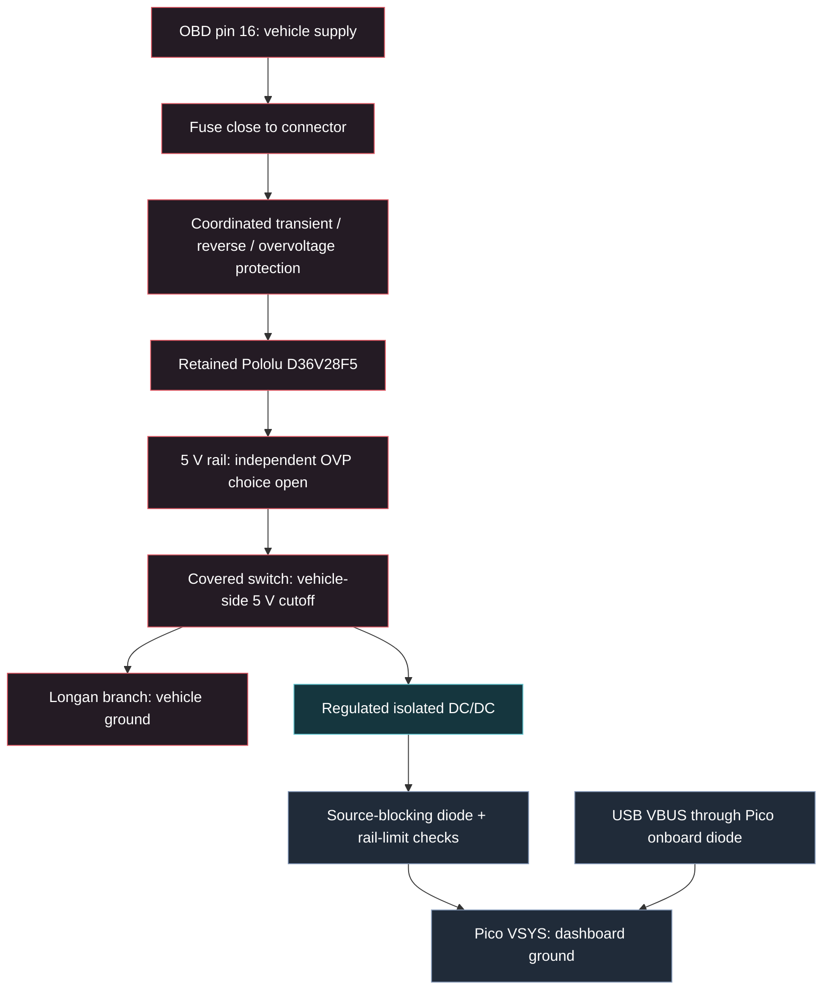
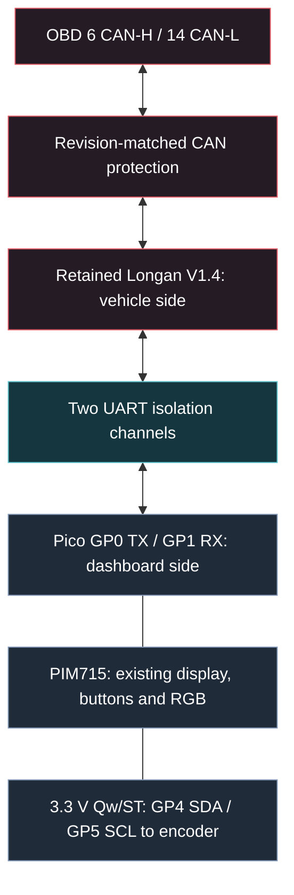

# Historical isolated Longan module build

**Superseded on 2026-10-18:** the selected route is now a USB-powered Pico 2 W,
PIM715, retained Adafruit 5880 encoder and the BLE prototype. See
[current hardware](README.md) and [BLE runtime](../docs/vehicle/ble-runtime.md).
Longan, Pololu, the covered switch, isolation modules and added capacitors below
belong to the earlier wired alternative. This record preserves component research
and unresolved checks; it is not the current purchasing or assembly plan.

Design checkpoint: 2026-10-17; Longan identification updated 2026-10-18.
The owner selected **isolated Longan**, mostly
ready-made parts with some soldering, and the existing covered switch on the
vehicle-side **5 V branch**. A custom PCB is not the default. This document
turns the [hardware audit](protection-plan.md) into a practical shortlist;
**conditional entries are not yet a purchasing or soldering instruction**.

## Earlier selected arrangement

- Retain Pico 2 W/PIM715, Adafruit 5880, Longan V1.4, Pololu D36V28F5 and
  Adafruit 3218. Bluetooth remains an unselected alternative.
- Use an assembled regulated isolated converter and an assembled UART isolator.
  Keep vehicle and dashboard grounds separate, including switch illumination.
- Put the covered switch after the regulated-rail protection, before the split
  to Longan and the isolated converter. It removes their incoming vehicle power.
- Unplug OBD for long parking and whenever physical disconnection from CAN is
  needed. No automatic CAN relay or second master switch is selected.
- Allow a clean restart after a supply dip. The intended sequence is **switch
  off → start engine → switch on**. Keep capacitors for smoothing; no battery,
  supercapacitor or dedicated crank ride-through circuit is selected.
- Group Longan, Pololu and added modules near the display, with approximately
  **1 m maximum OBD cable** and **20 cm maximum encoder cable**. Keep the 5 V
  and UART runs local. These approved layout targets still need thermal and
  signal-integrity checks; maintain the isolation gap through connectors/mounts.

The [historical protection plan](protection-plan.md) and
[wiring reference](wiring-diagram.txt) retain the earlier power and signal domains.
Protection remains design work to close, not a claim about an installed module.

## Earlier power and signal diagrams

These preserve the superseded wired architecture. Protection blocks remain
unqualified design work; the selected USB/BLE route uses neither diagram.

## Conditional BOM

| Item | Quantity | Candidate or retained part | Status / remaining check |
| --- | --- | --- | --- |
| Dashboard and controls | 1 set | Owned Pico 2 W, PIM715, Adafruit 5880 | Retain; measure peak demand with Full brightness and the intended profile |
| CAN adapter | 1 | Owned Longan Serial CAN Bus V1.4 | ATmega168PA and `662K` regulator marking identified; actual rail/load margin and termination remain open |
| Vehicle buck regulator | 1 | Owned Pololu 3782 D36V28F5 | Retain; check startup/load voltage and enclosure temperature |
| Covered cutoff | 1 | Owned Adafruit 3218 | Selected on vehicle-side 5 V; check total branch current, inrush and LED visibility |
| Isolated power | 1 | **XP Power ITX0505SA**; alternative **Traco TMR 6-0511** | Regulated through-hole modules; conditional on power/thermal checks below |
| UART isolation | 1 | **MIKROE-6518 DIGI Isolator 3 Click** | Assembled candidate; local supply/threshold and jumper checks below |
| External source blocking | 1 | Schottky diode into Pico VSYS | Select from measured current, hot leakage and forward drop; this is not an overvoltage clamp |
| OBD harness and fuse | 1 set | Keyed plug, inline holder near pin 16, rated wire and strain relief | Rating follows actual load/inrush, wire and fault-interruption requirements |
| Input and rail protection | 1 set | Coordinated automotive input protection; independent rail OVP if required by the selected fault envelope | No inexpensive ready-made combination has yet closed all failure cases; see below |
| Bypass and bulk capacitors | Initial candidates: one per bulk node | Panasonic FR **100 µF / 63 V EEUFR1J101L** and **220 µF / 50 V EEUFR1H221**, plus fitted local bypass | [Exact ratings, Allegro offers and placement](capacitors.md); additions depend on inrush, damping and module requirements |
| CAN protection | As required | Match the fitted SIT65HVD230 | No reviewed generic CAN TVS is admitted yet |
| Assembly | 1 set | Insulated enclosure, standoffs, locking connectors, heat-shrink and supported solder joints | Compact layout selected; size enclosure from modules and heat/clearance checks; no solderless breadboard in the car |

No Click host, extra microcontroller or MIKROE programming tool is needed for
the isolator's electrical signal path.

### Power module choice

[XP's ITX datasheet, pp. 1–5](https://www.xppower.com/portals/0/pdfs/SF_ITX.pdf)
specifies **ITX0505SA** as 4.5–9 V input, regulated 5 V/1.2 A output, with no
minimum load. Its 5 V models start derating at **55°C**, despite the 65°C
headline. At 70°C, the stated linear curve permits about 3.94 W. The 3300 µF
capacitive-load limit is a ceiling, not a recommended capacitor. `ITX0505S`
without the `A` is a different, dual-output part. Use the bottom-view pin drawing
for the exact single-output variant.

[Traco TMR 6-0511](https://www.tracopower.com/products/tmr6.pdf) is a similar
4.5–9 V to 5 V/1.2 A regulated SIP candidate. The manufacturer's indexed tables
were available, but its full PDF and exact-model derating curve could not be
retrieved during this check. It remains an alternative, not a verified thermal
upgrade. Do not substitute an unregulated 1 W USB-isolator converter.

Useful design arithmetic, **not a measurement of this dashboard**:

- [Pololu's 5 V ±4% specification](https://www.pololu.com/product/3782) means
  4.8 V at its low limit. A 4.5 V converter therefore leaves only **0.30 V** for
  switch, wiring, protection and supply droop. Keep this 5 V run short.
- At 6 W and the ITX's 81% typical efficiency, input demand is about 7.41 W,
  or 1.65 A at 4.5 V, with 1.41 W converter loss. This excludes Longan and uses
  typical efficiency, so it is not a worst-case power budget.
- Reserving 0.15 V for droop leaves about 91 mΩ total series resistance at that
  illustrative current. A diode on the converter **input** would spend much of
  the available margin. Source blocking belongs on the isolated output.

Select the converter only after checking actual startup and steady demand,
thermal derating and output excursions. An isolated supply does not regulate
away every internal fault. Pico 2 W's temperature limit and the display's own
supply needs still apply.

### UART module and pin verification

The [MIKROE-6518 product](https://www.mikroe.com/digi-isolator-3-click) and
[v100 schematic](https://download.mikroe.com/documents/add-on-boards/click/digi-isolator-3-click/digi-isolator-3-click-schematic.pdf)
show an ISO6521DR, separate power/ground on each side and opposite-direction
channels. Local bypass capacitors are already fitted. There is **no isolated
power converter** on this board. The snap/header arrangement permits wired
connections; removing its detachable section is optional.

This is a **functional isolator**, not a certified safety barrier for the whole
installation. [TI's ISO6521 datasheet, pp. 4, 7, 16 and 18](https://download.mikroe.com/documents/datasheets/ISO6521_datasheet.pdf)
allows supply windows 1.71–1.89 V or 2.25–5.5 V. It has no enable pins.
Default-high applies to a powered output when the opposite input side is off;
an unpowered output is undetermined. A driven input can weakly power a floating
local supply. These facts require local rail and power-order checks.

The following names are **IC nets**, not instructions to trust connector labels:

| Dashboard side | Isolation channel | Vehicle side |
| --- | --- | --- |
| Pico GP0 TX, physical pin 1 | INB (3) → OUTB (6) | Longan RX |
| Pico GP1 RX, physical pin 2 | OUTA (2) ← INA (7) | Longan TX |
| Pico 3V3 OUT / dashboard GND | VCC1 (1) / GND1 (4) | No ground connection across the barrier |
| Separate local supply | VCC2 (8) / GND2 (5) | Verified Longan MCU I/O rail / vehicle GND |

TB1 carries vehicle-side power/ground; TB2 carries INA/OUTB. Configure the local
GPIO jumpers by continuity to the above nets. The full Click board's VCC selector
must select 3.3 V on the Pico side. Do not derive the Longan-side setting from its
`5V` power-connector label. The new photos identify **ATmega168PA** and a `662K`
regulator marking consistent with nominal 3.3 V. The
[photo/source audit](longan-v1.4-identification.md#uart-electrical-and-software-contract)
records the MCU and isolator's different thresholds. Measure the actual rail,
qualify both directions and establish an accessible supply point/load budget.
This may need a small soldered wire, but its location is not yet qualified.

## What the approved cutoff does

The [Adafruit 3218 specification](https://www.adafruit.com/product/3218) limits
it to 12 V and recommends 1–2 A. Keep it on regulated vehicle-side 5 V. Connect
its lamp return only to vehicle ground; verify terminal identity and contact
current/inrush. Its built-in lamp may be dimmer than at 12 V.

Assuming vehicle input is present and the admitted supplies operate normally:

| Covered switch | USB | Longan and converter input | Dashboard |
| --- | --- | --- | --- |
| On | Absent | Powered | Powered from isolated supply |
| Off | Absent | Incoming power removed | Turns off as stored charge discharges |
| On | Present | Powered | Dual-source path must prevent backfeed |
| Off | Present | Incoming vehicle power removed | USB can keep Pico/display running |

The source diode follows [Pico 2 W's external-power guidance, §§3.4–3.5](https://datasheets.raspberrypi.com/picow/pico-2-w-datasheet.pdf).
Verify the complete supply order on the bench, including UART, rather than
treating a single diode as proof of isolation.

Pololu stays enabled with the branch switch off: its documented 2–3 mA no-load
draw alone amounts to **1.44–2.16 Ah over 30 days**. Input protection can add
more. Unplug OBD for long parking. CAN-H/L remain physically connected when
Longan is off; the switch cannot remove a shorted transceiver or cable. The
OBD power fuse does not interrupt current entering through CAN pins.

## Keep protection proportional and explicit

### Capacitors stay in the simple build

Use local ceramic bypassing, intermediate storage and sensible bulk damping,
including the parts already fitted to Pololu, the display and the chosen modules.
The UART candidate already has 100 nF and 10 µF on each isolated side. Additional
bulk is for ripple and short load steps, not seconds of cranking. For example,
100 µF can support an extra 0.5 A for only 0.1 ms before an idealized 0.5 V drop;
ESR adds an immediate drop. Bigger banks also increase switch-on current.

The [capacitor shortlist](capacitors.md) identifies Panasonic FR parts and
Allegro offers. The preferred 220 µF / 50 V part has 30 mΩ specified impedance
at 100 kHz / 20°C; the 100 µF / 63 V input candidate has 68 mΩ. Follow the
[selection checks](protection-plan.md#4-capacitors-local-bypass-local-storage-and-bulk)
for node voltage, effective capacitance, ripple and damping. Avoid choosing
every capacitor solely for the lowest ESR. Switching the dashboard off during
engine start removes its load, but **Pololu and input protection remain connected**
and must still tolerate the admitted vehicle input conditions.

### Remaining protection choices

The earlier audit explored custom controllers and optional CAN disconnects.
They are research alternatives, not an instruction to populate every block.

| Approach | Practical assessment |
| --- | --- |
| Fuse, coordinated TVS and damping around the retained regulator | Small, solderable candidate. Clamp, pulse energy, fuse clearing and wiring still need coordination; no claim of arbitrary load-dump survival |
| Assembled TI LM74800EVM-CD front end | Documented evaluation option with reverse/OV control, but adds size/cost and is not a vehicle-qualified accessory |
| Custom high-voltage rail supervisor and CAN relay chain | Not selected under the module-first scope |

The [TI EVM guide, §§2–3](https://www.ti.com/lit/ug/slvubu3a/slvubu3a.pdf)
describes a default 3–40 V input arrangement and nominal 37.5 V overvoltage
cutoff. This is not the LM7480 datasheet's separate 200 V application circuit.
An EVM jumper setting does not establish the assembled system's fault envelope.

Two limitations must remain visible while selecting the simpler network:

1. **Regulator internal failure:** a fuse or output Schottky does not guarantee
   that a failed Pololu cannot put excessive voltage on Longan or the converter.
   A generic 5 V TVS does not guarantee Pico's 5.5 V ceiling. Independent OVP
   remains an unresolved design choice, not an installed protection feature.
2. **CAN faults:** the actual SIT transceiver's limits rule out assuming any
   product labelled “24 V CAN TVS” is suitable. An added clamp can itself fail
   short. Keep this qualification separate from dashboard power isolation.

The current candidate list therefore supports a module-based build, but does
not yet close every original single-fault protection goal. Resolve the specific
remaining gaps before calling the BOM ready for vehicle assembly.

## Short path to an assembly-ready revision

1. Lay out the selected modules together near the display. Use the approved
   approximately ≤1 m OBD and ≤20 cm encoder leads, then verify enclosure fit,
   isolation clearance and heat removal. Restart on dips is approved.
2. Use the identified MCU/regulator evidence to verify Longan's actual circuit,
   rail and unpowered termination;
   measure dashboard startup/Full-brightness current using an isolated bench supply.
3. Choose the power module, fuse/wire, input protection and any independent OVP
   from those results. Record capacitor additions per node, including effective
   capacitance, damping, inrush and temperature margin.
4. Publish connector-facing wiring and the final part numbers, then bench-check
   polarity, separate grounds, rail maxima, USB ordering, cutoff, brownout/restart,
   UART idle/levels, encoder and CAN loading. Do not inject faults into the car.
5. Follow the [physical validation runbook](../docs/validation/pico2-dnuc-runbook.md)
   before parked vehicle work. Current firmware remains an unqualified raw-CAN
   transport; this hardware planning does not enable diagnostic polling.
